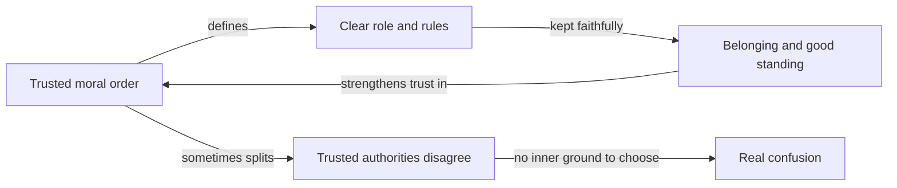

import ModuleFooter from '@site/src/components/ModuleFooter';
import RetrievalPrompt from '@site/src/components/RetrievalPrompt';

import Admonition from '@theme/Admonition';
import ModuleMeta from '@site/src/components/ModuleMeta';

<ModuleMeta />

---

## 🗺️ AQAL Mapping

| Dimension | Value |
|---|---|
| **Where** (Quadrants) | I (individual interior outlook), We (shared values and community belonging), Its (social institutions and rule-based systems) |
| **Depth** (Levels) | Amber/Mythic — conventional, role-based, order-seeking |
| **Skills** (Lines) | Cognitive (concrete-operational to early formal), Moral (conventional), Interpersonal (role-conforming) |
| **Experience** (States) | Reflective — structured self-inquiry from a stable waking baseline |
| **Style** (Types) | Structured-first; concrete before abstract; duty and belonging framed as strengths |

**Growing Up path:** This module addresses the Amber home stage on the Growing Up path. It orients learners to their current developmental location with honesty and dignity before any transition work begins.

---

## 🧭 Orient

:::info Before this module

This is the first module in the **Amber → Rational** developmental sequence. It provides the conceptual and experiential foundation for all subsequent modules in that pathway. No prerequisites are required.

:::

Understanding Amber matters right now because it is not confined to history books or to "other people's" communities — it is active in the parts of your own life organized around duty, role, and inherited moral order, whether or not your overall home stage has moved beyond it. Recognizing it accurately, in yourself, in a colleague who leans on clear rules, in a family member whose faith anchors their life, or in an institution you depend on, is the foundation for working with it skillfully rather than dismissing or pathologizing it.

:::tip Before you read
Take a minute to answer these in your own words before you read on. A wrong guess still helps you learn what follows.

1. Why might a person feel relief, rather than restriction, in having clear rules and a role they did not have to invent?
2. When two people you trust completely give you opposite instructions, what makes that so hard to resolve?
:::

---

## 🌿 Encounter

Before any framework names it, Amber has a felt shape. It is the quiet relief of knowing exactly what is expected of you — the role that doesn't have to be invented, the rule that doesn't have to be argued, the belonging that comes from being a good son, a faithful member, a reliable colleague. It is the steadiness of a story that explains where you came from, what you owe, and where it's all headed.

At this stage, the moral order is not a hypothesis to be tested — it is simply how things are. Right and wrong are given, not constructed. The authority of a scripture, a tradition, a chain of command, or a parent's word does not need to justify itself line by line; it is trusted because it has held, because it is legitimate, because departing from it would mean losing your place in something larger than yourself.

This is not an outlook held at arm's length and evaluated — it is lived from the inside, the way a role is lived rather than studied. A person moving through an Amber-organized moment does not experience "believing in duty" — they experience duty simply being the shape of a good life. Naming this only becomes possible from outside it, which is exactly what the frameworks below attempt to do with care.

---

## 🧠 Learn

## What Is the Amber/Mythic Stage?

The Amber stage — called *Blue* in Beck and Cowan's color-stage model (1996), the *Conformist* stage in Cook-Greuter's ego-development model (1999), *Stage 3* in Robert Kegan's constructive-developmental framework (1982), and *Synthetic-Conventional faith* in James Fowler's stages of faith (1981) — is one of the most significant and widely inhabited stages in adult development.

It is the stage at which human beings first internalize a comprehensive moral order, embed themselves in a community of shared belief, and organize their lives around role, duty, and divine or institutional authority. It emerged historically as the foundation of agriculture, empires, world religions, and stable civic life. Without Amber, there is no civilization.

Understanding Amber is not a prerequisite for moving *beyond* it — it is a prerequisite for doing so with wisdom and without contempt.

## The Amber Outlook

At the Amber stage, reality is understood through a mythic-literal lens:

- **A cosmic or moral order exists** — whether given by God, nature, tradition, or legitimate authority — and it is the duty of every person to conform to and uphold that order.
- **Rules are absolute.** They do not change based on context; they are given, not constructed. Moral law is discovered, not invented.
- **Authority is hierarchical and legitimate.** The king, the priest, the parent, the teacher, the scripture — these hold real authority that is not to be questioned lightly. Obedience to legitimate authority is a virtue, not a weakness.
- **Identity is role-based.** Who you are is defined primarily by your position in the social order: your family role, your religious community, your occupation, your duty. Individual preferences are secondary to communal expectation.
- **Time is linear and purposeful.** History moves toward a goal — salvation, justice, utopia, or final order. Actions in the present carry ultimate consequences.
- **In-group and out-group are sharply defined.** The community of the faithful is clearly distinguished from those outside it. Loyalty to the in-group is paramount; the out-group is often viewed with suspicion or as spiritually dangerous.

This is not pathology. This is a coherent, functional, and genuinely meaningful way of organizing human life — one that provided the stability necessary for every higher-stage development to occur.

## Four Framework Lenses

### Spiral Dynamics: Blue/Amber

Clare Graves' original research (later systematized by Beck & Cowan as *Spiral Dynamics*, 1996) identified the Blue/Amber value system as characterized by:

- **Absolutistic thinking** — one Truth, one Way, one Authority.
- **Sacrifice for deferred reward** — suffering and self-discipline now yields future salvation, security, or advancement.
- **Order and righteousness** — the universe is fundamentally just; good behavior is rewarded and transgression is punished.
- **Stability and certainty** — predictability and clear rules provide psychological safety.

Blue/Amber resolved the impulsive self-interest and power dynamics of the preceding Red stage by giving individuals a stable framework: if you follow the rules and fulfill your role, you are safe, righteous, and belong.

*In words:* a trusted moral order defines a clear role and rules. Keeping them faithfully brings belonging and good standing, which in turn strengthens trust in the order: a loop that makes life steady. When the authorities a person trusts disagree with each other, there is no inner ground from which to choose between them, and the result is real confusion rather than a simple decision.

**Evidence tier:** B — a theoretical synthesis built on Graves' research; widely used but not fully replicated in controlled studies.

### Cook-Greuter: The Conformist Stage

Susanne Cook-Greuter's ego-development research (building on Loevinger, 1976) describes the Conformist stage as the first stage in which the individual fully internalizes social norms:

- The individual *is* their role, their group membership, their reputation.
- Rules and norms are followed because they define who one is, not merely because of external enforcement.
- Deviation from group norms feels existentially threatening — like losing one's self.
- Complexity is managed by categorizing the world into clear groups: good/bad, us/them, right/wrong.
- Feedback from authority figures is taken as truth; self-assessment is calibrated by social mirroring.

The Conformist stage is stable precisely because identity is anchored in something beyond the individual — community, tradition, institution. This is its greatest strength. It is also the source of its characteristic limitation.

**Evidence tier:** B — qualitative developmental research with large samples; relies on self-report, and cross-cultural validity is still being checked.

### Kegan: Stage 3 (Interpersonal)

Robert Kegan's constructive-developmental framework (1982, 1994) describes Stage 3 — the *Interpersonal* stage — as the stage at which the individual is *embedded in* relationships and community:

- The individual's sense of self is co-constructed through important relationships. "I am what significant others see in me."
- Conflicting expectations from different authority figures or groups produce genuine confusion, because the self has no independent ground from which to adjudicate between them.
- Loyalty is experienced as an existential commitment, not a preference.
- Kegan notes that Stage 3 represents the developmental center of gravity of a very large proportion of adults in Western societies.

Kegan is careful to note that Stage 3 is not deficient; it is the culmination of a long developmental achievement. The limitation is not Stage 3 itself — it is remaining entirely at Stage 3 when the demands of adult life increasingly require the perspective-taking capacity of Stage 4.

**Evidence tier:** B — an influential theory with wide educational use; empirical testing is supportive but not exhaustive.

### Fowler: Synthetic-Conventional Faith

James Fowler's stages of faith (1981) describe *Synthetic-Conventional faith* as the stage in which faith becomes the adhesive of identity and community:

- Faith is not yet examined — it is *felt*, lived, inhabited.
- Religious or moral narratives provide a coherent and authoritative story about who one is and how to live.
- Authority is vested in persons or institutions that embody the tradition.
- Challenges to the narrative feel like challenges to the self.
- The "synthesis" in the stage name refers to the fact that diverse elements of identity, relationship, and belief are held together — not yet by critical reflection, but by a deeply felt, integrated mythos.

Fowler observed that many adults remain at this stage throughout their lives — and that for most of human history, this was the norm. Synthetic-Conventional faith built the great cathedrals, established hospitals, sustained families across generations of difficulty, and animated profound acts of sacrifice and service.

**Evidence tier:** B — interview-based research; influential but contested, and the original samples were culturally narrow.

All four frameworks are lenses for noticing patterns, not a measurement of you or a verdict on anyone's worth.

## The Gifts of Amber

A developmental framework that only names what Amber cannot do is dishonest and harmful. Amber has genuine gifts — capacities that are needed at every subsequent stage and that higher stages often fail to fully retain:

### Moral Conviction
Amber provides the capacity to hold a moral position and act on it — even at personal cost. The willingness to sacrifice comfort, security, or status for a principle is first fully embodied at Amber. Higher stages can sometimes rationalize their way out of moral commitments; Amber rarely does.

### Community Identity and Belonging
Amber offers a deep sense of belonging — the experience of being known, accepted, and held within a community of shared meaning. The loneliness that can accompany higher stages of development is, in part, the loss of this Amber capacity. The healthy expression of Amber community is not provincialism — it is genuine love and loyalty.

### Sacrifice and Service
The Amber willingness to subordinate individual desire to a larger good — a family, a nation, a faith, a duty — is one of the foundations of prosocial behavior. Every tradition of voluntary service, military honor, religious vocation, and parental sacrifice draws on Amber energy. This is not the blindness of conformity; it is the strength of commitment.

### Narrative Coherence
Amber organizes life into a meaningful story — one with a beginning, a moral arc, and an end. This narrative structure supports psychological coherence, long-term planning, and the endurance of difficulty. People who have lost the Amber capacity for narrative often experience their lives as fragmentary, purposeless, or unreal.

### Role Clarity and Reliability
Amber produces people who know what they are supposed to do, do it, and can be counted on. This reliability is a social good of the highest order. Teams, families, communities, and organizations that depend on Amber-structured roles function with a consistency that purely individualized or fluid structures rarely achieve.

## The Developmental Limitations of Amber

Naming Amber's limitations is not a judgment on individuals who are at or near this stage. It is a description of the developmental edge — the places where Amber's characteristic way of making sense of the world encounters genuine difficulties in certain adult contexts.

### Authority Dependence
Because Amber locates authority outside the self, individuals at this stage may have difficulty making decisions when authority figures conflict, are absent, or are themselves wrong. The capacity to evaluate the authority's claim — to ask *why* this is the rule, or *whether* this authority is reliable — requires a degree of self-authoring that Amber has not yet fully developed.

### In-Group/Out-Group Rigidity
The sharp distinction between in-group and out-group can limit empathy toward those outside the community, produce scapegoating when things go wrong, and impede cooperation across group boundaries. At moderate intensity, this is the experience of most cultural communities. At high intensity, it becomes a source of significant harm.

### Concrete-Literal Thinking
Amber tends to interpret metaphor literally, apply rules uniformly regardless of context, and struggle with ambiguity. Nuanced situations — where the right action is not clear, where rules conflict, or where context changes the meaning of a principle — are genuinely difficult. This is not a failure of intelligence; it is a characteristic of the cognitive structure of the stage.

### Difficulty with Ambiguity and Complexity
Amber provides certainty, order, and clarity. This is its gift. But certainty and clarity are not always available. When reality presents genuine moral complexity — competing legitimate claims, irreducible uncertainty, situations where every option involves loss — Amber's toolkit can feel insufficient. The capacity to hold ambiguity without collapsing it into certainty is a later-stage acquisition.

### Externalized Self-Evaluation
Because Amber identity is grounded in community and role, self-assessment is calibrated primarily by external feedback — "Am I fulfilling my role? What do others say about me? Am I in good standing with the community?" This leaves individuals vulnerable to manipulation by authority figures and makes it difficult to challenge external feedback even when it is inaccurate.

---

## 🧘 Practice

## Practice — Amber Strengths Inventory (15–20 minutes)

**Purpose:** Concretely identify the Amber capacities that are currently active in your life, so that the orientation in this module is not merely theoretical.

**Worked example:** for the *role reliability* prompt, someone might write: "I am the one in my family who remembers every birthday and sends the card. My sister says she never has to worry about it because I will. It feels like a small weight I carry gladly, and I would feel I had let people down if I forgot." Three to five plain sentences like these, about one real role, are all each prompt asks for.

**Instructions:**

1. Find a quiet place where you will not be interrupted. Take two or three slow breaths.
2. Read each prompt below and write your response in a journal or notebook. Aim for 3–5 sentences per prompt. Do not edit or evaluate as you write — just record what is true.
3. After writing all responses, read them back slowly.

**Prompts:**

1. **Moral conviction:** Describe a moral position you hold that you would not abandon simply because it was unpopular or inconvenient. What makes this conviction real to you?
2. **Belonging:** Identify a community, family, tradition, or group in which you feel genuinely known and accepted. What does belonging to this group give you that you could not easily find on your own?
3. **Sacrifice and service:** Describe one way in which you regularly set aside your own preferences to serve something larger — a family obligation, a professional role, a community commitment. What motivates you to do this?
4. **Role reliability:** Describe a role you occupy (parent, partner, colleague, friend, citizen) where others genuinely depend on you. How do you experience the responsibility of that role?
5. **Narrative:** Finish this sentence: "The story of my life, so far, is a story about ___________." Notice whether a story comes to you, how long it takes, and how it feels.

---

## ⚓ Stabilize

Reading this module, or even completing the practice above, gives you a *conceptual* map of the Amber stage — it does not, by itself, change your own structural relationship to authority, role, or moral certainty. Recognizing a pattern intellectually and being able to hold it with more choice in your own life are two different kinds of development, on two different timescales. Do not mistake the clarity of "I understand Amber now" for the slower, embodied work of actually metabolizing where Amber is still running unexamined in your own life — for instance, where you defer to an authority's word instead of testing it, or hold a rule as absolute where context actually matters.

This module's vocabulary — "duty," "role," "authority," "faith" — draws on frameworks developed primarily in Western institutional and religious contexts. The specific *forms* Amber-stage patterns take (which authorities, which roles, which moral codes) vary enormously across cultures and traditions; the underlying developmental logic described here (internalized moral order, role-based identity, legitimate hierarchical authority) is the generalizable claim, not the particular examples used to illustrate it. If your own cultural, religious, or family context expresses Amber differently than the examples above, trust your own lived pattern over the illustration.

**Back to your opening questions:** clear rules and a given role can bring relief because they answer, in advance, what is expected of you, and keeping them brings belonging and good standing in a community (the diagram in Learn). Nothing has to be invented or argued alone. Opposite instructions from two trusted people are hard because, when your sense of self rests on those relationships and that order, there is no separate inner ground from which to weigh them, so the conflict feels like a threat to who you are, not just a puzzle.

---

## 🔍 Reflect

Use these prompts for journaling or dialogue after the practice. These prompts are designed to support recognition without shame. There are no correct answers.

1. Where in your life do you most rely on clear rules or authoritative guidance to know what to do? Is that reliance generally useful, sometimes limiting, or both? How did you come to rely on it there?
2. Think of a community you belong to where the rules, norms, or beliefs are rarely questioned. What does that consistency give you? What does it cost you, if anything? Why do you think the rules there are so rarely questioned?
3. When you encounter someone whose moral framework differs significantly from your own, what is your first internal response? Curiosity? Unease? Judgment? Something else? Why do you think that response comes first for you?
4. Which of the Amber gifts described in this module do you most readily recognize in yourself? Which feels most important to protect or honor as you grow, and why?
5. Is there a situation in your life right now where you wish you had clearer guidance or authority to turn to? What would it give you if that clarity were available?

<Admonition type="tip" title="Facilitator Note">

**Presenting this content in group settings:**

The Amber stage is inhabited, at least in part, by a large proportion of adults across cultures. When introducing this material to a group, assume that several participants are speaking from within Amber — not merely describing it as outsiders.

**Framing recommendations:**

- Open with the gifts of Amber before naming limitations. Participants whose home stage is Amber will be more able to hear honest developmental analysis if they first feel seen and respected.
- Use concrete language. Avoid theoretical abstraction in the opening. Anchor every concept in a real-life example before naming its framework.
- Do not frame Amber as a problem to be solved, a stage to escape, or a deficiency to overcome. Frame developmental growth as *expanding* what one already has — adding new tools, not discarding good ones.
- Be alert to participants who respond to the Amber description with strong self-criticism ("I'm so stuck here"), contempt toward others they perceive as Amber ("I know people exactly like that — they're the problem"), or defensiveness ("That doesn't describe me at all"). All three responses may signal the content has landed in an unintegrated way.
- If the group includes participants from faith traditions, honor the tradition explicitly. Synthetic-Conventional faith built some of the most durable and generative institutions in human history. That is not nothing.

**Group facilitation structure:**

1. Present the four-framework overview (Beck and Cowan, Cook-Greuter, Kegan, Fowler) without ranking. Spend equal time on each.
2. Invite participants to share an example of an Amber gift from their own experience before any discussion of limitations.
3. Only after gifts are named in the group should you introduce limitations — and invite participants to name limitations they *themselves* notice in their own Amber patterns, rather than describing limitations in others.
4. Close with the Amber Strengths Inventory as a homework practice. This ensures the session ends with affirmation rather than deficit framing.

</Admonition>

---

## 📊 Assess

Use this rubric after completing the practice and reflection. It is intended for honest self-assessment, not comparison with others.

| Criterion | Not yet | Developing | Stable |
|---|---|---|---|
| **Framework familiarity** — You can describe the Amber/Mythic stage using at least two of the four frameworks presented | Cannot describe more than one | Can describe two or three with prompting | Can describe all four in your own words without notes, naming at least one feature of each |
| **Gifts recognition** — You can name at least three Amber gifts that are genuinely active in your own life | Cannot name any that feel personally true | Can name one or two with effort | Can name three or more, each with a specific example from your own life you can point to |
| **Limitations recognition** — You can name at least two Amber limitations you have personally experienced, without shame | Cannot identify any or feels only shame | Can name one with significant discomfort | Can name two or more with equanimity and curiosity, each tied to a specific situation you can describe |
| **Non-judgmental stance** — You can think about others who are at an Amber center of gravity without contempt or superiority | Find it difficult not to judge | Mostly non-judgmental but slipping occurs | Consistently curious and respectful toward Amber expression in others: you can name one recent moment you noticed a judgment and chose curiosity instead |
| **Readiness** — You can articulate one specific area of your life where expanding beyond Amber patterns would serve you | Cannot articulate this yet | Can articulate with prompting | Can articulate clearly and without shame, in one written sentence naming the area and a first step |

**Passing threshold:** Three or more criteria at *Developing* or *Stable*.

---

**Worked examples:**
- **Level 3:** "I can explain both the strengths and limitations of Amber-stage thinking using examples from my own life — not just abstract theory."
- **Level 4:** "When I feel the pull of conventional belonging, I don't reject it or surrender to it. I notice it as information about what I value, then make a conscious choice."

## 🔄 Integrate

Carry the orientation from this module into your daily context:

- **Gratitude practice:** Each day this week, identify one instance where an Amber capacity — duty, reliability, moral conviction, belonging — served you or someone around you well. Note it without qualification.
- **Observation without judgment:** When you notice Amber expression in others (rule-following, deference to authority, in-group loyalty), practice observing it without evaluation — as a developmental phenomenon, not a personal failing.
- **Honest inventory:** In one domain of your life (work, family, community, faith), identify whether authority-dependence is currently helping you or creating difficulty. Write a single honest sentence about it.
- **Conversation starter:** With someone you trust, share one insight from this module. Notice their response. Notice yours.

---

<RetrievalPrompt moduleName="Amber/Mythic Orientation" cards={[
  {q: "What is the Amber/Mythic stage called in Beck and Cowan's color-stage model?", a: "Blue/Amber — characterized by absolutistic thinking, sacrifice for deferred reward, order and righteousness, and stability through clear rules."},
  {q: "What does Cook-Greuter call the Amber stage?", a: "The Conformist stage — where identity is fully fused with role, group, and social norms; deviation from group expectations feels existentially threatening."},
  {q: "What is Kegan's Stage 3 and what is its key limitation for adult development?", a: "The Interpersonal stage — the self is co-constructed through relationships and authority. The limitation is the absence of an independent self-authored standpoint from which to adjudicate conflicting expectations."},
  {q: "What is Fowler's Synthetic-Conventional faith?", a: "A stage in which faith provides an authoritative and coherent narrative identity — felt and lived, not yet critically examined. Authority is vested in persons and institutions embodying the tradition."},
  {q: "Name four gifts of the Amber/Mythic stage.", a: "Moral conviction, community identity and belonging, willingness to sacrifice and serve, narrative coherence (and role clarity and reliability)."},
  {q: "Name four developmental limitations associated with the Amber/Mythic stage in adult development.", a: "Authority dependence, in-group/out-group rigidity, concrete-literal thinking (difficulty with ambiguity), and externalized self-evaluation."},
  {q: "Why is understanding the gifts of Amber necessary before introducing its limitations?", a: "Because learners at or near Amber will disengage or feel pathologized if limitations are named first. Strengths-first framing is both respectful and more effective for supporting developmental growth."},
]} />

---

## ⏱️ Retrieval Schedule

| Interval | Activity |
|---|---|
| 24 hours | Without looking, name as many of this stage's gifts as you can and say in a sentence what each gives a community. Add one specific example from your own life to any gift you did not have an example for. Then check your answer against the Gifts section and note what you missed |
| 72 hours | Complete the Assess rubric for the first time. Identify which criterion feels most alive and which feels most challenging |
| 7 days | Revisit the Reflect prompts. Choose one prompt you answered briefly and write a fuller response. Notice whether anything has shifted |
| 14 days | Complete the Assess rubric again. Note movement from *Not yet* to *Developing* or from *Developing* to *Stable*. Confirm readiness for the next module in the Amber → Rational sequence |

---

## 📚 Evidence and Citations

Evidence quality uses tiers Tier A, Tier B, and Tier C. Sources in this module are rated Tier A (primary research or strong empirical base) or Tier B (theoretical synthesis or clinical-practitioner evidence); no Tier C sources are cited. See the [Evidence Vetting Checklist](/internal/quality/evidence-vetting-checklist) for the full tier definitions.

| Claim | Source | Quality | Caveat |
|---|---|---|---|
| Spiral Dynamics Blue/Amber value system: absolutism, sacrifice, order, authority | Beck, D. E., & Cowan, C. C. *Spiral Dynamics: Mastering Values, Leadership, and Change* (1996), Blackwell | Tier B — theoretical synthesis built on Graves' original research | Graves' original data were limited in sample diversity; Spiral Dynamics extrapolations are widely used but not fully replicated in controlled empirical studies |
| Conformist ego stage: identity fused with role and social norms | Cook-Greuter, S. R. *Postautonomous Ego Development* (1999), doctoral dissertation, Harvard University | Tier B — qualitative developmental research; large sample across instruments | Self-report limitations; cross-cultural validity requires ongoing verification |
| Stage 3 Interpersonal: self co-constructed through relationships | Kegan, R. *The Evolving Self* (1982), Harvard University Press | Tier B — constructive-developmental theory; extensive clinical and educational application | Theoretical model; empirical testing is ongoing and supportive but not exhaustive |
| Synthetic-Conventional faith: identity through lived mythic narrative | Fowler, J. W. *Stages of Faith: The Psychology of Human Development and the Quest for Meaning* (1981), Harper & Row | Tier B — interview-based qualitative research; influential but contested in scope | Stage sequence is not universally accepted; culturally specific samples in original research |
| Strengths of Amber (moral conviction, belonging, sacrifice, narrative) | Wilber, K. *A Theory of Everything* (2000), Shambhala | Tier B — theoretical synthesis integrating multiple developmental frameworks | Not primary empirical research; synthesizes Graves, Kegan, Kohlberg, and others |
| Conventional morality as stage of moral development | Kohlberg, L. *The Philosophy of Moral Development* (1981), Harper & Row | Tier A — longitudinal cross-cultural moral development research | Criticisms include gender bias (Gilligan) and cultural specificity; Conventional stage nevertheless replicates robustly |

---

:::note Safety Note

This module is rated **Tier 1 (self-guided, low intensity)**. The content involves reflective self-inquiry about developmental patterns and does not intentionally access traumatic or highly emotionally charged material.

**Consent:** Proceed when you are willing to look honestly at patterns in your own thinking and values. You may pause or stop at any time. No response to any prompt is required or evaluated externally.

**Contraindications:** If you are currently in a crisis of meaning, a significant identity disruption, or an acute episode of psychological distress, postpone this module and engage support from a trusted person or qualified practitioner first. This platform does not provide therapy or clinical care.

**Stop rules:** If reflection on your developmental patterns produces significant shame, grief, or destabilization, stop immediately. Step away from the exercise. Take three slow breaths, place your feet firmly on the floor, and name three things you can see in the room around you. Return only when you are settled.

**Grounding alternative:** If self-inquiry feels too intense, shift to the Amber Strengths Inventory practice only — focusing on what is working and what you value — and postpone the Limitations section for another session.

**Escalation:** If distress persists, contact a trusted support person or qualified practitioner. Do not continue the module alone if you are significantly dysregulated.

For the full safety framework, see the [Shadowwork Safety Standard](/internal/safety/shadowwork-safety-standard). Review [Contraindications by Technique](/internal/safety/shadowwork-safety-standard#contraindications-by-technique) before beginning shadow practices, and watch for [Spiritual Bypassing Red Flags](/internal/safety/shadowwork-safety-standard#spiritual-bypassing-red-flags) as inquiry deepens.

:::

<ModuleFooter />
