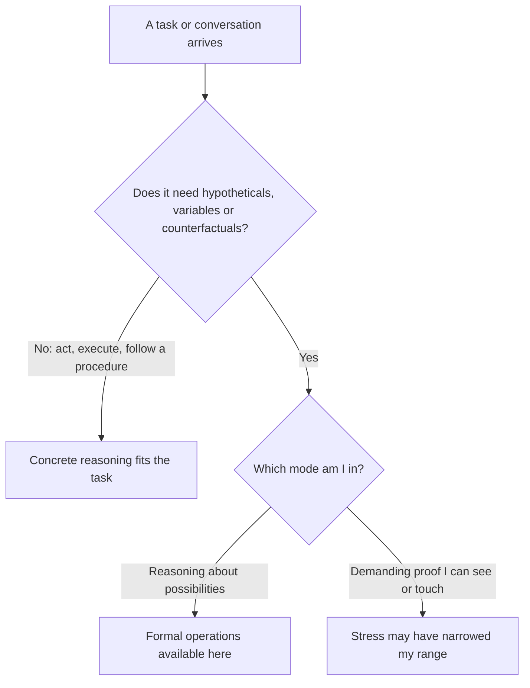

import ModuleFooter from '@site/src/components/ModuleFooter';
import RetrievalPrompt from '@site/src/components/RetrievalPrompt';

import Admonition from '@theme/Admonition';
import ModuleMeta from '@site/src/components/ModuleMeta';

<ModuleMeta />

## 🗺️ AQAL Mapping

| Dimension | This module's focus |
|---|---|
| **Quadrants** (Where) | I — what it is like, from the inside, to think concretely or formally; We — the families, teams and cultures that expect one kind of reasoning or the other; It — reasoning you can observe in written tasks on ratios, combinations and hypotheticals; Its — schools and workplaces that demand and reward different kinds of reasoning |
| **Levels** (Depth) | Concrete operational through formal operational thinking, with attention to what makes formal reasoning available or unavailable in a given moment |
| **Lines** (Skills) | Cognitive (primary); self, emotional and interpersonal (supporting): feeling threatened, emotional load and social pressure all affect which kind of reasoning is available |
| **States** (Experience) | Ordinary reflective waking attention, with structured self-observation during reasoning tasks |
| **Types** (Style) | Educational and professional background shape where formal reasoning has been practised; cultural background shapes which kind of reasoning a setting expects (see Stabilize) |

## 🧭 Orient

This is the second module in the Cognitive Line suite. It follows the overview and turns one distinction from it, concrete versus formal reasoning, into something you can observe in your own thinking.

:::info Before this module
This module assumes the shared vocabulary from [Cognitive Line Overview & Orientation](./cognitive-line-overview-orientation). Complete that first.
:::

Why this matters now: most adults can reason abstractly somewhere, and almost nobody does it everywhere. The useful question is where your formal reasoning is available, and what takes it away. The goal is not to rank yourself. It is a better fit between the task and the kind of thinking you bring to it.

:::tip Before you read
Take a minute to answer these in your own words before you read on. A wrong guess still helps you learn what follows.

1. Think of a topic where you reason easily about "what if" and one where you only trust what you can see. Why might the same person think so differently in the two?
2. Is thinking concretely always a weaker way to think? When might it be the better choice?
:::

## 🌿 Encounter

There is a kind of thinking that stays close to what is in front of you. You sort, compare, count and check. You trust what you have seen work. When someone says "but suppose it were otherwise", the question feels thin, a little pointless. *If I can't see it or touch it, it's not real yet.* This thinking is quick and sure-footed, and it gets things done.

There is another kind that moves among possibilities. You hold something that has not happened and ask what would follow. You change one thing in your head and leave the rest fixed. You can state what would prove you wrong. *I can reason about things that don't exist yet.* This thinking is slower, and it can reach places that experience has not yet been.

You probably know both from the inside, in different rooms of your life:

- At work you model next year's market under three sets of assumptions. That evening, in a difficult conversation at home, you hear yourself say "show me exactly when I did that."
- You reason fluently about the design of a software system. Looking at your own bank balance in a bad month, your thinking shrinks to one number and one week.
- You compare policy options calmly in a committee. On a subject that touches who you are, every "what if" sounds like an attack, and you want proof before you will discuss it.

Nothing is wrong in any of these scenes. Each shows a mind using the kind of reasoning that is available in that moment. This module is about noticing which one that is.

## 🧠 Learn

**Concrete operational thinking** is reasoning from tangible, observable instances. Sorting, comparing and drawing conclusions work well when the examples are visible and grounded in experience. Reasoning stays tied to categories and particular cases.

**Formal operational thinking** is *hypothetico-deductive* reasoning: starting from a possibility, working out what would follow, and checking that against evidence. It includes varying one factor at a time, listing every combination, and handling abstract ideas as objects of thought.

By the end of this module you should be able to tell the two apart from the inside, say in which areas of your life each one is available to you, name what narrows your reasoning under pressure, and use two prompts to widen it again.

*In words:* first ask what the task requires. If it only needs action or a known procedure, concrete reasoning is the right tool. If it needs possibilities, variables or counterfactuals, notice which mode you are in: reasoning about possibilities means formal operations are available in that domain, and insisting on visible proof suggests stress has narrowed your range.

### Formal reasoning depends on the domain

Adults do not have formal reasoning as a single, general possession. In a well-known logic puzzle, a small minority of adults choose correctly when the rule is about letters and numbers (Wason, 1968). When a rule with the same logical form is about something familiar, such as who is allowed to drink alcohol, most people solve it (Griggs & Cox, 1982). The logic is unchanged. The content makes the difference. Piaget himself later wrote that adults may reach formal operations in the areas where they have aptitude and professional training, and not necessarily elsewhere (Piaget, 1972).

<Admonition type="info" title="Why this matters">

Ask *where* formal reasoning is available to you, not whether you "have" it. The practical aim is to make it reliable in more areas of your life and under more conditions.

</Admonition>

## Four Framework Lenses on Concrete-to-Formal Reasoning

Each lens is one way of looking at the same shift. These are stage-style models, and a stage model is a lens for noticing patterns in your own reasoning. It is not a measurement of you and it says nothing about anyone's worth.

### Piaget and Inhelder: Two Kinds of Operation

Jean Piaget and Bärbel Inhelder described formal operations as a different kind of reasoning from concrete operations, and not as more of the same. In their tasks, such as working out what determines the swing of a pendulum, younger children tested factors haphazardly. Adolescents began to hold all factors but one constant and to reason from hypotheses.

**How it applies here:** the four tasks in Practice are adult versions of the things Piaget and Inhelder looked for: conservation, proportion, combinations and reasoning from a hypothesis.

**Evidence tier:** B — foundational observational research with many later replications of the basic sequence; the original participants were children and adolescents, and later work found that performance depends heavily on task content.

### Fischer: Skills Depend on Context and Support

Kurt Fischer's dynamic skill theory treats a cognitive ability as a skill built in a particular context, and not as a general trait. The same person shows a higher level of reasoning with support, such as a worked model or a prompt, than they show alone, and a higher level in familiar areas than in unfamiliar ones. Fischer called the gap between the two a person's *developmental range*.

**How it applies here:** this is why Practice asks you to note, task by task, which area of life each one felt easy or hard in, and why Integrate gives you prompts to carry with you.

**Evidence tier:** B — a well-supported developmental theory with a substantial research base; most studies concern children and students, and less is known about emotionally loaded adult situations.

### Labouvie-Vief: Emotion and the Complexity of Thought

Gisela Labouvie-Vief's work on adult thinking describes a trade-off. When a person is calm and has resources to spare, they can hold complex, many-sided pictures of a situation. Under strong emotion or strain, thinking tends to simplify toward clearer, more one-sided pictures that protect a sense of safety. Research on the brain under stress points the same way: a review of laboratory studies concluded that even fairly mild, uncontrollable stress can quickly impair the functions of the prefrontal cortex that support flexible reasoning (Arnsten, 2009).

**How it applies here:** this is the basis for the stress map in Part B of the practice. Narrowing under pressure is an expected feature of how minds work.

**Evidence tier:** B — a theoretical and empirical synthesis; effects vary between people and situations, and much of the stress research was done with animals.

### Kegan: Having a Conclusion Versus Being It

Robert Kegan's subject-object theory builds on Piaget. It describes development as a series of shifts in which something a person was embedded in ("subject") becomes something they can step back from and examine ("object").

**How it applies here:** when you ask "what evidence would count against my view?", you are treating your own conclusion as an object you can examine. When that question feels like a threat, you are, for the moment, inside the conclusion. This is the module's own application of Kegan's theory to a single act of reasoning.

**Evidence tier:** B — a constructive-developmental theory supported by interview-based research; samples have been limited in cultural range.

## The Gifts of Concrete and Formal Reasoning

### Reliable Execution

Concrete reasoning gets things done correctly. Following a tested procedure step by step, checking each result against what you can observe, is how aircraft are flown, wounds are dressed and meals reach the table. It is the right tool whenever a known method fits the task.

### Evidence You Can Point To

Concrete reasoning keeps thought anchored to what has been seen to happen. "Show me" is a sound demand. It protects against plausible ideas that have never been checked against the world.

### Reasoning About What Does Not Exist Yet

Formal reasoning lets you work on a situation before it arrives. You can compare three futures, design something that has never been built, and see a problem in a plan before anyone has acted on it.

### Testing One Thing at a Time

Formal reasoning brings method to uncertainty. Holding everything constant except one factor, and listing every combination so that none is missed, is the difference between finding out and guessing.

### Holding a Belief as a Hypothesis

Formal reasoning lets you say in advance what would change your mind. A belief held this way can be tested and improved, and a disagreement with someone becomes a shared question about evidence.

## The Limitations of Formal Reasoning and of This Self-Check

### Abstraction Can Lose Contact with the Ground

The very power to reason about what does not exist can, at the boundary, become a way of losing touch with what does. A plan can be coherent on paper and unworkable in the room. Formal reasoning needs concrete checking to stay honest.

### Analysis Can Postpone Action

The same thoroughness that examines every alternative can, at the boundary, delay a decision past the point where it was useful. Some situations need a tested procedure carried out now.

### You Are Judging Your Own Reasoning

The self-check in this module is a set of self-scored exercises. It is not a validated test. Judging your own reasoning is subject to the same blind spots the module is trying to show you: a person reasoning concretely about a subject may not see it while they are doing it.

### Most Real Thinking Is a Mixture

The two kinds of reasoning separate cleanly in a definition. In practice, most adult thinking blends them, and sorting a response into one box can hide more than it shows.

### What Is a Misreading

Concrete reasoning is sometimes taken, by people who prize abstraction, as a sign of lower intelligence. Piaget's framework does not say that, and neither does this module. Choosing concrete reasoning because the task calls for it is a strength.

---

## 🧘 Practice

### Reasoning Range Check (30–35 minutes)

**Duration:** 30–35 minutes, in one sitting. Part A takes about 20 minutes and Part B about 10 to 15.

**Setup:** a quiet table, a notebook and a pen. Sit comfortably. Write your answers out in full sentences: the writing is the evidence you will look back on.

**Worked example (Task 4):** someone who believes strongly that "our customers choose us on price" writes:

- *If this were false, what else would change?* "We would expect customers to stay when we raise prices a little, and to leave when service gets slow."
- *What evidence would count against my view?* "Last year's price rise, if few customers left afterwards."
- *What rival explanation fits the same facts?* "They may choose us because we deliver fastest, and our prices happen to be low as well."

That is the whole move: a consequence, a possible disproof, and a rival account. The belief has not been abandoned. It has been made testable.

Now work through the two parts. Take your time. If you need to stop at any point, that is fine.

**Part A — Four tasks**

1. **Conservation.** Read this claim: "If the same total project budget is redistributed across categories, the overall budget has changed." Write whether it is true or false, and explain why in a few sentences. Then restate your answer using something other than money: time, attention or materials. Take a moment before moving on.
2. **Proportion.** A team grows from 4 to 8 members and its total output grows from 120 to 180 units a week. Work out the output per person before and after. Write whether the growth is proportional, and name one further factor that might explain the change.
3. **Combinations.** You are testing three changes, A, B and C, which may interact. List every combination you would need to test, leaving out "none". Write one line on how you made sure you had them all. No rush.
4. **Reasoning from a hypothesis.** Choose one thing you believe firmly about your work. Answer the three questions from the worked example: what else would change if it were false, what evidence would count against it, and what rival explanation fits the same facts. Pause here before continuing.
5. **Mark each task.** Beside each of the four, write "easy" or "effortful", and the area of your life it most resembled.

Check your answers to tasks 1 to 3 (open after you have written yours)

- **Task 1:** false. Moving money between categories leaves the total unchanged, in the same way that rearranging the hours of a day leaves 24 of them.
- **Task 2:** 30 units per person before and 22.5 after. Total output rose and output per person fell, so the growth is not proportional. Possible factors include time spent training new members and more time spent coordinating.
- **Task 3:** seven combinations: A, B, C, AB, AC, BC and ABC. A systematic method is to list the singles, then the pairs, then all three.

Task 4 has no single correct answer. Check that you wrote something for each of the three questions that could, in principle, be observed.

**Part B — Where pressure narrows your thinking**

6. **Name one situation.** Think of a recurring, everyday situation in which your thinking becomes more concrete under pressure: you want proof you can see, you fix on one factor, or "what if" questions feel like attacks. Choose something ordinary, and not the hardest thing in your life at present.
7. **Fill in one row.** Copy the table below and complete a row for that situation. Take a moment over the last column: choose something small and specific you could do in the moment, such as writing the question down and answering it tomorrow.
8. **Add up to two more rows** if you have time and energy. One complete row is enough for today.
9. **Look for a shared trigger.** If you have more than one row, write two or three sentences on what the triggers have in common.

| Situation | What sets it off | How I know my thinking has narrowed | What it usually costs | First thing I will do when I notice it |
|---|---|---|---|---|
| 1 |  |  |  |  |
| 2 |  |  |  |  |
| 3 |  |  |  |  |

---

## ⚓ Stabilize

**Doing the tasks is not the same as having the capacity.** Completing four written tasks at a quiet table shows what your reasoning can do with time and no pressure. It does not show what is available to you in a tense meeting or a hard conversation. That gap is the subject of Part B, and it closes slowly, through practice in live situations.

**Schooling and culture shape these tasks.** The tasks in Part A resemble school and office problems, and formal schooling trains exactly this kind of reasoning. In field interviews in Central Asia in the 1930s, adults without schooling tended to answer logic problems from their own direct experience and declined to reason from premises they could not vouch for (Luria, 1976). That is a reasoned position about what counts as knowledge. If the tasks here feel artificial, that tells you about the tasks and the setting they come from as much as about you.

### Pre/Trans Checkpoint: Two Look-Alikes

**Fitting concreteness versus narrowing under stress.** Not all thinking needs to be abstract. Concrete reasoning fits when immediate action, a reliable procedure or hands-on execution is required. Narrowing has happened when stress reduces your reasoning in a situation that does need hypotheticals, several factors or a counterfactual.

*Ask:* am I choosing concrete thinking because the task requires it, or because pressure has reduced my range?

**Formal reasoning versus abstract-sounding language.** Sophisticated vocabulary is not formal reasoning. Formal reasoning shows in stated hypotheses, factors varied one at a time, and a willingness to say what would count against your view.

*Ask:* can I produce and test alternatives that might show my preferred view is wrong, or am I using abstract language to protect a conclusion I already hold?

<Admonition type="warning" title="A practical rule against fooling yourself">

When in doubt, write down the factors you think are involved and what would count against your view. If you cannot, assume you are still reasoning concretely in this area.

</Admonition>

**Back to your opening questions:** the same person can reason formally where they have practice and support and concretely where emotional load is high, so the useful question is where formal reasoning is available (the section on domains in Learn). Concrete thinking is not weaker in itself: it is the better choice when the task calls for immediate action, a reliable procedure or hands-on execution. It becomes a problem when stress narrows your range in a situation that needs hypotheticals.

## 🔄 Integrate

Anchors for the next week. Each one attaches to something you already do.

- **Before you decide (2 minutes):** once a day, before any decision that matters a little, write one counterfactual ("if I do this, what else changes?") and one rival explanation ("what else could explain what I'm seeing?"). Then decide.
- **When you hear yourself ask for proof (30 seconds):** when "show me exactly" comes out of your mouth, ask silently whether the task needs proof or whether you are under pressure. Use the first action from your stress map.
- **After a meeting or a hard conversation (2 minutes):** as you leave the room or close the call, note which kind of reasoning you were mostly using and whether it fitted the task.
- **At the end of the week (15 minutes):** take one idea from your work that you usually handle through examples, such as trust, quality or risk. Define it without an example, name the factors that affect it, and write one prediction your definition makes that could turn out wrong.

**Related modules:** [Cognitive Line Overview & Orientation](./cognitive-line-overview-orientation) for the full arc; [Critical Thinking Foundations](./critical-thinking-foundations) for judging arguments and evidence; [Systems Thinking 101](./systems-thinking-101) for reasoning about many interacting factors.

---

## 🔍 Reflect

Use these after the practice. There are no correct answers.

1. *Journaling:* In which area of your life might you overestimate your formal reasoning? Why might that area be easy to misjudge?
2. *Journaling:* Where in your life is concrete reasoning wise and sufficient at present? Why is it enough there?
3. *Journaling:* Think of a specific recent decision where a counterfactual or a rival explanation would have changed the outcome. How would you explain, in your own words, why you did not reach for one at the time?
4. *With a partner:* Each share one row of your stress map. Your partner asks one question only: "How do you know, in the moment, that your thinking has narrowed?"
5. *In a group of three or four:* Each name one setting that expects concrete reasoning from you and one that expects formal reasoning. What happens when you bring the wrong one?
6. *Body check-in:* Recall the moment in Task 4 when you wrote what would count against your belief. What did you notice in your body as you wrote it?

<Admonition type="tip" title="Facilitator Note">

**Presenting this content in group settings:** confirm that participants have completed [Cognitive Line Overview & Orientation](./cognitive-line-overview-orientation), so the group shares a vocabulary. Say at the start that the tasks are not an intelligence test and that nobody will be asked to share their answers to Part A.

**Group facilitation structure (90 minutes):** 10 min introduction and the two opening questions / 10 min walk through the diagram and the worked example / 20 min Part A individually, in silence / 5 min checking answers privately / 15 min Part B individually / 15 min paired exchange using Reflect prompt 4 / 15 min whole-group debrief using Reflect prompt 5.

**Watch-fors:**

- *Comparing scores.* If participants begin comparing how many tasks they found easy, restate that the question is where, not how much.
- *Abstract vocabulary without a test.* A participant who speaks fluently in abstractions and cannot write down what would count against their view is probably reasoning concretely in that area. Ask for the written version, kindly.
- *A stress map that opens something large.* Let each person complete their row privately before any discussion. If the exercise surfaces distress, follow the Safety Note.

**Adapting for mixed groups:** participants with little formal schooling, or schooling in a different tradition, may find Part A artificial. Offer everyday versions of the same tasks, such as sharing food fairly for proportion or planning a route with three possible stops for combinations. Participants who reason abstractly for a living can be asked to do Task 4 on a belief from their home life, where the same skill is often less available.

</Admonition>

## 📊 Assess

Use this rubric for honest self-assessment after the practice and at the 14-day interval. Rate what you can show, not what you feel.

| Criterion | Not yet | Developing | Stable |
|---|---|---|---|
| **Telling the two apart** | I can define the two kinds of reasoning and cannot yet spot them in myself | I can point to one concrete and one formal moment in my own thinking | I can quote one concrete and one formal example of my own, in writing, from each of two areas of my life |
| **Mapping by area** | I think of my reasoning as the same everywhere | I can name two areas where my reasoning differs | My notes name at least three areas of my life, each with a task or situation that was easy or effortful there |
| **Seeing the narrowing** | I notice afterwards that I "wasn't thinking clearly" and cannot say more | I can name what sets it off, and the signs are still vague | My stress map has at least two completed rows, each with a specific sign and a real example from the past month |
| **Reasoning formally on demand** | I cannot produce an alternative to my own view | I can produce alternatives when someone prompts me | I have at least three written decisions from the past two weeks, each with one counterfactual, one rival explanation and one thing that would count against my view |

**Passing threshold:** Stable in at least 3 of 4 criteria.

## ⏱️ Retrieval Schedule

| Interval | When | Activity |
|---|---|---|
| 1 | 24 hours after completing the module | Without looking, write a definition of concrete and of formal reasoning and the two questions from the checkpoint in Stabilize. Then check them against the module and review the cards below |
| 2 | 3 days | Without looking at your first attempt, redo Task 4 with a different belief from the same area of work. Compare the two attempts |
| 3 | 7 days | Explain to someone else, in your own words, why the same person can reason formally at work and concretely at home. Ask them where it happens to them |
| 4 | 14 days | Apply the "before you decide" anchor to one real decision, add one new real example to your stress map, and complete the Assess rubric |

<RetrievalPrompt moduleName="Cognitive Line — Concrete to Formal Operations" cards={[
  {q: "What is concrete operational thinking?", a: "Reasoning from tangible, observable instances. Sorting, comparing and inferring work well when examples are visible and grounded in direct experience, and purely hypothetical scenarios feel vague or 'not real yet'."},
  {q: "What is formal operational thinking?", a: "**Hypothetico-deductive reasoning**: starting from a possibility, working out what would follow and checking it against evidence. It includes varying one factor at a time, listing every combination, and handling abstract ideas as objects of thought."},
  {q: "What does domain-specificity mean for concrete and formal reasoning in adults?", a: "A person may reason formally in one area (for example modelling market scenarios at work) and default to concrete reasoning in another, especially under emotional load. The useful question is where formal reasoning is available, not whether you 'have' it."},
  {q: "What did the logic-puzzle studies show about content and reasoning?", a: "Few adults solve the puzzle when the rule is about letters and numbers, and most solve a rule with the same logical form when it is about something familiar. The logic is the same; the content changes performance."},
  {q: "How does fitting concreteness differ from narrowing under stress?", a: "Concrete reasoning fits when immediate action, a reliable procedure or hands-on execution is required. **Narrowing** is when stress reduces your reasoning in a situation that needs hypotheticals, several factors or a counterfactual. Ask: does the task require this, or has pressure reduced my range?"},
  {q: "How does formal reasoning differ from abstract-sounding language?", a: "Sophisticated vocabulary is not formal reasoning. Formal reasoning shows in stated hypotheses, factors varied one at a time, and a willingness to say what evidence would count against your view."},
  {q: "In a tense conversation at home you catch yourself demanding 'show me exactly when I did that.' Which idea applies and what would you do?", a: "Probably narrowing under stress in a situation that needs formal reasoning. Note the trigger and the sign, do the first action from your stress map, then produce one counterfactual and one rival explanation before deciding how to respond."},
  {q: "What is the module's practical rule against fooling yourself?", a: "When in doubt, write down the factors you think are involved and what would count against your view. If you cannot, assume you are still reasoning concretely in this area."},
  {q: "Name two gifts of concrete reasoning and two of formal reasoning.", a: "Concrete: reliable execution of tested procedures; evidence you can point to. Formal: reasoning about what does not exist yet; testing one thing at a time; holding a belief as a hypothesis (any two)."},
  {q: "Self-check: name one area where your thinking narrows under pressure, what sets it off, and one habit to widen it again.", a: "A strong answer names a specific situation and trigger, an early sign of the shift, and a small habit such as writing one counterfactual and one rival explanation before a decision. It also names where concrete reasoning is wise and sufficient."}
]} />

## 📚 Evidence and Citations

Tiers follow the [Evidence Vetting Checklist](/internal/quality/evidence-vetting-checklist): **A** = randomized trial, systematic review or meta-analysis; **B** = peer-reviewed observational or experimental study, or a well-validated framework; **C** = expert opinion or a theoretical or practitioner framework with limited empirical testing. No Tier A source is cited here.

| Claim | Source | Tier | Caveat |
|---|---|---|---|
| Concrete and formal operations are distinct kinds of reasoning; formal operations involve reasoning from hypotheses and controlling variables | Inhelder, B., & Piaget, J. (1958). *The Growth of Logical Thinking from Childhood to Adolescence*. Basic Books. | B | Original participants were children and adolescents; applying the distinction to adults requires attention to task content |
| Adults may reach formal operations in the areas of their aptitude and professional training, and not necessarily in others | Piaget, J. (1972). Intellectual evolution from adolescence to adulthood. *Human Development*, *15*(1), 1–12. | B | A theoretical paper revising his earlier position, not a new study |
| Few adults solve an abstract version of a conditional-rule puzzle | Wason, P. C. (1968). Reasoning about a rule. *Quarterly Journal of Experimental Psychology*, *20*(3), 273–281. | B | A laboratory task with students; what the task measures is still debated |
| Most people solve a rule with the same logical form when its content is familiar | Griggs, R. A., & Cox, J. R. (1982). The elusive thematic-materials effect in Wason's selection task. *British Journal of Psychology*, *73*(3), 407–420. | B | Students in one country; the reasons for the content effect are disputed |
| Cognitive performance varies with context and support; people show a higher level with support than alone | Fischer, K. W., & Bidell, T. R. (1998). Dynamic development of psychological structures in action and thought. In W. Damon & R. M. Lerner (Eds.), *Handbook of Child Psychology: Vol. 1* (5th ed.). Wiley. | B | A theoretical synthesis; most supporting studies concern children and students |
| Under emotional strain, adult thinking tends to become less complex and more one-sided | Labouvie-Vief, G. (2003). Dynamic integration: Affect, cognition, and the self in adulthood. *Current Directions in Psychological Science*, *12*(6), 201–206. | B | A theoretical and empirical synthesis; effects vary by person and situation |
| Even mild uncontrollable stress can rapidly impair prefrontal functions that support flexible reasoning | Arnsten, A. F. T. (2009). Stress signalling pathways that impair prefrontal cortex structure and function. *Nature Reviews Neuroscience*, *10*(6), 410–422. | B | A review drawing heavily on animal studies; does not test the reasoning tasks used here |
| Development as a shift from being embedded in something to being able to examine it | Kegan, R. (1982). *The Evolving Self: Problem and Process in Human Development*. Harvard University Press. | B | A theoretical model supported by interview research; its application to a single act of reasoning is this module's own |
| Adults without formal schooling tended to answer logic problems from direct experience | Luria, A. R. (1976). *Cognitive Development: Its Cultural and Social Foundations*. Harvard University Press. | B | Field interviews from the 1930s in one region; methods and interpretation have been questioned |
| Structured critical reflection can strengthen adults' capacity to examine their own assumptions | Mezirow, J. (1991). *Transformative Dimensions of Adult Learning*. Jossey-Bass. | C | A theoretical framework for adult education; outcomes depend on how the learning is designed |

:::note Safety Note

**Tier:** 1 — Standard reflective content

This module involves written reasoning tasks and reflection on everyday situations in which pressure narrows your thinking.

**Consent:** continue only if you are willing to look at your reasoning without judging yourself for it. You may pause or stop any exercise at any time.

**Contraindications:** if you are in acute distress or a major crisis, leave out Part B and complete Part A alone. This platform does not provide therapy or clinical care.

**Stop rules and grounding:** if Part B surfaces significant distress, stop. Put the notebook down, look around the room and name five things you can see. Return when you feel settled, or on another day.

**Escalation:** if distress persists, speak with a trusted person or a qualified professional. This content is educational, not therapeutic.

:::

<ModuleFooter />
