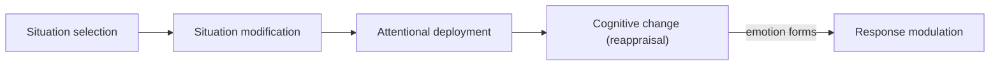

import ModuleFooter from '@site/src/components/ModuleFooter';
import RetrievalPrompt from '@site/src/components/RetrievalPrompt';
import ModuleMeta from '@site/src/components/ModuleMeta';
import Admonition from '@theme/Admonition';

<ModuleMeta />

**Position in sequence:** This is the second module in the **Emotional Line** suite. It builds directly on [Emotional Line Overview & Orientation](./emotional-line-overview-orientation) and focuses on the foundational architecture of regulation capacity across L2-L3. For more precise emotion naming practice, pair this module with [Emotional Granularity](./emotional-granularity).

---

## 🌿 Encounter

Bring to mind a recent moment of moderate emotional intensity — not overwhelming, just noticeably activated. Before applying any framework to it, simply notice: where in your body did you feel it first? Was your attention wide or narrow? That raw noticing, before any strategic intervention, is the starting material every regulation strategy below actually works on.

:::tip Before you read
Take a minute to answer these in your own words before you read on. A wrong guess still helps you learn what follows.

1. Hiding a feeling and changing how you see a situation can both make you look calm. Which do you think works better over time, and why?
2. When you feel completely shut down, why might "just think about it differently" not help?
:::

---

## 🧠 Learn

This module covers the foundational skill architecture of emotion regulation, centering on levels L2-L3 of the Emotional line (AQAL Competency Map).

## 1) Gross's Process Model (1998, 2015)

Emotion regulation operates across five sequential strategy families. **Evidence tier:** A — two decades of experimental and meta-analytic support, though which strategy helps depends on the person, context and timing.

- **Situation Selection:** Choosing or avoiding situations based on expected emotional impact (for example, opting out of a volatile optional meeting).
- **Situation Modification:** Altering an external environment to change its emotional impact (for example, moving a difficult conversation to a private space).
- **Attentional Deployment:** Directing attention within a situation (for example, focusing on a technical task during a high-stress deployment).
- **Cognitive Change (Reappraisal):** Altering how an event is evaluated to modify its emotional trajectory.
- **Response Modulation:** Directly influencing physiological or behavioral responses after an emotion is generated (for example, deep breathing or expressive suppression).

*In words:* the families follow the life of an emotional episode. You can choose the situation, change it, steer your attention within it, or change how you evaluate it, all before the emotion fully forms. Response modulation is the only family that acts after the emotion has formed, which is why suppression comes late and costs more.

## 2) Reappraisal vs. Suppression

Meta-analytic evidence establishes a distinct contrast between these approaches:

- **Cognitive Reappraisal:** Reduces felt emotional intensity, lowers physiological activation, and correlates with improved long-term well-being.
- **Expressive Suppression:** Inhibits outward behavioral expression but increases internal physiological arousal, impairs memory consolidation, and strains social connection.

## 3) Polyvagal Orientation

The autonomic nervous system provides the biological substrate for regulation capacity. **Evidence tier:** B — a useful organizing model for practice; its specific neurobiological claims remain debated.

- **Ventral Vagal State:** The physiological zone of safety, social engagement, and active self-regulation.
- **Sympathetic State:** Hyper-arousal and activation; the fight-or-flight survival response.
- **Dorsal Vagal State:** Hypo-arousal, immobilization, and metabolic shutdown.

## 4) Regulation and Development

Regulation capacity operates recursively within the Emotional line: it simultaneously requires structural capacity and acts as the stabilizer that enables further vertical development.

## 5) The Window of Tolerance

The practical operating zone where an individual can effectively process and regulate emotional intensity without tipping into sympathetic hyper-arousal or dorsal hypo-arousal.

---

## Two Framework Lenses: Gross's Process Model and Polyvagal Theory

This module draws on two distinct frameworks that operate at different levels of description. Gross's process model is a *cognitive-behavioral* account — it describes regulation as a sequence of strategic choice points (situation selection through response modulation) that a person can deliberately act on. Polyvagal theory is a *physiological* account — it describes the autonomic nervous system states (ventral vagal, sympathetic, dorsal vagal) that set the actual biological ceiling on what kind of regulation is possible at a given moment.

The two lenses layer rather than compete: Gross's model tells you *which strategic move* to make, while polyvagal orientation tells you *what is physiologically available* to work with right now. Attempting a Gross-style cognitive reappraisal while in a dorsal vagal shutdown state is unlikely to work — the nervous system has to return toward ventral vagal safety before higher cognitive strategies become accessible again. Reading regulation capacity through only one lens — pure cognitive strategy without physiological context, or pure physiology without strategic skill — gives an incomplete picture.

## The Limitations of These Regulation Frameworks

Both frameworks, useful as they are, have genuine limits.

First, polyvagal theory's specific neurobiological claims — particularly the precise mapping of vagal pathways to social-engagement behavior — remain actively debated within mainstream neuroscience, even though the three-zone model (ventral, sympathetic, dorsal) is a highly useful organizing heuristic for practice. Treat the physiological detail as a working model, not settled fact.

Second, Gross's five-strategy taxonomy describes *what* regulation strategies exist but says relatively little about *when* a given strategy is the right one for a given person and context — the same reappraisal that helps one person can function as avoidance for another, depending on what is actually being reappraised away from.

Third, both frameworks describe individual regulation capacity without fully addressing that regulation is often relational — co-regulation with another nervous system (see [Co-Regulation & Relational Attunement](./co-regulation-relational-attunement)) is frequently the actual mechanism by which a dysregulated state shifts, not solo cognitive or physiological self-management alone.

## 🗺️ AQAL Mapping

| Quadrant | Expression in Emotion Regulation |
|---|---|
| **Upper-Left (Interior-Individual)** | Subjective capacity for attention redirection, cognitive reappraisal, and interoceptive awareness. |
| **Upper-Right (Exterior-Individual)** | Observable behavioral regulation patterns, measured heart-rate variability (HRV), and down-regulated body language. |
| **Lower-Left (Interior-Collective)** | Shared relational safety, shared vocabulary, and cultural norms dictating appropriate emotional expression. |
| **Lower-Right (Exterior-Collective)** | Environmental structures, institutional safety nets, and physical spaces that support or disrupt physiological regulation. |

---

## 🧘 Practice

## Exercise 1: Strategy Identification

1. Review your emotional responses over the past 48 hours.
2. Identify your dominant active strategy.
3. Classify it strictly into one of Gross's five families.

## Exercise 2: Reappraisal Micro-Practice (10 minutes)

**Worked example:** a train is cancelled and you will be 30 minutes late to a casual lunch (intensity 5/10). Default thought: "This always happens to me, and now the day is ruined." Temporal lens: "In 12 months I will not remember this lunch started late." Intensity drops to 3/10. The event did not change; only the evaluation did, and the log shows by how much.

1. Recall a recent, moderately charged event (intensity 4-6/10).
2. Write down the default automatic thought.
3. Apply three distinct alternative reappraisal framings:
   - **Objective Lens:** How would an objective, neutral third party view this?
   - **Growth Lens:** What hidden structural competency is this situation testing or building?
   - **Temporal Lens:** How significant will this event look 12 months from now?
4. Re-evaluate and log emotional intensity changes.

## Exercise 3: Window of Tolerance Mapping

Identify three recent high-charge situations and plot your physiological state along the Ventral (regulated), Sympathetic (activated), or Dorsal (shutdown) axes.

---

## ⚓ Stabilize

- **Intellectualization Risk:** Avoid using these taxonomies as a defensive cognitive bypass to rationalize or distance yourself from a felt emotion rather than processing it.
- **Regulation vs. Avoidance:** True regulation alters the cognitive evaluation or physiological response to a felt reality; emotional avoidance seeks to prevent the reality from entering awareness.
- **Variations:** Account for cultural, contextual, and temperamental differences when defining optimal or appropriate regulatory expressions.

---

**Back to your opening questions:** reappraisal tends to work better over time. It lowers felt intensity and physiological activation, while suppression hides the expression but raises internal arousal and strains connection. "Think about it differently" often fails in shutdown because reappraisal needs cognitive resources that a dorsal vagal state makes hard to reach; the nervous system has to move back toward safety first.

## The Gifts of Emotion Regulation

A working regulation architecture changes what is possible in a difficult moment. Instead of being carried wherever the first automatic response leads, you gain a set of genuine choice points — situation selection, attentional redirection, reappraisal, response modulation — any one of which can shift the trajectory of an emotional episode before it fully takes over.

It also changes your relationship to intensity itself. Knowing where you sit on the window of tolerance, and recognizing the physiological signatures of ventral, sympathetic, and dorsal states, turns a confusing surge of feeling into something legible — a state you can name and work with rather than simply endure.

Finally, this capacity compounds outward. A person who can regulate their own activation is far more available to co-regulate with others — a calmer nervous system is, in itself, a resource the people around you can borrow from.

## 🔄 Integrate

- Before a known high-stakes conversation, identify in advance which Gross strategy you intend to lead with.
- Track your window of tolerance across a full week, noting which situations, people, or times of day reliably narrow it.
- When you catch yourself using suppression, ask what reappraisal might accomplish instead — without judging the suppression itself.

---

## 🔍 Reflect

- Which of Gross's five strategy families do you reach for most automatically? Why do you think that one became your default?
- Can you recall a moment this week when you noticed your own polyvagal state shift in real time?
- Where is the edge of your current window of tolerance — what reliably pushes you past it?
- Think of one specific moment this month when you avoided a feeling. How would regulating it instead have looked different, in your own words?
- Choose one regulation strategy from this module to try this week. Why that one, and how will you tell, from something you can observe, whether it helped?

---

## 📊 Assess

**Emerging:** Can name Gross's five strategy families and the three polyvagal states from memory, but has not yet tracked their own patterns against them.

**Proficient:** Accurately identifies, in real time, which strategy they are using and which autonomic zone they are in, and can deliberately choose a different strategy when the current one is not serving them. Check: you can point to three logged occasions, each naming the strategy, the autonomic zone and the strategy you chose instead.

**Passing threshold:** *Proficient*: on at least three real occasions you named the strategy and autonomic zone you were in at the time and chose a strategy on purpose.

This module builds directly on the differentiation skills in [Emotional Granularity](./emotional-granularity) — granularity supplies the precise label; regulation determines what you do once the feeling is named.

---

## 📚 Evidence and Citations

| Claim / Model | Evidence Tier | Notes & Caveats |
|---|---|---|
| Gross Process Model / Reappraisal | **Tier A** | Supported by robust, extensive meta-analytic tracking over two decades. |
| Barlow Unified Protocol Concepts | **Tier A** | Strong transdiagnostic empirical validity across diverse populations. |
| DBT Skill Adaptations | **Tier A** | Highly effective in clinical settings; translated here strictly as a non-clinical developmental skill framework. |
| Polyvagal Theory | **Tier B** | Highly useful as an organizational model for somatic practices; specific neurobiological claims remain debated within standard neuroscience literature. |

---

## 🧠 Knowledge Retention & Retrieval

<RetrievalPrompt moduleName="Emotion Regulation Foundations" cards={[
  {q: "What are the five strategy families in **Gross's process model**?", a: "Situation Selection, Situation Modification, Attentional Deployment, Cognitive Change (Reappraisal) and Response Modulation."},
  {q: "You move a difficult conversation to a private room. Which Gross family is that, and how does it differ from Situation Selection?", a: "Situation Modification: you alter the environment of a situation you are still entering. Situation Selection would be choosing or avoiding the situation altogether, such as opting out of a volatile optional meeting."},
  {q: "How do **cognitive reappraisal** and **expressive suppression** differ in their effects?", a: "Reappraisal changes how an event is evaluated, reducing felt intensity and physiological activation and correlating with better long-term well-being. Suppression inhibits outward expression but increases internal arousal, impairs memory consolidation and strains social connection."},
  {q: "What are the three autonomic states in the polyvagal orientation?", a: "Ventral vagal: safety, social engagement and active self-regulation. Sympathetic: hyper-arousal, fight or flight. Dorsal vagal: hypo-arousal, immobilization and shutdown."},
  {q: "What is the **window of tolerance**?", a: "The zone in which a person can effectively process and regulate emotional intensity without tipping into sympathetic hyper-arousal or dorsal hypo-arousal."},
  {q: "You try a reappraisal while feeling shut down and flat, and it does nothing. Why, according to the two-lens view?", a: "Gross's model says which strategic move to make, while the polyvagal lens says what is physiologically available. In a dorsal vagal shutdown, higher cognitive strategies are hard to access; the nervous system needs to move back toward ventral safety first."},
  {q: "How does genuine regulation differ from **avoidance**, and what is the intellectualization risk?", a: "Regulation changes the evaluation of, or physiological response to, a felt reality; avoidance tries to keep that reality out of awareness. Intellectualization is using the taxonomies to rationalize or distance yourself from a feeling instead of processing it."},
  {q: "Self-check: which Gross family do you reach for most automatically, and can you name your autonomic state right now?", a: "Proficiency means identifying in real time which strategy you are using and which zone you are in, and choosing a different strategy when needed. Reciting the models without being able to locate yourself means the underlying skill is not built yet."},
]} />

## Retrieval Schedule

| Stage | Timing | Activity |
|---|---|
| Initial Review | 24 Hours | Review Gross's five strategy families and identify one you used in the past day. |
| Consolidation | 72 Hours | Repeat the reappraisal micro-practice with a new moderate-intensity event and compare outcomes. |
| Deep Encoding | 7 Days | Revisit your window-of-tolerance map and note which conditions most reliably support regulated functioning. |

---

<Admonition type="tip" title="Facilitator Note">

- Have participants classify a strategy they actually used this week into one of Gross's five families before introducing the reappraisal micro-practice — grounding the taxonomy in a real recent instance makes it stick.
- Watch for intellectualization: a participant who can recite the five strategies and three polyvagal states fluently but cannot say which one they are in right now has not yet built the underlying skill.
- The Window of Tolerance Mapping exercise works best over several real sessions, not one sitting — encourage participants to keep a running log rather than a single retrospective pass.
- If a participant reports dorsal shutdown or sympathetic flooding during the practice, redirect immediately to grounding per the Safety Note below rather than continuing with cognitive reappraisal.

</Admonition>

## Anki Flashcards

Q: What are the five strategy families in James Gross's process model of emotion regulation?
A: Situation Selection, Situation Modification, Attentional Deployment, Cognitive Change (Reappraisal), and Response Modulation.

Q: What is the primary psychological difference between cognitive reappraisal and expressive suppression?
A: Reappraisal changes how an event is evaluated before the emotional response fully stabilizes, while suppression inhibits outward expression after the emotion is already active.

Q: What are the three autonomic zones identified in polyvagal orientation?
A: Ventral Vagal, Sympathetic, and Dorsal Vagal.

Q: What is the window of tolerance?
A: The physiological and psychological zone in which a person can effectively process emotional intensity without tipping into hyper-arousal or hypo-arousal.

Q: What defensive risk comes from over-systematizing emotion regulation models?
A: Intellectualization — using the framework to distance from feeling rather than process it.

Q: What is the distinction between healthy emotion regulation and emotional avoidance?
A: Regulation works with a felt emotion by modulating appraisal or response, while avoidance tries to prevent the emotion or trigger from entering awareness.

Q: How are DBT skills contextualized in this module?
A: As non-clinical developmental skill adaptations, not as therapeutic or medical interventions.

Q: What should you do if a practice triggers intense emotional distress?
A: Stop immediately, shift to grounding, and seek professional clinical support if needed.

---

## 🩺 Clinical Safety Sign-off (Human-required)

- **Review Status:** Pending
- **Reviewer:** [Human required]
- **Date:** [Human required]

---

:::note Safety Note

This module is rated **Tier 1 (self-guided, low intensity)**. The practices are educational, but tracking your window of tolerance and engaging reappraisal can surface acute, activated emotional material.

**Consent:** Proceed only if you are willing to observe emotional activation directly and pause when needed. You may stop any exercise at any time.

**Contraindications:** Postpone this module if you are in acute psychological distress, structurally dissociated, or dealing with clinical-level dysregulation that requires formal support. This module is educational and is not a substitute for clinical emotion regulation training such as DBT or CBT-ER when clinical-level dysregulation is present.

**Stop rules:** If you experience overwhelming physiological activation, structural dissociation, or feel unable to remain oriented, halt the practice immediately. This is the module's critical stop rule.

**Grounding:** Pivot to physical grounding exercises such as placing both feet on the floor, lengthening the exhale, orienting to the room, and naming five visible objects before deciding whether to continue.

**Escalation:** If distress remains high or repeats reliably, seek support from a qualified clinician rather than continuing the practice alone.

:::

<ModuleFooter />
