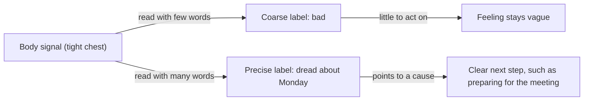

import ModuleFooter from '@site/src/components/ModuleFooter';
import RetrievalPrompt from '@site/src/components/RetrievalPrompt';
import ModuleMeta from '@site/src/components/ModuleMeta';
import Tooltip from '@site/src/components/Tooltip';
import Admonition from '@theme/Admonition';

<ModuleMeta />

## 🗺️ AQAL Mapping

| Dimension | This module's focus |
|---|---|
| **Quadrants** (Where) | Primarily I: telling your own feelings apart from the inside. Secondarily We: sharing a precise feeling with another person, in words your shared culture understands |
| **Levels** (Depth) | Level 1 to Level 2 on the emotional line of the platform's competency map: from "good or bad" to distinct, named feelings |
| **Lines** (Skills) | Emotional (primary); interpersonal and cognitive (supporting) |
| **States** (Experience) | Ordinary reflective waking attention. No altered or non-ordinary state is involved |
| **Types** (Style) | The words available for feelings differ by language and cultural background, and families differ in how openly feelings are named (see Stabilize) |

## 🧭 Orient

This is an early skills module on the emotional line. Later modules on regulating emotion and on understanding other people build on the naming skill you practise here.

:::info Before this module
This module assumes you can pause and notice what you are feeling without reacting straight away. If that is new, start with [Mindfulness Basics](./mindfulness-basics).
:::

Why this matters now: "stressed", "fine" and "bad" are true and coarse. They tell you, and the people around you, very little about what is going on or what would help. A more exact word often carries its own next step.

Your first label is not wrong. In this module you treat it as a starting point.

:::tip Before you read
Take a minute to answer these in your own words before you read on. A wrong guess still helps you learn what follows.

1. Why might someone who says "I feel dread about Monday" cope better than someone who says "I feel bad"?
2. Do you think learning more emotion words changes what you feel, or only how you describe it?
:::

## 🌿 Encounter

Someone asks how you are, and you say "fine". You are not lying. Something is there, a kind of weather, and "fine" is close enough to get you through the doorway.

Later the same weather is still there and you call it "stressed". That word fits a great many days. It fits the day before a deadline and the day after an argument and the day you slept badly, and those days do not feel the same.

Now and then a better word arrives on its own. You realise you are not stressed about the meeting, you are *embarrassed* about what you said in the last one. The feeling does not vanish, and something in it settles. It has edges now. You know what it is about, and you can see what you might do.

Most people know both experiences: the blur, and the click when the right word lands. This module is about making the click happen more often, on purpose.

## 🧠 Learn

**Emotional granularity** is the ability to make fine-grained distinctions between feelings: moving from "I feel bad" to "I feel ashamed, because I fell short of my own standard." Researchers also call it *emotion differentiation*.

It rests on three skills:

- **Differentiation** — <Tooltip term="Differentiation" definition="Telling similar feelings apart, such as anxiety, dread and apprehension, instead of folding them into one general 'bad' feeling.">telling similar feelings apart (anxiety, dread, apprehension)</Tooltip>
- **Labeling** — finding the word that fits what you feel
- **Context** — connecting the feeling to what set it off and what it means to you

The same body signal can become a coarse label or a precise one, depending on the words you bring to it:

*In words:* the same body signal, such as a tight chest, can be read with a small set of emotion words or a large one. A small set gives a coarse label like "bad", which leaves the feeling vague and offers little to act on. A larger set gives a precise label like "dread about Monday", which points to a cause and a possible next step.

### What the research shows, and what it does not

People differ in how finely they tell their feelings apart. In a diary study, people who described their unpleasant feelings in more differentiated terms also reported using a wider range of ways to manage those feelings, especially when the feelings were intense (Barrett, Gross, Christensen & Benvenuto, 2001). A later review found that higher differentiation is linked, across several studies, with less reliance on harmful ways of coping during distress (Kashdan, Barrett & McKnight, 2015).

These findings are correlations. They show that granularity and better coping tend to go together. They do not show that practising granularity causes better coping. The evidence closest to a causal test is described under the framework lenses below, and it is narrower than the claim most people want to make.

## Four Framework Lenses on Naming Feelings

Each lens is one way of looking at the same skill.

### Barrett: The Theory of Constructed Emotion

Lisa Feldman Barrett proposes that an emotion is not a fixed reaction waiting to be detected. The brain builds it in the moment, from signals inside the body, the situation, and the emotion concepts a person has learned. On this account, a person with more emotion concepts can build more specific emotions.

**How it applies here:** if the theory is right, learning the difference between "disappointed" and "discouraged" does more than improve your description. It changes what you are able to notice.

**Evidence tier:** B — supported by a body of brain-imaging and behavioural research; it remains one of several competing theories of emotion and parts of it are actively debated.

### Brackett: The RULER Skills

Marc Brackett and colleagues at Yale describe five skills that can be taught in sequence: Recognizing, Understanding, Labeling, Expressing and Regulating emotion. In a randomized trial across 62 schools, classrooms that used the RULER programme were rated by observers as warmer and more emotionally supportive after one year (Rivers, Brackett, Reyes, Elbertson & Salovey, 2013).

**How it applies here:** this module trains the L, labeling, and touches the two skills before it. The practice below follows the same order: recognize, understand, then label.

**Evidence tier:** A — a cluster-randomized trial; it tested a whole school programme with children, so it does not isolate labeling or show the same effect in adults.

### Lieberman: Affect Labeling

Matthew Lieberman and colleagues study what happens when people put a feeling into words. In a brain-imaging experiment, naming the emotion shown in a picture was followed by a smaller response in the amygdala, a region involved in detecting threat, than other ways of responding to the same picture (Lieberman et al., 2007). In a randomized experiment, people with a fear of spiders who described their feelings in words while near a spider showed a smaller physical stress response a week later than comparison groups, although their self-rated fear did not differ (Kircanski, Lieberman & Craske, 2012).

**How it applies here:** these studies are the reason step 6 of the practice asks you to write the label down, and not just think it.

**Evidence tier:** A (Kircanski et al., 2012) and B (Lieberman et al., 2007) — small laboratory samples and specific tasks; the effect on how people say they feel is weaker than the effect on physical measures.

### Kegan: From Being a Feeling to Having One

Robert Kegan's subject-object theory describes development as a series of shifts in which something a person was embedded in becomes something they can step back from and look at. "Subject" is what we are caught inside. "Object" is what we can observe and work with. A stage model like this is a lens for noticing patterns. It is not a measurement of you and it says nothing about anyone's worth.

**How it applies here:** "I am furious" and "I notice resentment about the rota" describe different relationships to a feeling. In the second, the feeling is something you have. Naming is one everyday way that shift happens. This is the module's own application of Kegan's theory, and Kegan did not study emotion labeling.

**Evidence tier:** B — a constructive-developmental theory supported by interview-based research; its link to emotion labeling is an interpretation, not a tested finding.

## The Gifts of Emotional Granularity

### A Feeling You Can Work With

A precise word carries information. "Dread about Monday's review" tells you what the feeling is about and suggests what to prepare. The feeling becomes a message you can read.

### More Ways to Respond

Different feelings call for different responses. Loneliness asks for contact, and resentment asks for a boundary. People who tell their feelings apart more finely report using a wider range of ways to manage them (Barrett et al., 2001).

### Words That Settle

Putting a feeling into words is itself a way of meeting it. In the laboratory studies described above, labeling was followed by a smaller alarm response in the brain and the body.

### Being Understood

"I'm stressed" gives another person very little to respond to. "I'm resentful that I took on too much, and I'm not angry at you" gives them something they can answer. Precision is a form of consideration for the listener.

### A Vocabulary That Grows with Use

Each distinction you make stays available. Having once told disappointment from discouragement, you have both words ready the next time. On the constructed-emotion account, each new concept is a new thing you can perceive.

## The Limitations of Emotional Granularity Training

### The Research Is Ahead of the Training

The link between granularity and better coping is well documented as a correlation. Whether deliberately practising granularity produces those benefits in adults is still being tested. Treat the benefits as plausible and worth exploring, and not as established.

### Precision Takes Time

The very care that makes a label accurate can, at the boundary, slow a response that needs to be fast. When something is urgent or unsafe, a quick, coarse read ("not safe", "leave") serves better than a search for the exact word. Granularity belongs to reflection, before or after the moment.

### Words Can Stand In for Feeling

The very words that give you a handle on a feeling can, at the boundary, become a way to hold it at arm's length. A person can discuss their "ambivalence" fluently and never let themselves feel it. A growing vocabulary is not the same as a growing capacity to stay present with what the words name.

### The Words Belong to a Language

Emotion words are not the same everywhere. Languages divide feelings differently, and some have common words for feelings that English lacks (Russell, 1991). Most of the research cited here was done with participants from a narrow range of societies (Henrich, Heine & Norenzayan, 2010). An English word list is a scaffold, and it is not a map of what all people feel.

### What Is a Misreading

Naming feelings precisely is sometimes mistaken for dwelling on them, or for being "too emotional". The skill described here is brief and specific: find the word, and move on with better information.

---

## 🧘 Practice

### The Second Label (15–20 minutes)

**Duration:** 15–20 minutes, in one sitting.

**Setup:** a quiet place to sit, a notebook and a pen, and the word list below where you can see it. Sit in any position that is comfortable.

**Choosing your moment:** you will recall a moment from the last day or two that carried a *mild to moderate* feeling: a small irritation, a flat patch, a flicker of worry, a quiet satisfaction. Do not choose the hardest thing in your life right now. The skill is easier to learn on everyday material.

**A starting word list.** This list is a prompt, and it is not a validated instrument. Add words from your own first language wherever they fit better.

| Family | Some finer words |
|---|---|
| Anger | irritated, frustrated, resentful, indignant |
| Fear | uneasy, nervous, apprehensive, dread |
| Sadness | disappointed, discouraged, lonely, homesick |
| Shame | embarrassed, guilty, inadequate, exposed |
| Joy | content, relieved, proud, grateful |

**Worked example:** a friend cancels dinner an hour before.

- *First label:* "annoyed".
- *What happened, and what it meant:* I had kept the evening free and was looking forward to it.
- *Candidates:* annoyed, disappointed, lonely, unimportant, relieved.
- *Testing each one:* "annoyed" is close. "Disappointed" fits better, because the feeling is about the lost evening and not about my friend. "Relieved" is also true, a little: I was tired.
- *Second label:* "disappointed, with a trace of relief." One evening held more than one feeling.

Now try it yourself. Take your time. If you need to stop at any point, that is fine.

1. **Recall the moment.** Bring to mind your chosen moment from the last day or two. Write one sentence saying what happened.
2. **Write your first label.** Put down the first word that comes, however coarse. "Bad" and "fine" are acceptable. Take a moment before going on.
3. **Say what it was about.** Write one sentence on what set the feeling off and why it mattered to you.
4. **List candidates.** Look at the word list and write three to five words that might fit, including your first label. No rush. Words from different families are welcome.
5. **Test each one.** For each candidate, finish the sentence "I felt ___ because ___." Cross out the ones where the sentence does not ring true. Pause here before continuing.
6. **Write your second label.** Choose the word, or pair of words, that fits best and write it beside your first label. If your first label still fits best, keep it. That is also a result.
7. **Notice the difference.** Write one line on what the second label tells you that the first did not.

**If the moment turns out heavier than you expected:** stop, close the notebook, and choose a lighter moment another time.

---

## ⚓ Stabilize

**Knowing the words is not the same as having the skill.** It is easy to learn twenty new emotion words in an afternoon. It is much harder to find the right one while you are in the middle of an argument. The first is knowledge. The second is a capacity that grows slowly, through many small repetitions in real moments. Do not take a larger vocabulary as proof that the capacity is in place.

**A calm label is the easy case.** In this practice you looked back on a mild feeling. Labeling a strong feeling as it happens is a later skill, and other modules on this platform approach it with more support.

**Your language counts.** The word list in this module is English, and English divides feelings in its own particular way. If you think and feel in another language, its words are likely to be more exact for you. Use them. Where two languages disagree about where one feeling ends and the next begins, neither one is the correct map.

**Back to your opening questions:** "dread about Monday" points to a cause and a next step, and "bad" leaves the feeling vague (the diagram in Learn). People who tell their feelings apart more finely tend to use more ways of coping, although whether training granularity causes this is still being tested. On the constructed-emotion account, words do more than describe: an emotion is built from body signals and the concepts you bring, so a richer vocabulary can change what you are able to perceive. That account is one theory among several.

## 🔄 Integrate

Anchors for the next two weeks. Each one attaches to something you already do.

- **When someone asks how you are (10 seconds):** before you answer "fine" or "busy", find one more exact word silently. You can still say "fine" aloud.
- **Before a conversation you care about (1 minute):** as you walk to the room or open the call, finish the sentence "Right now I feel ___ about this, because ___."
- **When you close your laptop or put down your tools for the day (2 minutes):** write one line in a notebook with two feelings from the day, each from a different family in the word list.
- **When you catch yourself saying "stressed" (30 seconds):** ask "stressed how?" and replace the word once, aloud or in your head.

---

## 🔍 Reflect

Use these after the practice. There are no correct answers.

1. *Journaling:* What was your first label, and what did you settle on? Why do you think the first word came first?
2. *Journaling:* Did finding a more exact word change how you related to the feeling? How would you explain what changed, or why nothing did?
3. *Journaling:* Think of a specific conversation this week in which you said "stressed" or "fine". How might a more exact word have changed what the other person did?
4. *With a partner:* Each describe a mild moment from your week using one coarse word. Your partner offers three finer words as questions ("Was it more like ...?"). What was it like to be offered words by someone else?
5. *In a group of three or four:* Which feelings does each of you find hardest to name? What do you notice about which families of feeling were named freely where you grew up?
6. *Body check-in:* When your second label landed, where did you notice it in your body, if anywhere?

## 📊 Assess

Use this rubric for honest self-assessment after a week of practice, and again at the 14-day interval. Rate what you can show, not what you feel.

| Criterion | Not yet | Developing | Stable |
|---|---|---|---|
| **Telling families apart** | I describe most feelings as good, bad, fine or stressed | I can sometimes say whether a feeling is nearer anger, fear, sadness or shame | In my notebook I can point to at least three entries from the past week, each naming a feeling from a different family |
| **Finding the second label** | My first word is my final word | I can find a finer word when I use the list and take my time | I can point to at least three entries where my second label differs from my first and I wrote why it fits better |
| **Linking feeling to cause** | I know that I feel something and cannot say what it is about | I can name the cause after talking it through | In at least three entries I completed "I felt ___ because ___" with a specific event |
| **Using the word with others** | I keep to "fine" and "stressed" in conversation | I have used a more exact word with someone once | I can name two conversations in the past two weeks in which I used an exact feeling word, and say how the other person responded |

**Passing threshold:** Stable in at least 3 of 4 criteria.

## ⏱️ Retrieval Schedule

| Interval | When | Activity |
|---|---|---|
| 1 | 24 hours after completing the module | Without looking, write the definition of emotional granularity and its three skills. Then check them against Learn and review the cards below |
| 2 | 3 days | Without looking at the word list, write as many finer words as you can for two families. Check the list, then run steps 2 to 6 of the practice on a new mild moment |
| 3 | 7 days | Explain to someone else, in your own words, why "dread about Monday" is more useful than "bad". Ask them for a recent "stressed" and help them find a second label |
| 4 | 14 days | Apply one Integrate anchor deliberately for a full day, write what you noticed, and complete the Assess rubric |

<RetrievalPrompt moduleName="Emotional Granularity" cards={[
  {q: "What is emotional granularity?", a: "The ability to make fine-grained distinctions between feelings, for example telling dread from apprehension, instead of folding them into 'bad'. Researchers also call it emotion differentiation."},
  {q: "What are the three skills emotional granularity rests on?", a: "Differentiation (telling similar feelings apart), labeling (finding the word that fits) and context (linking the feeling to what set it off and what it means)."},
  {q: "What does the research say about granularity and coping, and what is the main caveat?", a: "People who differentiate their feelings more finely report using a wider range of ways to manage them and rely less on harmful coping. The caveat: these are correlations, and whether training granularity causes the benefit is still being tested."},
  {q: "According to the theory of constructed emotion, why might a larger emotion vocabulary change what you feel?", a: "The theory holds that the brain builds an emotion in the moment from body signals, the situation and learned emotion concepts. More concepts allow more specific emotions to be built. It is one theory among several and parts of it are debated."},
  {q: "What is affect labeling, and what did laboratory studies find?", a: "Putting a feeling into words. In laboratory studies it was followed by a smaller amygdala response and, in one randomized experiment, a smaller physical stress response a week later. Samples were small and self-rated fear did not differ."},
  {q: "What is the difference between a coarse label and a precise one? Give an example.", a: "A coarse label names a general tone ('bad', 'stressed') and offers little to act on. A precise label names a specific feeling and its cause ('dread about Monday's review') and points to a next step."},
  {q: "You tell a colleague 'I'm stressed' and they offer to take work off you, which is not what you need. How would you apply this module?", a: "Find the second label: ask 'stressed how?' and test candidates with 'I felt ___ because ___.' You might land on 'resentful that the plan changed without me', which gives your colleague something different to respond to."},
  {q: "When is a quick, coarse read better than a precise label?", a: "When something is urgent or unsafe and a fast response matters. Granularity belongs to reflection before or after the moment."},
  {q: "Why is an English emotion word list a scaffold and not a universal map?", a: "Languages divide feelings differently, and most of the research was done with participants from a narrow range of societies. Words from your own first language may fit better."},
  {q: "Self-check: recall one mild feeling from today. What was your first label, your second label, and the 'because'?", a: "A strong answer gives two different words, or keeps the first with a reason, and completes 'I felt ___ because ___' with a specific event."}
]} />

## 📚 Evidence and Citations

Tiers follow the [Evidence Vetting Checklist](/internal/quality/evidence-vetting-checklist): **A** = randomized trial, systematic review or meta-analysis; **B** = peer-reviewed observational or experimental study, or a well-validated framework; **C** = expert opinion or a theoretical or practitioner framework with limited empirical testing.

| Claim | Source | Tier | Caveat |
|---|---|---|---|
| Classrooms using the RULER programme were rated as more emotionally supportive after one year | Rivers, S. E., Brackett, M. A., Reyes, M. R., Elbertson, N. A., & Salovey, P. (2013). Improving the social and emotional climate of classrooms: A clustered randomized controlled trial testing the RULER approach. *Prevention Science*, *14*(1), 77–87. | A | A whole-school programme with children; does not isolate labeling or test adults |
| Describing feelings in words during exposure was followed by a smaller physical stress response a week later | Kircanski, K., Lieberman, M. D., & Craske, M. G. (2012). Feelings into words: Contributions of language to exposure therapy. *Psychological Science*, *23*(10), 1086–1091. | A | Small sample with one specific fear; self-rated fear did not differ between groups |
| School programmes that teach social and emotional skills improve those skills on average | Durlak, J. A., Weissberg, R. P., Dymnicki, A. B., Taylor, R. D., & Schellinger, K. B. (2011). The impact of enhancing students' social and emotional learning: A meta-analysis of school-based universal interventions. *Child Development*, *82*(1), 405–432. | A | Covers broad programmes for children and adolescents; background support for teachability, not a test of granularity training |
| People who differentiate negative feelings more finely report using more ways to regulate them | Barrett, L. F., Gross, J., Christensen, T. C., & Benvenuto, M. (2001). Knowing what you're feeling and knowing what to do about it: Mapping the relation between emotion differentiation and emotion regulation. *Cognition and Emotion*, *15*(6), 713–724. | B | Correlational diary study with students; causal direction not established |
| Higher emotion differentiation is linked with less harmful coping during distress | Kashdan, T. B., Barrett, L. F., & McKnight, P. E. (2015). Unpacking emotion differentiation: Transforming unpleasant experience by perceiving distinctions in negativity. *Current Directions in Psychological Science*, *24*(1), 10–16. | B | A narrative review of mostly correlational studies |
| Naming an emotion is followed by a smaller amygdala response than other ways of responding | Lieberman, M. D., Eisenberger, N. I., Crockett, M. J., Tom, S. M., Pfeifer, J. H., & Way, B. M. (2007). Putting feelings into words: Affect labeling disrupts amygdala activity in response to affective stimuli. *Psychological Science*, *18*(5), 421–428. | B | Small brain-imaging sample; participants labeled pictures of faces, not their own feelings |
| Emotions are constructed from body signals, context and learned concepts | Barrett, L. F. (2017). The theory of constructed emotion: An active inference account of interoception and categorization. *Social Cognitive and Affective Neuroscience*, *12*(1), 1–23. | B | A theoretical account; one of several competing theories of emotion |
| Language helps shape how emotions are perceived, beyond communicating them | Lindquist, K. A., Satpute, A. B., & Gendron, M. (2015). Does language do more than communicate emotion? *Current Directions in Psychological Science*, *24*(2), 99–108. | B | A review written by proponents of the constructionist view |
| Emotion categories differ across languages and cultures | Russell, J. A. (1991). Culture and the categorization of emotions. *Psychological Bulletin*, *110*(3), 426–450. | B | A review of studies up to 1991; later work has refined the picture |
| Most behavioural research draws on a narrow range of societies | Henrich, J., Heine, S. J., & Norenzayan, A. (2010). The weirdest people in the world? *Behavioral and Brain Sciences*, *33*(2–3), 61–83. | B | A review and argument; not specific to emotion research |
| Development as a shift from being embedded in an experience to being able to look at it | Kegan, R. (1982). *The Evolving Self: Problem and Process in Human Development*. Harvard University Press. | B | A theoretical model supported by interview research; its application to emotion labeling is this module's own |
| The five RULER skills as a teachable sequence | Brackett, M. A. (2019). *Permission to Feel*. Celadon Books. | C | A book for general readers by the programme's developer; see Rivers et al. (2013) for the trial |

<Admonition type="tip" title="Facilitator Note">

**Presenting this content in group settings:** tell the group at the start that they will work with a mild, everyday feeling and that nobody will be asked to share what their feeling was about. Have participants keep their first label visible beside their second. The contrast between the two is the teaching point.

**Group facilitation structure (60 minutes):** 10 min introduction and the two opening questions / 10 min walk through the diagram and the cancelled-dinner example / 20 min individual practice in silence / 10 min paired exchange using Reflect prompt 4 / 10 min whole-group debrief on which words were hard to find.

**Watch-fors:**

- *Fluent vocabulary, no contact.* A participant who can recite many emotion words and goes blank when asked for a current feeling has not yet built the skill. Offer two candidate words and let them choose.
- *Choosing a heavy moment.* If someone begins describing a major loss or a crisis, thank them, and steer the exercise back to an everyday moment. Follow up with them privately afterwards.
- *Correcting each other's labels.* In pairs, finer words are offered as questions. If a partner starts telling the other what they "really" feel, restate the instruction.

**Adapting for mixed groups:** people who are new to naming feelings do well with the five families alone, before any finer words. People with a large vocabulary can be asked for the "because" sentence every time, which is where fluent speakers tend to be vague. In multilingual groups, invite words from every language in the room and ask what each one captures that the English list misses.

</Admonition>

:::note Safety Note

**Tier:** 1 — Standard reflective content

This module involves recalling a mild, everyday feeling and finding words for it. If any material surfaces significant distress, pause and speak with a trusted person. You can stop at any point and return with a lighter moment. This content is educational, not therapeutic.

:::

<ModuleFooter />
