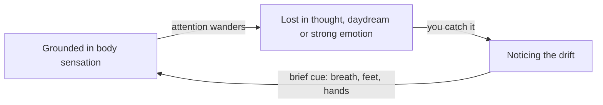

import ModuleFooter from '@site/src/components/ModuleFooter';
import RetrievalPrompt from '@site/src/components/RetrievalPrompt';
import ModuleMeta from '@site/src/components/ModuleMeta';
import Admonition from '@theme/Admonition';

<ModuleMeta />

## 🗺️ AQAL Mapping

| Dimension | Value |
|---|---|
| **Where** (Quadrants) | I — individual interior experience |
| **Depth** (Levels) | Personal → Pluralistic (Orange → Green) |
| **Skills** (Lines) | Somatic, Cognitive |
| **Experience** (States) | Gross waking — ordinary sensorimotor reality |
| **Style** (Types) | Experiential; structured-first option available |

**Waking Up path:** This module addresses the *gross* stage of the Waking Up path, providing the grounded baseline required before advancing to subtle, causal, or witnessing states.

---

## 🧭 Orient

Before beginning, notice that this module asks for something deceptively simple: paying attention to what your body already feels, without trying to change or improve it. There is no special state to achieve here — only a clearer, more consistent contact with the ordinary sensory reality you are already in.

:::tip Before you read
Take a minute to answer these in your own words before you read on. A wrong guess still helps you learn what follows.

1. If you are awake right now, you are already in the "gross" (waking) state. What would it add to be *aware* of being in it?
2. Why might steady contact with ordinary body sensation matter before trying deeper meditative states?
:::

## 🌿 Encounter

Right now, without changing anything, notice the sensation of your feet against the floor or your seat beneath you. Notice it for a few seconds longer than you normally would. That brief noticing — not analyzing, just noticing — is the entire practice this module builds on.

## 🧠 Learn

## The Five States in AQAL

Ken Wilber's AQAL framework identifies five natural states of consciousness that all humans cycle through (Wilber, *Integral Spirituality*, 2006):

| State | Everyday Name | Characteristics |
|---|---|---|
| **Gross** | Waking | Sensorimotor reality; physical body; ordinary perception |
| **Subtle** | Dreaming | Imagery, emotion, interior vision, energetic experience |
| **Causal** | Deep sleep | Formless, undifferentiated awareness; deep rest |
| **Witnessing** | Turiya | Pure awareness observing all other states |
| **Non-dual** | — | Subject and object collapse; unobstructed presence |

The **gross state** is the baseline — the ordinary waking experience of your physical body and sensory environment. It is not a lesser state. It is the foundation. **Evidence tier:** B — a theoretical synthesis of contemplative traditions, not a directly measured taxonomy.

## Why Gross State Awareness Matters

Most people are *in* the gross state without being *aware* of it. Awareness of the gross state means:

- You can notice when your attention is fully present in sensorimotor reality.
- You can detect when you have drifted into subtle-state absorption (daydreaming, fantasy, emotional flooding) or dissociated from the body.
- You have a reliable anchor to return to between and after higher-state practices.

*In words:* attention rests in ordinary body sensation, then wanders into thought, daydream or strong emotion. Awareness of the gross state is what lets you catch that drift and use a brief cue, such as a breath or the feel of your feet, to come back. The practices below train each part of this loop.

Without a stable gross-state baseline, attempts to access subtle or causal states lack grounding. You may mistake emotional reactivity for subtle-state access, or bypass the body altogether (Wilber, *Integral Psychology*, 2000).

## State vs. Stage: A Critical Distinction

States are **temporary**. You can visit any state regardless of your developmental stage. A child can have a peak non-dual experience; a meditator with decades of practice still returns to the gross waking state.

Stages are **permanent acquisitions**. Once you develop the capacity to take a new perspective, you do not lose it.

This module addresses **states**, not stages. Stabilizing gross-state awareness is a *practice*, not a developmental achievement.

## Sensorimotor Awareness

Jean Piaget identified sensorimotor processing as the earliest and most fundamental form of cognition — direct physical engagement with the world (Piaget, *The Construction of Reality in the Child*, 1954). In adult development, this capacity does not disappear; it becomes the substrate of all higher-order awareness. **Evidence tier:** A — foundational developmental research, though it studied infants and its use for adult awareness is interpretive.

The somatic psychology tradition (Levine, *Waking the Tiger*, 1997; *In an Unspoken Voice*, 2010) identifies the body's felt sense as a primary data source. Embodied presence — full, non-dissociated inhabitation of the body — supports:

- Emotional regulation
- Stress recovery
- Accurate self-assessment of state
- A stable foundation for contemplative practice

**Evidence tier:** B — clinical-theoretical work with a practitioner evidence base, not randomised controlled trials.

## Two Framework Lenses: Wilber's AQAL States Model and Somatic Psychology

This module draws on two complementary lenses. Wilber's AQAL states model places the gross state within a larger spectrum (gross, subtle, causal, witnessing, non-dual), giving learners a map of where this baseline sits relative to the higher-state work covered in later modules. Somatic psychology (Piaget's sensorimotor foundations, Levine's body-based trauma work) supplies the practical, felt-sense methodology — how to actually contact and stabilize gross-state awareness in the body, rather than just conceptually locate it on a map.

Used together, these lenses explain both the *why* (gross-state awareness is foundational to all later state work) and the *how* (specific, body-based practices for building that foundation). The AQAL map without the somatic method would be an abstract taxonomy; the somatic method without the AQAL map would lose sight of why this particular skill matters for the developmental journey ahead.

## The Limitations of Gross-State Frameworks

These frameworks have real limits. First, the AQAL five-state model is a theoretical synthesis, not a directly measured taxonomy — it integrates diverse contemplative traditions into a single spectrum, and the boundaries between states (especially gross and subtle) are experientially fuzzier than the clean table above suggests.

Second, body-based sensory practices, while generally low-risk, are not universally neutral. For learners with a trauma history, directed attention to physical sensation can occasionally surface distress rather than grounding — a possibility this module's Safety Note addresses directly rather than assuming away.

Third, gross-state awareness is a practice of attention, not a technique that produces a permanent trait after a fixed number of repetitions. Some days the body will be easy to feel; other days attention will be diffuse or resistant, regardless of how much prior practice has occurred. Consistency, not intensity, is what builds the capacity.

---

## 🧘 Practice

**Worked example:** step 4 with an ordinary case. You sit down after a walk to the shops and bring attention to the soles of your feet. You notice warmth in the heels and a dull pressure under the balls of the feet. Your mind says "my shoes are too tight"; you notice that is a comment, not a sensation, and return to warmth and pressure. After about 30 seconds you move on to the ankles.

## Practice 1 — Full-Body Scan (5–10 minutes)

**Purpose:** Systematically contact gross-state awareness from feet to crown.

**Duration:** 5–10 minutes

**Instructions:**

1. Sit upright in a chair with both feet flat on the floor, or lie on your back with arms at your sides.
2. Close your eyes, or soften your gaze toward the floor.
3. Take three slow breaths: inhale for a count of four, exhale for a count of six.
4. Bring your attention to the **soles of your feet**. Notice any sensation — pressure, temperature, tingling, or numbness. Stay here for 30 seconds.
5. Slowly move attention upward: **ankles → shins and calves → knees → thighs → hips**. At each region, pause briefly and simply notice what is present.
6. Continue to the **lower abdomen and lower back**, then the **chest and upper back**, then the **shoulders**.
7. Move to the **arms** — upper arms, elbows, forearms, hands, fingertips.
8. Continue to the **throat and neck**, **jaw and face**, **top of the skull**.
9. After reaching the crown, rest in a global sense of your whole body as one field of sensation for 60 seconds.
10. Open your eyes. Notice the visual field. Notice sounds. Notice the weight of your body.

**Check-in question:** Are you noticing sensations as they are, or describing or judging them? Return to bare sensation if needed.

---

## Practice 2 — Five-Sense Grounding (5–8 minutes)

**Purpose:** Anchor attention in gross-state reality through each sensory channel.

**Duration:** 5–8 minutes

**Instructions:**

1. Sit or stand in a quiet space. Begin with three slow, deep breaths.
2. **Touch (60 seconds):** Place both palms flat on your thighs or a table. Press gently. Notice texture, temperature, firmness. Alternate pressing and releasing. Stay with the physical sensation only.
3. **Sound (60 seconds):** Close your eyes. Without labelling the source, simply listen. Notice the foreground sound, then the background. Notice silence between sounds.
4. **Sight (60 seconds):** Open your eyes. Without analyzing, scan the room slowly. Notice color, shape, light, and shadow. Let the visual field exist without commentary.
5. **Smell (30 seconds):** Notice any scents present. There may be little or nothing — that is information too.
6. **Taste (30 seconds):** Notice the current taste in your mouth. Swallow once. Notice the absence of strong taste if present.
7. **Integration (60–120 seconds):** With all senses lightly open, remain still. Notice the body as an object *in* a sensory environment. Notice the environment as something your body is *receiving*.
8. Take one slow breath, and gently return to normal activity.

**Variation:** This practice can be done outdoors or in nature to amplify the signal from each sensory channel.

---

## 🔍 Reflect

Record your responses in a journal after completing either practice. Aim for honest observation rather than evaluation.

1. Before the practice, where was your attention located — in your body, in your thoughts, somewhere else? Describe as specifically as you can.
2. Which areas of the body were easiest to feel? Which were hardest or seemed absent? What might that difference indicate?
3. Did you notice any shift between the beginning and end of the practice? If so, how would you describe it, and why do you think it happened?
4. Think of a specific moment from the past day when you noticed a physical sensation. How did you respond to it, and why did you notice it then and not at other times?
5. What is one situation in the coming week where pausing to contact gross-state awareness might be useful? What would that pause look like?

---

## 📊 Assess

Use this rubric to gauge your current gross-state awareness capacity. Review your responses after one week of regular practice.

| Criterion | Not yet | Developing | Stable |
|---|---|---|---|
| **Body contact** — You can feel the physical sensations of your body in real time, without effort | Rarely notice body sensations during ordinary activity | Notice sensations during dedicated practice but not spontaneously | Regularly contact physical sensations throughout the day: you can name at least three moments from yesterday when you noticed a body sensation unprompted |
| **State detection** — You can recognise when you are grounded in gross-state awareness vs. lost in thought or emotional flooding | Cannot distinguish these states reliably | Can distinguish after reflection, not in the moment | Can detect state in real time, with a few seconds' lag at most: you can recall at least two moments this week when you caught a drift as it happened |
| **Return capacity** — When you notice you have drifted, you can reliably return to gross-state awareness | Cannot return without significant effort | Can return using a formal practice | Can return using a brief cue (breath, foot contact, tactile anchor): you can name the cue and at least two times this week you used it |
| **Baseline stability** — You can sustain gross-state awareness for the duration of a 5-minute practice without major drift | Frequent, unrecovered drift throughout | Moderate drift with some recovery | Mostly sustained, with brief recoveries as needed: in at least three of your last five sessions, each drift ended within a breath or two |
| **Transfer** — You spontaneously use gross-state awareness cues in daily life (before meetings, after stressful events, etc.) | Not occurring | Occasional, prompted by others or external cues | Self-initiated in at least 2–3 situations per week, which you can list |

**Passing threshold:** Three or more criteria at *Developing* or *Stable* after two weeks of consistent practice (see the 14-day retrieval checkpoint in the schedule below).

---

**Worked examples:**
- **Level 3:** "I can notice the transition from drowsy waking to alert attention during my commute — it has a distinct felt quality I used to miss."
- **Level 4:** "I distinguish three qualities within waking: post-sleep dullness, post-coffee alertness, and the spacious calm after deliberate breathing."

## The Gifts of Gross-State Awareness

A stable gross-state baseline gives you something deceptively valuable: a reliable place to return to. When emotions run high, when a practice goes sideways, or when life simply feels overwhelming, the ability to anchor attention in the felt sense of your own body is available in seconds, requires no special conditions, and works regardless of what else is happening.

It also sharpens self-perception generally. Learners who build this capacity often report noticing earlier when they are dissociating, ruminating, or emotionally flooding — not because the module teaches emotional regulation directly, but because clear contact with the body makes departures from that contact easier to detect.

Finally, this foundation makes every subsequent state-development module more trustworthy. Subtle, causal, and witness-state work all depend on being able to tell the difference between a genuine state shift and simply losing touch with ordinary embodied reality — and that discernment is built here, first.

## Stabilize

**Practice, not achievement:** As the Learn section notes, gross-state awareness is a skill maintained through ongoing practice, not a milestone reached once and retained permanently. Expect capacity to fluctuate with sleep, stress, and life circumstances — a lapse in stability is not a regression to be alarmed by, but a normal feature of an attentional skill.

**Back to your opening questions:** being in the waking state is not the same as noticing it. Awareness of the gross state adds the ability to catch when attention has drifted into thought, daydream or emotional flooding, and to return with a brief cue (the cycle diagram in Learn). That steady baseline matters before deeper practices because, without it, it is hard to tell a genuine shift in state from ordinary dissociation or emotional flooding.

**A baseline for everything else:** Because later modules in this states sequence build directly on this one, resist the temptation to rush past gross-state work to reach "more advanced" subtle or causal practices. A shaky foundation here tends to surface later as confusion between authentic higher-state access and ordinary dissociation or emotional flooding.

---

## 🔄 Integrate

Carry gross-state awareness into your daily context:

- **Before transitions:** Before starting a new task, take three grounding breaths and briefly scan your feet and hands.
- **During emotionally charged interactions:** When you notice emotional intensity rising, anchor attention in the physical sensation of your feet on the floor before responding.
- **After screen time:** After 60+ minutes of computer or phone use, use Practice 2 (Five-Sense Grounding) as a reset.
- **As a practice bookend:** Begin and end any meditation, journaling, or reflective session with 60 seconds of the Full-Body Scan.

---

<Admonition type="tip" title="Facilitator Note">

- Emphasize that this module has no dramatic goal state — some participants expect a special experience and may undervalue the practice when it simply feels like "noticing my feet."
- If a participant reports distress rather than grounding during a sensory practice, stop and use the Safety Note's stop rules before continuing — do not push through in the name of "staying with the practice."
- Use the Reflect prompts to surface how often participants already touch gross-state awareness in daily life without naming it — this often increases buy-in for the practices.
- Frame this module explicitly as foundational for the later subtle, causal, and witness-state modules, so participants understand why time is being spent on something that can feel basic.

</Admonition>

<RetrievalPrompt moduleName="Gross State Awareness" cards={[
  {q: "What is the gross state in Wilber's AQAL framework?", a: "The ordinary waking state of sensorimotor and physical experience — the baseline for all other state work."},
  {q: "What is the difference between a state and a stage in AQAL?", a: "States are temporary experiences (waking, dreaming, deep sleep, witnessing, non-dual). Stages are permanent developmental acquisitions of perspective-taking capacity."},
  {q: "Why is gross state awareness necessary before subtle or causal state training?", a: "Without a stable physical baseline, learners cannot detect when they have left gross-state reality, leading to confusion between emotional flooding and genuine subtle-state access."},
  {q: "What does \"embodied presence\" mean in somatic psychology?", a: "Full, non-dissociated inhabitation of the body — attending to physical sensations as they are, without bypassing them through thought or reactive behaviour."},
  {q: "Name the five AQAL states in order.", a: "Gross (waking), Subtle (dreaming), Causal (deep sleep), Witnessing (turiya), Non-dual."}
]} />

## ⏱️ Retrieval Schedule

| Interval | Activity |
|---|---|
| 24 hours | Repeat one practice from this module; answer Reflect question 1 again in your journal |
| 72 hours | Complete the Assess rubric for the first time; note which criteria are active |
| 7 days | Repeat the Assess rubric; identify one daily-life integration target for the next week |
| 14 days | Final rubric review; confirm passing threshold (3+ criteria at Developing or Stable) and note growth since Day 1 |

---

## 📚 Evidence and Citations

Evidence quality uses Tier A (primary research or strong empirical base) and Tier B (theoretical synthesis or clinical-practitioner evidence). See the [Evidence Vetting Checklist](/internal/quality/evidence-vetting-checklist) for the full tier definitions.

| Claim | Source | Quality | Caveat |
|---|---|---|---|
| Five-state model (gross, subtle, causal, witnessing, non-dual) | Wilber, K. *Integral Spirituality* (2006), Shambhala | Tier B — theoretical synthesis; not direct empirical study | This model integrates contemplative traditions; empirical operationalisation is active research area |
| State-stage distinction | Wilber, K. *Integral Psychology* (2000), Shambhala | Tier B — theoretical framework | Cross-tradition comparison; peer review within integral studies |
| Sensorimotor foundations of cognition | Piaget, J. *The Construction of Reality in the Child* (1954), Basic Books | Tier A — foundational developmental research | Original work on infants; adult extrapolation is interpretive |
| Somatic experiencing and the body's role in regulation | Levine, P. *In an Unspoken Voice* (2010), North Atlantic Books | Tier B — clinical-theoretical; practitioner evidence base | Not a randomised controlled study; widely used in somatic therapy |
| Body scan as attention-regulation practice | Kabat-Zinn, J. *Full Catastrophe Living* (1990/2013), Bantam | Tier A — MBSR protocol with substantial empirical support | Context is MBSR, not AQAL; transfer to state-awareness framing is direct extrapolation |

---

:::note Safety Note

This module is rated **Tier 1 (self-guided, low intensity)**. The practices involve directed attention to ordinary physical sensations and do not intentionally access emotionally charged material.

**Consent:** Proceed when you are willing to bring attention to your physical experience at a manageable pace. You may pause or stop at any time.

**Contraindications:** If you are currently experiencing acute dissociation, depersonalisation, or derealisation, postpone this practice and consult a qualified mental health professional before continuing. This platform does not provide clinical care.

**Stop rules:** If sensory awareness practice produces distress rather than grounding, stop immediately. Open your eyes, look around the room, name three visible objects aloud, and press your feet firmly into the floor.

**Escalation:** If distress persists, step away from the practice and contact a trusted support person or qualified practitioner.

For the full safety framework, see the [Shadowwork Safety Standard](/internal/safety/shadowwork-safety-standard). If distress is unexpectedly activated, follow the [Trauma Activation Response Protocol](/internal/safety/shadowwork-safety-standard#trauma-activation-response-protocol).

:::

<ModuleFooter />
