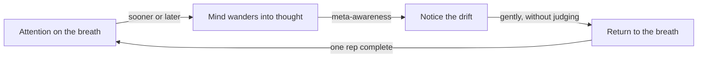

import RetrievalPrompt from '@site/src/components/RetrievalPrompt';
import ModuleMeta from '@site/src/components/ModuleMeta';
import Tooltip from '@site/src/components/Tooltip';
import Admonition from '@theme/Admonition';

<ModuleMeta />

## 🗺️ AQAL Mapping

| Dimension | Value |
|---|---|
| **Where** (Quadrants) | I — individual interior experience |
| **Depth** (Levels) | Personal → Pluralistic (Orange → Green) |
| **Skills** (Lines) | Cognitive, Somatic |
| **Experience** (States) | Mindfulness — non-judgmental awareness of present experience |
| **Style** (Types) | Experiential; short daily practice with a self-assessment rubric |

This module is deliberately foundational: it does not require or target any particular developmental stage, and it does not involve altered or non-ordinary states. Its purpose is to build a basic, general-purpose attentional skill — noticing when attention has wandered and returning it — that later, more advanced states and lines modules on this platform assume as a starting capacity.

## 🧭 Orient

Before beginning, notice that this practice asks for very little: no special posture, no belief system, and no particular outcome to produce. The only job is to notice when attention has left the breath and to bring it back — as many times as that happens. There is no version of this practice where noticing distraction counts as failure; noticing is the entire skill being built.

:::tip Before you read
Take a minute to answer these in your own words before you read on. A wrong guess still helps you learn what follows.

1. If your mind wanders fifty times in ten minutes of practice, have you failed at mindfulness? Why or why not?
2. What do you think is the difference between paying attention to something and being aware of it?
:::

## 🌿 Encounter

As you sit with the instructions below, expect the mind to wander — often, and sometimes into thoughts that feel urgent or important. This is not a sign that the practice isn't working. Meet each return to the breath as a small, complete rep of the actual skill, regardless of how many times it needs repeating in a single session.

## 🧠 Learn

**Mindfulness** = non-judgmental awareness of present experience.

The mind naturally wanders. Mindfulness is not the absence of thought, but the *noticing* of thought — and the choice to return attention to the present moment. This capacity is trainable.

Key distinctions:
- **Attention** — what you focus on
- **Awareness** — the space in which experience occurs
- **Meta-cognition** — <Tooltip term="Meta-cognition" definition="Awareness of your own awareness — observing the observer rather than being caught in thought">awareness of your own awareness</Tooltip>

Each session is a loop you go around many times:

*In words:* attention starts on the breath and, sooner or later, drifts into thought. Meta-awareness is the moment you notice the drift. You then return attention to the breath without judging yourself, and the loop starts again. Each full pass is one repetition of the skill, so a session with many drifts is a session with many reps.

## Two Framework Lenses: Attention Research and Classical Mindfulness Traditions

Cognitive and neuroscientific research on attention and mind-wandering supplies this module's operational language — the distinction between focused attention and open monitoring, and the finding that the brain's default mode of operation involves substantial spontaneous mind-wandering that can be trained, though not eliminated. **Evidence tier:** A — large experience-sampling and randomised studies, though correlational findings and short training periods limit how far they generalise.

Classical mindfulness traditions (chiefly Buddhist *sati* and *vipassana* practice, secularised here) supply the actual practice instructions and the centuries of accumulated experience about what beginners encounter and how to work with it. **Evidence tier:** B — a clinical-practitioner synthesis of traditional practice; secularisation removes the original ethical context.

These two lenses layer straightforwardly: the research framing keeps expectations realistic — mind-wandering is normal brain function, not a personal failing — while the traditional practice instructions provide a structure (breath focus, noticing, returning, open awareness) that has been refined and taught successfully for a very long time. Neither lens is sufficient alone: research without practice produces intellectual understanding without skill; practice without the research framing can leave beginners believing that a wandering mind means they are doing it wrong.

## The Limitations of Basic Mindfulness Training

This module is intentionally narrow, and that narrowness is itself a limitation worth naming. It builds a general attentional skill but does not, on its own, address emotional processing, relational patterns, or the deeper states and stages territory covered elsewhere on this platform — a learner who completes this module has taken a first step, not a comprehensive one.

The self-assessment rubric also has real limits. Self-reported attention and self-reported "meta-awareness" are both notoriously difficult to verify from the inside — a learner who feels highly attentive is not necessarily more attentive than one who feels distracted, and the rubric should be read as a rough developmental signal, not a precise measurement.

Finally, basic mindfulness training is sometimes marketed as a general solution to stress, productivity, or emotional difficulty, and that framing oversells what a 10–20 minute daily practice can realistically deliver. It is a foundational skill-building practice, not a treatment for clinical anxiety, depression, or trauma — those require different, often professionally supported, forms of care.

---

## 🧘 Practice

**Duration:** 10–20 min

**Worked example:** step 4 in a real first session. You are on your third breath when you realise you are planning tomorrow's lunch. That realisation is the noticing. You might silently say "planning" and bring attention back to the rise and fall of your belly. Two breaths later you are replaying a work email; you notice again and return again. That is two reps of the skill, not two failures.

**Instructions:**
1. Find a comfortable position — sitting in a chair, cross-legged on a cushion, or lying down all work. If you have back pain, lying flat with knees bent or sitting with your back supported is fine.
2. Close your eyes or soften your gaze downward
3. Focus attention on the physical sensation of breathing — the air moving in and out, the rise and fall of your chest or belly
4. When the mind wanders (it will), gently notice and return
5. End with 2 minutes of open awareness — let your attention go wherever it naturally goes. Don't try to focus on anything. Just notice whatever arises and passes.

**Frequency:** Daily, minimum 10 minutes

---

## 🚧 Common Obstacles

**Mind-wandering is not failure.** The brain is designed to wander. Every time you notice it and return, you are practicing exactly the skill this exercise builds. The goal is not to stop thoughts — it is to notice them and choose where to place attention. The noticing itself is the success.

**Drowsiness.** If you regularly fall asleep during practice, try: sitting up instead of lying down, practicing with eyes open, practicing at a different time of day, or splashing cold water on your face before starting. Brief drowsiness is normal — if it persists across sessions, your body may genuinely need rest.

**Restlessness.** The feeling of wanting to stop, move, or check your phone is common for beginners. Try shortening the practice to 5 minutes. The restlessness often peaks around the 2–3 minute mark and then recedes. Sitting with the discomfort for just one more minute is a training effect.

**Emotional releases.** Mindfulness can surface sadness, anxiety, or irritation that was already present but unfelt. If this happens, you can: open your eyes, place both feet on the floor, and take three slow breaths. You do not need to push through strong emotion — you can stop the practice. This is not a failure; it is awareness working.

**"Nothing is happening."** Beginners often feel they are doing it wrong because nothing dramatic occurs. Most meditation is ordinary. The effects of mindfulness accumulate over weeks and months, not minutes. Think of it like physical exercise: a single workout does not transform your body, but consistent practice does.

---

## 🔍 Reflect

- How often did your attention drift during the practice?
- What types of thoughts pulled attention away most? Why do you think those ones had the strongest pull?
- Was there a difference in quality between the beginning and end? How would you explain the change?
- What did "returning" to breath feel like?
- Think of a specific moment this week when you reacted before you could think. How might noticing a breath first have changed what happened?

---

## 📊 Assess (Self + Structured)

| Level | Indicator |
|-------|-----------|
| 1 | Notices when attention has drifted (retrospectively) |
| 2 | Returns to breath within seconds of noticing drift |
| 3 | Sustains focused attention for 5+ minutes . *Example: "I sat for 10 minutes and my mind wandered maybe 15 times, but each time I noticed within a few seconds and returned to the breath. I never got lost in a thought for more than 30 seconds."*. *Example: "I sat for 10 minutes and my mind wandered maybe 15 times, but each time I noticed within seconds and returned to the breath. I never got lost in thought for more than half a minute."*|
| 4 | Meta-awareness: observing the observer: you can name at least one moment from daily life this week, outside formal practice, when you noticed a reaction as it was rising . *Example: "During a tense conversation, I noticed myself getting defensive — and simultaneously noticed that I was noticing. I could see the anger rising without being swept away by it."*|

**Passing threshold:** Level 3: you can sit for 5 minutes or more and return to the breath within seconds each time you notice drift.

---

## The Gifts of Basic Mindfulness Training

Even at this foundational level, mindfulness practice offers something genuinely valuable: a repeatable way to notice the gap between a stimulus and a reaction, and to choose, at least occasionally, a more deliberate response in that gap. This is a small skill with outsized downstream effects — it is the same capacity that later, more advanced emotional regulation and relational work depends on.

The practice also builds a realistic relationship with one's own mind. Beginners typically arrive expecting meditation to produce calm or emptiness; what they actually encounter is a wandering, active mind that returns to the breath imperfectly and often. Learning to treat this as normal, rather than as a personal failure, is itself a durable psychological gain independent of any specific meditative attainment.

Finally, the meta-cognitive capacity this module targets — noticing that you are noticing — is a general-purpose skill that transfers well beyond formal seated practice. Once developed even modestly, it shows up unbidden in daily life: noticing defensiveness rising in an argument, noticing a habitual thought pattern beginning, noticing tension in the body before it becomes pain.

## Stabilize

**Consolidation, not achievement:** There is no advanced version of "returning attention to the breath" to graduate toward. What stabilises with consistent practice is not a special state but the reliability of the basic skill — noticing drift sooner, and returning to the present moment more easily, across more situations in daily life, not just during seated practice.

**A baseline for everything else:** This module's rubric levels (1 through 4) describe a gradual strengthening of one simple capacity, not a hierarchy of spiritual attainment. Reaching Level 3 or 4 means the basic skill is now available as a foundation for the more advanced states, emotional, and shadow-integration modules elsewhere on this platform — not that this module's work is "finished" in some final sense.

**Back to your opening questions:** fifty wanders in ten minutes is not failure. Each time you notice the drift and return, you complete one rep of the exact skill this practice builds (the loop in Learn). Attention is what you focus on, such as the breath, while awareness is the wider space in which the breath, thoughts and sounds all appear. Meta-cognition is noticing which of the two you are doing.

## 🔄 Integrate

Apply this in real life:
- Pause for 3 breaths before responding in conversation
- Take a 1-minute mindful pause between tasks
- Notice body sensations during stressful moments

---

## 📚 Evidence and Citations

Evidence quality uses Tier A (primary research or strong empirical base) and Tier B (theoretical synthesis or clinical-practitioner evidence). See the [Evidence Vetting Checklist](/internal/quality/evidence-vetting-checklist) for the full tier definitions.

| Claim | Source | Quality | Caveat |
|---|---|---|---|
| Mind-wandering is the brain's default mode and occurs roughly 30–50% of waking hours | Killingsworth, M.A. & Gilbert, D.T. "A wandering mind is an unhappy mind." *Science* 330(6006), 2010 | Tier A — large-scale experience-sampling study | Correlational; does not establish that mind-wandering causes reduced well-being rather than the reverse |
| Mindfulness-based attention training improves sustained attention and reduces mind-wandering | Mrazek, M.D. et al. "Mindfulness training improves working memory capacity and GRE performance." *Psychological Science* 24(5), 2013 | Tier A — randomised controlled study | Short training duration (2 weeks); generalisability to long-term daily practice not directly tested |
| Secularised mindfulness practice derives from Buddhist *sati* (mindfulness) and *vipassana* (insight) traditions | Kabat-Zinn, J. *Full Catastrophe Living* (1990), Delta | Tier B — clinical-practitioner synthesis adapting traditional practice | Secularisation removes ethical and soteriological context present in the original tradition |
| Meta-awareness (awareness of awareness) is a distinct, trainable component of mindfulness | Dunne, J. "Toward an understanding of non-dual mindfulness." *Contemporary Buddhism* 12(1), 2011 | Tier B — theoretical and contemplative-scholarship synthesis | Conceptual clarification rather than a controlled empirical study |

---

## Safety Note

**Tier:** 1 — Standard reflective content

This module involves breath-focused and open-monitoring attention practice. As noted above, mindfulness can surface sadness, anxiety, or irritation that was already present but unfelt — you can always stop the practice, open your eyes, and ground through the feet and breath. If distress persists beyond the session, pause and speak with a trusted person. This content is educational, not therapeutic.

---

<Admonition type="tip" title="Facilitator Note">
- Keep instructions simple and concrete for beginners — avoid layering in advanced concepts (nondual awareness, jhana states, etc.) that belong to later modules.
- Normalise mind-wandering explicitly and often. The single most common reason beginners quit is believing that a wandering mind means they are "bad at meditating."
- If a participant reports strong emotional release during practice, follow the Common Obstacles guidance: let them stop, ground through breath and feet, and check in afterward rather than pushing through.
- This module has no Tier 2 restrictions, but if a participant reports a personal history of trauma, dissociation, or a diagnosed psychiatric condition, mention that later modules on this platform carry specific safety tiers and prerequisites.
</Admonition>

<RetrievalPrompt moduleName="Mindfulness Basics" cards={[
  {q: "What is mindfulness?", a: "Non-judgmental present-moment awareness"},
  {q: "What is the difference between attention and awareness?", a: "Attention is focused; awareness is the open space in which experience occurs"},
  {q: "What is meta-cognition in mindfulness?", a: "Awareness of your own awareness — observing the observer"}
]} />

## ⏱️ Retrieval Schedule

| Interval | Activity |
|---|---|
| 24 hours | Repeat the 10-minute practice; answer the first two Reflect questions in your journal |
| 72 hours | Repeat the practice; note which Common Obstacle (if any) showed up and how you responded |
| 7 days | Complete the Assess rubric for the first time; identify your current level |
| 14 days | Repeat the Assess rubric; note any shift from Day 7; identify one Integrate practice to carry forward |

