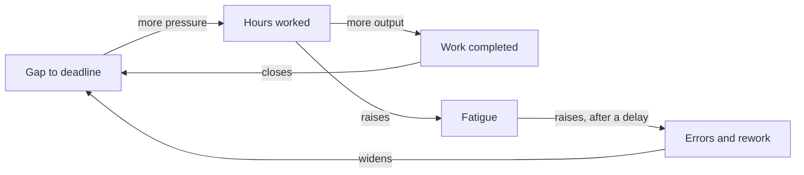

import RetrievalPrompt from '@site/src/components/RetrievalPrompt';
import ModuleFooter from '@site/src/components/ModuleFooter';
import ModuleMeta from '@site/src/components/ModuleMeta';
import Admonition from '@theme/Admonition';

<ModuleMeta />

## 🗺️ AQAL Mapping

| Dimension | This module's focus |
|---|---|
| **Quadrants** (Where) | It — a system as something you can observe and draw; Its — that system as part of a wider network of interlocking systems. Interior experience (I, We) is touched in Reflect, and is not the main subject |
| **Levels** (Depth) | Rational → Pluralistic (Orange → Green): from single-cause explanations toward seeing many interacting causes |
| **Lines** (Skills) | Cognitive (primary): reasoning about relationships between parts, over time |
| **States** (Experience) | Ordinary waking attention in an analytical mode. No altered or non-ordinary state is involved |
| **Types** (Style) | People who favour detail and people who favour the big picture both use this skill; cultural background shapes which systems feel natural to draw as diagrams (see Stabilize) |

## 🧭 Orient

This is a stand-alone skills module on the cognitive line. It builds on the evidence-based, cause-and-effect reasoning described in the earlier orientation module, and it prepares you for later modules that ask you to hold several interacting causes in mind at once.

:::info Before this module
This module assumes you are comfortable with step-by-step, evidence-based reasoning. If that is new to you, start with [Reason, Achievement, and Effectiveness](./rational-orange-orientation).
:::

Why this matters now: most of the problems that keep coming back in a team, a household or a habit are held in place by the way the parts are connected. Pushing harder on one part often changes little. Learning to see the connections gives you a different set of choices.

:::tip Before you read
Take a minute to answer these in your own words before you read on. A wrong guess still helps you learn what follows.

1. A team works harder to meet a deadline, makes more mistakes, and falls further behind. Why might "work harder" be making things worse?
2. If you could change only one thing about a system you belong to, how would you decide which thing?
:::

## 🌿 Encounter

You have met this before. You fix something and it comes back. You cut one cost and another rises. You have the same argument at home for the third month running, with the same opening line and the same ending. You push, and something you cannot see pushes back.

From inside, it feels personal. Someone is being lazy, or stubborn, or careless. You look for the person at fault, and sometimes that person is you. You try harder. For a week or two the effort seems to work, and then the old pattern returns, as if it had been waiting.

There is another way the same events can look. Step back far enough and the argument has a shape. The late project has a shape. Each person is responding sensibly to what is in front of them, and the result is a pattern that nobody chose. The pattern has its own momentum, and it would probably continue with different people in the same positions.

That second view is what this module trains. It does not ask you to stop caring who did what. It asks you to look at the connections first.

## 🧠 Learn

**Systems thinking** is understanding how parts relate to form a whole, and how the whole shapes its parts in return.

Linear thinking says: A causes B.
Systems thinking says: A and B influence each other, through loops, over time.

Five concepts carry most of the work:

- **Stock**: something that accumulates and can be counted at a moment in time, such as unfinished tasks, savings, trust or fatigue.
- **Flow**: the rate at which a stock rises or falls, such as tasks arriving per week or money spent per month.
- **Feedback loop**: a chain of cause and effect that comes back to where it started. A *reinforcing* loop amplifies change. A *balancing* loop pulls a stock toward a goal or limit.
- **Delay**: the time lag between a cause and its effect. Delays make systems overshoot and swing.
- **Leverage point**: a place in a system where a small change produces a large, lasting effect.

A sixth idea, **emergence**, names the result: behaviour of the whole that no single part produces alone, such as a traffic jam or a team's mood.

The opening deadline question is two loops working against each other:

*In words:* a gap to the deadline creates pressure to work more hours. More hours complete more work, which closes the gap: a balancing loop. More hours also build fatigue, which, after a delay, causes errors and rework that widen the gap again: a reinforcing loop. Because of the delay, "work harder" looks like it is working at first, then makes things worse.

### Why this skill has to be learned

Seeing loops and accumulations does not come naturally, even to people with strong analytical training. In a classic management simulation, participants who ran a simple supply chain produced large swings in their orders because they overlooked stock they had already ordered and not yet received (Sterman, 1989). In classroom studies, graduate students with strong mathematics backgrounds often misjudged how a bathtub fills when the inflow and outflow were shown on a graph (Booth Sweeney & Sterman, 2000). A later series of experiments found the same error across different ways of presenting the task: people assumed that a stock rises and falls in step with its inflow (Cronin, Gonzalez & Sterman, 2009). These studies used short written and simulated tasks, so they show that the difficulty is common, not how it plays out in a particular family or workplace.

## Four Framework Lenses on Systems

Each lens below is one way of looking at the same territory. None of them is the territory.

### System Dynamics: Stocks, Flows and Feedback

Jay Forrester's system dynamics supplies the core vocabulary of this module. Forrester modelled factories and supply chains as stocks connected by flows, with feedback loops and delays governing how the stocks change. The central claim is that a system's structure, more than any single decision inside it, generates its behaviour over time.

**How it applies here:** when you draw the stocks, flows and loops in a system you belong to, you are making a small, informal version of a system dynamics model.

**Evidence tier:** B — a long-established modelling method with a large research literature in engineering and management; its use for family, personal or emotional systems is an extrapolation.

### Leverage Points: Where to Intervene

Donella Meadows asked a practical question of any system map: where should a person intervene? Her answer was a ranked list. Adjusting numbers, such as budgets, quotas or subsidies, sits at the low end. Changing information flows, rules and goals sits higher. Changing the shared assumptions a system is built on sits highest.

**How it applies here:** after you draw a map, the list gives you a way to compare possible changes, so that you do not default to "more effort" on the most visible part.

**Evidence tier:** C — an influential practitioner synthesis argued from cases and experience; the ranking has not been tested in controlled comparisons.

### Recurring System Patterns

Peter Senge and colleagues described a small set of loop structures that turn up again and again, and gave them plain names. In "fixes that fail", a quick fix relieves a symptom and, after a delay, feeds the original problem. In "shifting the burden", a short-term remedy weakens the capacity for a lasting one. In "limits to growth", a reinforcing loop meets a balancing loop it did not account for.

**How it applies here:** the deadline diagram above is a "fixes that fail" pattern. Knowing a few named patterns gives you a starting guess when you meet a new situation.

**Evidence tier:** C — a management-practice framework taught widely and illustrated with cases; the patterns are teaching devices, and they have limited direct empirical testing.

### Kegan: Making the System an Object

Robert Kegan's subject-object theory describes adult development as a series of shifts in which something a person was embedded in, and so could not see, becomes something they can step back from and look at. Kegan calls what we are embedded in "subject" and what we can look at "object". A stage model like this is a lens for noticing patterns. It is not a measurement of you and it says nothing about anyone's worth.

**How it applies here:** drawing a system you are part of is a small act of this kind. For the length of the exercise, the team or household you are usually inside becomes something on a page in front of you. This reading of Kegan is the module's own application of his theory, and it is not a claim that Kegan made about systems mapping.

**Evidence tier:** B — a constructive-developmental theory supported by interview-based research and wide use in education and coaching; samples have been limited in cultural range.

## The Gifts of Systems Thinking

### Seeing Structure Behind Behaviour

Systems thinking lets you explain a recurring problem by the way the parts are connected. People readily explain what others do by their character and overlook the pull of the situation, a tendency social psychologists have studied for decades (Ross, 1977). A system map puts the situation on the page, where it can be discussed.

### Patience with Delays

Understanding delays tells you how long to wait before judging a change. A sound change can look like a failure in its first weeks, and a harmful one can look like a success. Naming the delay in advance lets you decide when to check, and what you expect to see.

### Finding Where Effort Counts

A map shows you several places to act and lets you compare them. Attention moves from the most visible part of a problem to the rule, the goal or the missing information that keeps the problem in place.

### A Shared Picture

A diagram gives a group one thing to look at together. Two people who disagree about who is at fault can often agree on where the arrows go. The conversation then turns to the arrows.

### Anticipating Side Effects

Tracing a loop forward shows you what a change is likely to set in motion beyond its intended effect. You can ask "and then what?" several steps ahead, before you act.

## The Limitations of Systems Thinking as a Personal-Development Tool

### Analysis in Place of Contact

The very distance that makes a pattern visible can, at the boundary, become a way of staying away from it. It is possible to draw an elegant diagram of a painful pattern at home and feel nothing of it. The map is then standing in for the experience it was meant to clarify.

### A Map of People Is a Simplification

The same precision that suits factories and supply chains fits human lives more loosely. Trust, resentment and meaning do not behave like inventory. A diagram of "my family" or "my habits" is a useful sketch, and it leaves out most of what the people in it feel and intend.

### Knowing the Leverage Point Is Not Having the Leverage

The clarity a map gives about where change would matter most does not make that change easier. Meadows herself observed that the higher a leverage point sits on her list, the more a system tends to resist changing it. A map can show you the rule that needs to change in an organization where you have no power to change rules.

### Structure Can Become an Excuse

The same shift from blaming people to seeing structure can, at the boundary, dissolve responsibility altogether. "The system made me do it" is as incomplete as "it is all your fault". People inside a loop still choose, and some have far more room to choose than others.

### What Is a Misreading

Systems thinking is sometimes described as cold, or as ignoring people. That is a reading of how the tools have at times been used. The method itself is silent about how much care you bring to the people on your map.

---

## 🧘 Practice

### System Map of a Recurring Pattern (25–30 minutes)

**Duration:** 25–30 minutes, in one sitting.

**Setup:** a quiet table, a large sheet of paper and a pen, or a blank page in a notebook. Sit comfortably. You will be drawing boxes and arrows, so leave plenty of space.

**Choosing your system:** pick a real system you are part of, with a pattern that keeps recurring: a team, a household routine, a volunteer group, your own working week. For this first map, choose something with moderate stakes. If a family or relationship system is in open conflict right now, set it aside and choose another.

**Worked example:** a household where the dishes pile up.

- *Stocks:* dirty dishes in the sink; household patience.
- *Flows:* dishes arrive after each meal; dishes leave when someone washes them.
- *Reinforcing loop:* a full sink makes each person less willing to start, so the pile grows faster.
- *Balancing loop:* when the pile passes a threshold, someone snaps and cleans it all, and the stock drops back.
- *Delay:* the person who always cleans builds resentment for weeks before it shows.
- *Leverage point:* a rule ("wash your own plate before bed") instead of another argument. The rule changes the structure, and no one has to try harder.

Now map your own system. Take your time. If you need to stop at any point, that is fine.

1. **Name the pattern.** At the top of the page, write one sentence describing what keeps happening. Describe events, not people's character. Take a moment to check that the sentence is fair to everyone in it.
2. **List the stocks.** Write down three to five things in this system that build up or run down: tasks, money, energy, goodwill, unanswered messages. Draw a box around each one.
3. **Draw the flows.** For each box, add an arrow in for what raises it and an arrow out for what lowers it. Label every arrow with a few words.
4. **Find one reinforcing loop.** Look for a chain of arrows that returns to where it started and amplifies itself. Trace it with your finger and say it aloud: "more of this leads to more of that, which leads to more of this." Mark it **R**. No rush. If you cannot find one, pause here before continuing and look at what happens when the pattern gets worse.
5. **Find one balancing loop.** Look for whatever stops the pattern from running away entirely: a limit, a deadline, someone stepping in. Mark it **B**.
6. **Mark one delay.** Find an arrow where the effect arrives long after the cause. Draw two short lines across it and write roughly how long the lag is.
7. **Choose one leverage point.** Ask which rule, goal or piece of missing information, if changed, would alter a loop. Circle it and write one sentence saying which loop it would change and how.
8. **Place yourself.** Draw a small mark where your own actions enter the map. Take a moment to look at the whole page before you put the pen down.

---

## ⚓ Stabilize

**A map is not a capacity.** Finishing one diagram shows that you understand the vocabulary. It does not mean you will see loops and delays in the middle of a tense meeting, when the pull toward blaming a person is strongest. That takes repetition in live situations over months. Treat your first map as a first rep.

**Seeing a pattern is not the same as working through it.** If the system you mapped holds something painful, the diagram does not replace feeling it or talking about it with the people involved. The map can support that conversation. It cannot have it for you.

**Where this vocabulary comes from.** Stocks, flows and leverage points come from mid-twentieth-century engineering and management in the United States. Drawing a family or community as boxes and arrows is one culturally specific way of representing relationships. Many communities already have their own long-standing ways of understanding how people, land and obligations depend on one another. If the diagram language sits awkwardly with how you understand your own community, trust that, and use the questions (what builds up, what feeds itself, what takes time) in whatever form fits.

**Back to your opening questions:** working harder closes the deadline gap at first, and fatigue then feeds errors and rework back into the gap after a delay, so effort alone can widen it (the diagram in Learn). To choose the one thing to change, look for a leverage point: rules, goals and information flows usually change behaviour more than pushing harder on one part.

## 🔄 Integrate

Anchors for the next two weeks. Each one attaches to something you already do.

- **Before you send a fix (1 minute):** when you are about to propose a solution in a message or a meeting, pause and write one line for yourself: "This could feed back by ...". Then send it.
- **When a problem comes back (2 minutes):** the next time something you thought was solved returns, ask "what loop brought this back?" before you ask "who dropped the ball?" Jot the loop in three or four words.
- **At the end of your working week (5 minutes):** take one recurring frustration from the week and sketch its main loop on a single sheet. Keep the sheets together so you can compare them.
- **When you start something new (1 minute):** at the start of any change you make at home or at work, write down how long you expect it to take before the effect shows, and put a check date in your calendar.

---

## 🔍 Reflect

Use these after the practice. There are no correct answers.

1. *Journaling:* What surprised you about the system you mapped? Why do you think you had not seen it before you drew it?
2. *Journaling:* Where do your own actions enter the map? How do they feed one of the loops?
3. *Journaling:* Think of a specific time a fix you tried made a problem worse. Which loop on a map of that situation would explain what happened?
4. *With a partner:* Each describe your map in two minutes without showing the page. Then ask each other: which delay in this system causes the most confusion, and how would people act differently if they could see it?
5. *In a group of three or four:* Choose one person's map. Where would each of you intervene, and why would a change there outlast more effort somewhere else? Notice where you disagree.
6. *Body check-in:* Look at the place on the map where you marked yourself. What do you notice in your body as you look at it?

## 📊 Assess

Use this rubric for honest self-assessment after the practice and at the 14-day interval. Rate what you can show, not what you feel.

| Criterion | Not yet | Developing | Stable |
|---|---|---|---|
| **Mapping structure** | I describe a recurring problem as a list of events or as one person's fault | I can draw stocks and arrows for a system I belong to, with help from the worked example | I have two or more maps of real systems I belong to, each with labelled stocks and flows, drawn without looking at the example |
| **Reading loops and delays** | I cannot yet say whether a loop amplifies or stabilizes | I can label one loop correctly on my own map | On each of my maps I can point to one reinforcing loop, one balancing loop and one delay, and say each aloud in a sentence |
| **Choosing where to act** | My first answer to a recurring problem is more effort | I can name a leverage point on a map and I am unsure which loop it changes | I have written down one change I made, the loop it targeted, the delay I expected, and what happened by the check date |
| **Seeing my own part** | I leave myself off the map | I can mark where I enter the map when prompted | On each map I have marked where my actions feed a loop, and I can give one example from the past month |

**Passing threshold:** Stable in at least 3 of 4 criteria.

## ⏱️ Retrieval Schedule

| Interval | When | Activity |
|---|---|---|
| 1 | 24 hours after completing the module | Without looking, write the definitions of stock, flow, reinforcing loop, balancing loop, delay and leverage point. Then check them against Learn and review the cards below |
| 2 | 3 days | Without looking at your first map, redraw the reinforcing loop from memory. Compare the two and note what you left out or added |
| 3 | 7 days | Explain the deadline example to someone else using a sketch you draw in front of them. Ask them where they would intervene |
| 4 | 14 days | Map a second system from scratch, apply one Integrate anchor to it deliberately, and complete the Assess rubric |

<RetrievalPrompt moduleName="Systems Thinking 101" cards={[
  {q: "What is a feedback loop?", a: "A chain of cause and effect that comes back to where it started, so that an output becomes an input. It is either reinforcing or balancing."},
  {q: "What is the difference between a reinforcing loop and a balancing loop?", a: "A reinforcing loop amplifies change, toward growth or collapse. A balancing loop pulls a stock toward a goal or limit and so stabilizes it."},
  {q: "What is the difference between a stock and a flow?", a: "A stock is an accumulation you can count at a moment in time, such as unfinished tasks or savings. A flow is the rate at which a stock rises or falls, such as tasks arriving per week."},
  {q: "Why do delays matter in a system?", a: "The effect of a change arrives after a time lag, so people keep pushing after they have already done enough, or give up before a sound change has shown its effect. Delays make systems overshoot and swing."},
  {q: "What is a leverage point?", a: "A place in a system where a small change produces a large, lasting effect. In Meadows' list, rules, goals and information flows usually rank above adjusting numbers."},
  {q: "A team works longer hours to hit a deadline and falls further behind. Which pattern is this, and what are its two loops?", a: "A 'fixes that fail' pattern. Balancing loop: more hours complete more work and close the gap. Reinforcing loop: more hours build fatigue, which after a delay causes errors and rework that widen the gap."},
  {q: "What is emergence?", a: "Behaviour of a whole that no single part produces alone, such as a traffic jam or a team's mood. It arises from how the parts interact."},
  {q: "What did the bathtub studies find about how people reason about stocks and flows?", a: "Many well-educated adults misjudge how a stock changes when shown its inflow and outflow, often assuming the stock moves in step with the inflow. The studies used short written tasks."},
  {q: "Name two limitations of using systems maps for personal life.", a: "Any two of: a map can stand in for contact with a painful pattern; a diagram of people leaves out most of what they feel and intend; knowing the leverage point does not give you the power to change it; 'the system did it' can become an excuse."},
  {q: "Self-check: for a recurring problem in your own week, name one stock, one loop and the place your own actions enter.", a: "A strong answer names something that accumulates, says whether the loop amplifies or stabilizes and traces it in a sentence, and gives a specific action of your own that feeds it."}
]} />

## 📚 Evidence and Citations

Tiers follow the [Evidence Vetting Checklist](/internal/quality/evidence-vetting-checklist): **A** = randomized trial, systematic review or meta-analysis; **B** = peer-reviewed observational or experimental study, or a well-validated framework; **C** = expert opinion or a theoretical or practitioner framework with limited empirical testing. No Tier A source is cited here: the claims about using systems maps in personal life rest on Tier B and Tier C sources.

| Claim | Source | Tier | Caveat |
|---|---|---|---|
| Stocks, flows, feedback loops and delays as a way to model how structure produces behaviour over time | Forrester, J. W. (1961). *Industrial Dynamics*. MIT Press. | B | Developed for industrial and organizational systems; applying it to personal or family systems is an extrapolation |
| People managing a simple simulated supply chain overlook stock already on order, which produces large swings | Sterman, J. D. (1989). Modeling managerial behavior: Misperceptions of feedback in a dynamic decision making experiment. *Management Science*, *35*(3), 321–339. | B | A laboratory simulation; behaviour in real organizations involves more information and more people |
| Graduate students with strong quantitative training often misjudge simple stock-and-flow tasks | Booth Sweeney, L., & Sterman, J. D. (2000). Bathtub dynamics: Initial results of a systems thinking inventory. *System Dynamics Review*, *16*(4), 249–286. | B | Students at one business school; short paper-and-pencil tasks |
| People tend to assume a stock moves in step with its inflow, across several ways of presenting the task | Cronin, M. A., Gonzalez, C., & Sterman, J. D. (2009). Why don't well-educated adults understand accumulation? A challenge to researchers, educators, and citizens. *Organizational Behavior and Human Decision Processes*, *108*(1), 116–130. | B | Short experimental tasks; does not test whether training transfers to daily life |
| People explain others' behaviour by character and underweight the situation | Ross, L. (1977). The intuitive psychologist and his shortcomings: Distortions in the attribution process. *Advances in Experimental Social Psychology*, *10*, 173–220. | B | A review chapter; later research found the size of the effect varies across cultures and situations |
| Development as a shift from being embedded in something to being able to look at it (subject to object) | Kegan, R. (1994). *In Over Our Heads: The Mental Demands of Modern Life*. Harvard University Press. | B | A theoretical model supported by interview research; its application to systems mapping is this module's own |
| A ranked list of places to intervene in a system, from numbers to shared assumptions; higher points meet more resistance | Meadows, D. H. (1999). *Leverage Points: Places to Intervene in a System*. The Sustainability Institute. Meadows, D. H. (2008). *Thinking in Systems: A Primer*. Chelsea Green. | C | A practitioner synthesis argued from cases and expert judgment; the ranking is untested in controlled comparisons |
| Named recurring loop structures such as "fixes that fail", "shifting the burden" and "limits to growth" | Senge, P. M. (1990). *The Fifth Discipline: The Art and Practice of the Learning Organization*. Doubleday. | C | A management-practice book; the patterns are teaching devices with limited direct empirical testing |

<Admonition type="tip" title="Facilitator Note">

**Presenting this content in group settings:** this is an analytical, diagram-based module. Keep the focus on drawing observable structure. Ask everyone to choose a real system with moderate stakes, and say plainly that a system in open conflict is not the right choice for a first map.

**Group facilitation structure (75 minutes):** 10 min introduction and the two opening questions / 10 min walk through the deadline diagram and the dishes example / 25 min individual mapping in silence / 15 min paired sharing using Reflect prompt 4 / 15 min whole-group debrief on leverage points.

**Watch-fors:**

- *Elegant, detached maps.* A participant who draws a polished diagram of a painful pattern and speaks about it with no feeling may be using the map to keep distance. Ask, gently, what it is like to be inside that loop.
- *The map as a case against someone.* If a participant uses the diagram to prove that one person is the problem, bring them back to step 8 and ask where their own actions enter.
- *Paired sharing that turns into advice.* Remind pairs that the task is to understand the other person's map, not to fix their system.

**Adapting for mixed groups:** people who are new to cause-and-effect diagrams do well with a single loop and a familiar example such as the dishes. People who map systems for a living can be asked to draw the same system from another member's point of view. In groups where a diagram feels like a foreign way to describe relationships, invite a story or a spoken account of "what feeds what" in its place.

</Admonition>

:::note Safety Note

**Tier:** 1 — Standard reflective content

This module involves analytical reflection and drawing a map of a system you are part of. If any material surfaces significant distress, for example because the system you chose touches on a real conflict, pause and speak with a trusted person. You can stop at any point and return with a lower-stakes system. This content is educational, not therapeutic.

:::

<ModuleFooter />
