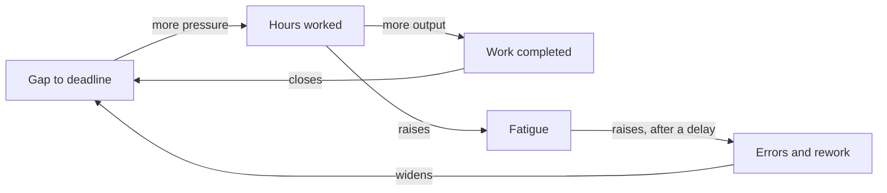

import RetrievalPrompt from '@site/src/components/RetrievalPrompt';
import ModuleMeta from '@site/src/components/ModuleMeta';
import Admonition from '@theme/Admonition';

<ModuleMeta />

## 🗺️ AQAL Mapping

| Dimension | Value |
|---|---|
| **Where** (Quadrants) | It — the system as an observable, analyzable object; Its — the system as embedded in a wider network of interlocking systems |
| **Depth** (Levels) | Rational → Pluralistic (Orange → Green) |
| **Skills** (Lines) | Cognitive, Systems |
| **Experience** (States) | Analytical — a clear-headed, structured mode of attention applied to relationships between parts |
| **Style** (Types) | Systems-thinker; analytical; diagram-based mapping exercise |

This module addresses the exterior (It/Its) quadrants rather than interior experience — it trains a way of *analyzing* systems, not a state of consciousness or a stage of development. It complements the platform's interior-focused states and lines modules by giving learners a structured way to see the systems — teams, families, organizations, ecosystems — within which that interior work takes place.

## 🧭 Orient

This module trains an analytical skill rather than an interior practice — there is no state to enter and no felt experience to cultivate. Before beginning, choose a real system you are currently part of, ideally one with genuine stakes for you, since abstract or hypothetical systems tend to produce diagrams that are technically correct but practically uninteresting.

:::tip Before you read
Take a minute to answer these in your own words before you read on. A wrong guess still helps you learn what follows.

1. A team works harder to meet a deadline, makes more mistakes, and falls further behind. Why might "work harder" be making things worse?
2. If you could change only one thing about a system you belong to, how would you decide which thing?
:::

## 🌿 Encounter

As you begin mapping, expect the system to look messier and more interconnected than you initially assumed — most real systems have more feedback loops and longer delays than a first pass reveals. Resist the urge to simplify the diagram prematurely; the goal at this stage is accurate complexity, not a tidy picture.

## 🧠 Learn

**Systems thinking** = understanding how parts relate to form wholes, and how wholes influence their parts.

Linear thinking: A causes B.  
Systems thinking: A and B influence each other through feedback loops, delays, and emergent properties.

Key concepts:
- **Feedback loop** — output becomes input; reinforcing (amplifying) or balancing (stabilizing)
- **Emergence** — properties that arise from interaction, not reducible to parts
- **Stocks and flows** — stocks are accumulations; flows are rates of change
- **Delays** — time lags between cause and effect that create oscillation
- **Leverage points** — places in a system where small changes have large effects

The opening deadline question is two loops working against each other:

*In words:* a gap to the deadline creates pressure to work more hours. More hours complete more work, which closes the gap: a balancing loop. More hours also build fatigue, which, after a delay, causes errors and rework that widen the gap again: a reinforcing loop. Because of the delay, "work harder" looks like it is working at first, then makes things worse.

## Two Framework Lenses: Systems Dynamics and Donella Meadows' Leverage Points

Systems dynamics (Forrester's stocks-and-flows modeling) supplies this module's core vocabulary — stocks, flows, feedback loops, and delays — as a rigorous, diagrammable way of representing how a system's parts interact over time. **Evidence tier:** B — a foundational modeling framework; its use for personal and psychological systems is an extrapolation.

Donella Meadows' leverage-points framework builds on that vocabulary to answer a more practical question: given a system map, where should a person actually intervene to produce meaningful change, and why do some intervention points (subsidies, taxes) produce far less change than others (goals, paradigms)? **Evidence tier:** B — a widely cited synthesis argued from cases and expert judgment, not a controlled comparison.

These two lenses layer directly: systems dynamics gives you the map, and the leverage-points framework tells you how to read it for action. Used together, they move a learner from simply describing a system accurately to identifying where their own effort is likely to matter — and where it is likely to be wasted on a low-leverage point that feels intuitive but changes little.

## The Limitations of Systems Thinking as a Personal-Development Tool

Systems thinking is a genuinely powerful analytical framework, but it was developed primarily for engineering, ecological, and organizational systems — its fit to the interior, subjective territory of personal development (emotions, meaning-making, identity) is looser than its fit to more mechanical systems, and diagrams of "my family system" or "my emotional patterns" should be read as useful simplifications, not literal descriptions of psychological reality.

The practice also has a characteristic failure mode: intellectualization. Because mapping a system is a cognitive, diagram-based activity, it is possible to produce an elegant causal loop diagram of a painful relational or emotional pattern while remaining entirely disconnected from the felt experience of that pattern — analysis substituting for, rather than supporting, genuine engagement with what is actually happening.

Finally, leverage points identified on a diagram are not automatically actionable. Meadows herself noted that the highest-leverage points (paradigms, goals) are also the hardest to shift and the most resistant to direct intervention — a systems map can show you where change matters most without making that change any easier to actually achieve.

---

## 🧘 Practice

**Duration:** 15–20 min

**Worked example:** a household where the dishes pile up. *Stocks:* dirty dishes; household patience. *Reinforcing loop:* a full sink makes each person less willing to start, so the pile grows. *Balancing loop:* when the pile passes a threshold, someone snaps and cleans it all, and the stock drops back. *Delay:* resentment from the person who always cleans builds for weeks before it shows. *Leverage point:* a rule ("wash your own plate before bed") rather than another argument — it changes the structure, not one person's effort.

Now map your own system:

**Instructions:**
1. Choose a system you are part of (team, family, organization, ecosystem)
2. Identify 3–5 key elements (stocks)
3. Map the flows between them with arrows
4. Identify at least one reinforcing loop (virtuous or vicious cycle)
5. Identify at least one balancing loop (homeostatic mechanism)
6. Note one delay and one leverage point

---

## 🔍 Reflect

- What surprised you about the system you mapped? Why didn't you see it before you drew the map?
- Where do you see yourself creating unintended consequences? How does your own behavior feed one of the loops?
- What delay in the system is causing the most confusion? How would the people in it act differently if they could see it?
- Where is the highest-leverage intervention point, and why would a change there outlast more effort somewhere else?
- Think of a time a fix you tried made a problem worse. Which loop explains what happened?

---

## 📊 Assess (Self + Structured)

| Level | Indicator |
|-------|-----------|
| 1 | Understands that systems have interconnected parts |
| 2 | Can identify feedback loops in simple systems |
| 3 | Maps complex systems with multiple loops and delays: your map labels at least one reinforcing loop, one balancing loop and one delay |
| 4 | Uses systems maps to design interventions and anticipate consequences: you can point to a change you made, the loop it targeted, and what happened next |

**Passing threshold:** Level 3: you have mapped a real system you are part of, with at least two feedback loops and one delay.

---

## The Gifts of Systems Thinking

The single most durable gift of this practice is a shift away from blaming individual actors (yourself included) toward seeing behavior as an output of a system's structure. A recurring conflict, a stalled project, or a personal habit that resists willpower alone often makes more sense — and becomes more tractable — once it is seen as the predictable output of a feedback loop rather than a moral failing.

Systems thinking also builds a specific form of patience: understanding delays helps explain why an intervention that seems to be failing may simply not have had time to show its effect yet, and why an intervention that seems to be working may be producing a temporary result that a balancing loop will later undo. This reduces the common error of abandoning a sound intervention too early, or doubling down on one that is only working in the short term.

Finally, the leverage-points framework gives learners a genuinely practical prioritization tool: instead of treating every possible intervention as equally worth trying, it directs attention toward the handful of places — goals, rules, information flows, paradigms — where effort is disproportionately likely to matter.

## Stabilize

**Consolidation, not achievement:** There is no final, complete systems map to produce — real systems keep changing, and a map that was accurate six months ago may already be missing a new feedback loop. What stabilises with practice is not a finished diagram but the habit of asking systems-thinking questions (What loop is this? What's the delay? Where's the leverage?) automatically, in the moment, rather than only in a dedicated mapping exercise.

**A baseline for everything else:** The analytical habits this module builds — looking for loops, delays, and leverage rather than single causes — are a general-purpose lens that supports, rather than replaces, the platform's more interior-focused emotional, states, and shadow-integration work. Seeing the system a difficult pattern lives in does not substitute for feeling and processing that pattern directly.

**Back to your opening questions:** working harder closes the deadline gap at first, but fatigue feeds errors and rework back into the gap after a delay, so effort alone can widen it (the diagram in Learn). To choose the one thing to change, look for a leverage point: rules, goals and information flows usually change behavior more than pushing harder on one part.

## 🔄 Integrate

Apply this in real life:
- Before intervening, ask: "What feedback loops am I triggering?"
- When a solution fails, look for the balancing loop you missed
- Draw a causal loop diagram for one recurring problem in your life

---

## 📚 Evidence and Citations

Evidence quality uses Tier A (primary research or strong empirical base) and Tier B (theoretical synthesis or clinical-practitioner evidence). See the [Evidence Vetting Checklist](/internal/quality/evidence-vetting-checklist) for the full tier definitions.

| Claim | Source | Quality | Caveat |
|---|---|---|---|
| Systems dynamics — stocks, flows, feedback loops, and delays as a modeling framework | Forrester, J.W. *Industrial Dynamics* (1961), MIT Press | Tier B — foundational theoretical and applied-engineering framework | Originally developed for industrial and organizational systems; application to personal/psychological systems is an extrapolation |
| Leverage points — a hierarchy of places to intervene in a system, from parameters to paradigms | Meadows, D.H. "Leverage Points: Places to Intervene in a System." Sustainability Institute (1999); Meadows, D.H. *Thinking in Systems* (2008), Chelsea Green | Tier B — widely cited theoretical synthesis by a leading systems-dynamics practitioner | Ranking of leverage points is argued from case examples and expert judgment, not a controlled comparative study |
| Systems thinking pedagogy improves problem-solving and reduces "event-level" thinking in learners | Sweeney, L.B. & Sterman, J.D. "Bathtub dynamics: initial results of a systems thinking inventory." *System Dynamics Review* 16(4), 2000 | Tier A — empirical study of systems-thinking comprehension | Measures comprehension of simple stock-flow tasks; does not directly test personal-development transfer |

---

## Safety Note

**Tier:** 1 — Standard reflective content

This module involves analytical reflection and mapping of systems you are part of. If this practice surfaces significant distress — for example, mapping a family or relationship system that touches on genuine conflict — pause and speak with a trusted person. This content is educational, not therapeutic.

---

<Admonition type="tip" title="Facilitator Note">
- This is an analytical, diagram-based module — keep the focus on mapping observable structure rather than drifting into unstructured emotional processing, which belongs to other modules.
- Encourage learners to pick a real, currently-relevant system rather than an abstract example; diagrams of real stakes produce far more useful insight.
- Watch for over-intellectualization — a learner producing an elegant, detached diagram of a painful pattern without any felt engagement with it. Gently ask what it would feel like to sit with the pattern itself, not just the map.
- If mapping a family or relationship system surfaces genuine distress, follow the Safety Note: pause the analytical exercise and check in directly.
</Admonition>

<RetrievalPrompt moduleName="Systems Thinking 101" cards={[
  {q: "What is a feedback loop?", a: "A causal chain where output becomes input, either reinforcing or balancing the system"},
  {q: "What is emergence in systems thinking?", a: "Properties that arise from the interaction of parts and cannot be reduced to any single part"},
  {q: "What is a leverage point?", a: "A place in a system where small changes produce large effects"},
  {q: "What is the difference between a reinforcing and balancing loop?", a: "Reinforcing loops amplify change (growth or collapse); balancing loops stabilize the system toward a goal"}
]} />

## ⏱️ Retrieval Schedule

| Interval | Activity |
|---|---|
| 24 hours | Revisit your system map; add or revise one feedback loop you missed the first time |
| 72 hours | Answer the Reflect questions in your journal; identify the delay causing the most confusion |
| 7 days | Complete the Assess rubric for the first time; identify your current level |
| 14 days | Repeat the Assess rubric; draw a causal loop diagram for one recurring problem in your life, as suggested in Integrate |

