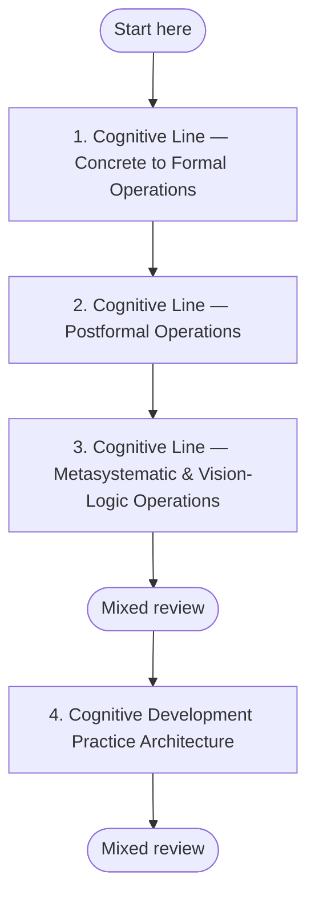

## 🧠 Cognitive Line Development (QuickStart)

**Why this sequence?** Cognitive development follows a structural progression: concrete operations → formal operations → postformal/systemic → metasystematic/vision-logic. Each stage transcends and includes the previous one. This sequence builds from foundational logical thinking through increasingly complex forms of reasoning, ending with the practice architecture that lets you apply these capacities deliberately.
## Plan your pathway

Self-paced learning works better when you decide before you start. **Write one if-then plan now:** *"When [time/place], I will [first step]."* For example: "When I finish my morning coffee, I will open **Cognitive Line — Concrete to Formal Operations** and work on it for 20 minutes." If-then plans help people follow through on goals (Gollwitzer & Sheeran, 2006).

**Suggested pace:** one weekly complexity practice, and one module at a time. Cognitive operations develop over years, so the module-by-module pace is yours to set; move on when you meet the threshold, not by the calendar.

**Visible progress:** [My Progress](../my-progress) shows the modules you have completed and the reviews due. It is stored only in your browser, and you can clear it at any time.

**Mixed review:** After every third module, run a mixed review on [My Progress](../my-progress). It mixes questions from the earlier modules instead of one module at a time, so it feels harder than rereading, and that effort is what builds lasting memory.

**Mastery before moving on:** Each module's Assess section sets a passing threshold. Meet it before you start the next module; if you do not, repeat the practices first. This gate is advisory: the site cannot check it for you, so be honest with yourself.

*In words:* start at step 1 and work in order. Your place in the path is the last module marked complete on My Progress. A mixed review follows every third module.

| Step | Module | Pass when |
|---|---|---|
| 1 | [Cognitive Line — Concrete to Formal Operations](../modules/cognitive-line-concrete-to-formal) | At least three criteria at *Developing* or above. |
| 2 | [Cognitive Line — Postformal Operations](../modules/cognitive-line-postformal-operations) | At least three criteria at *Developing* or above, with at least one at *Stable*. |
| 3 | [Cognitive Line — Metasystematic & Vision-Logic Operations](../modules/cognitive-line-metasystematic-vision-logic) | At least four criteria at *Developing* or above, with at least two at *Stable*. Given the developmental rarity of genuine metasystematic operations, *Developing* on all criteria is a strong and legitimate result. |
| 4 | [Cognitive Development Practice Architecture](../modules/cognitive-line-practice-architecture) | 12/16 with no criterion below 2. |

---

## Operations vs. Content vs. Style (Start Here)

Many high-achieving learners confuse these three:

- **Cognitive operations (structure):** the complexity of the thinking process you can run.
- **Cognitive content (information):** what facts, concepts, and domain knowledge you know.
- **Cognitive style (personality):** your preferred way of approaching problems (e.g., analytical, intuitive, fast, cautious).

Three concrete examples:

1. **A physician with elite medical knowledge (content) can still reason mostly in formal either/or categories (operations), while having a decisive style (style).**
2. **A policy analyst with a systems-thinking style (style) can still struggle to integrate multiple conflicting systems at once if metasystematic operations are not yet stable (operations), even with excellent data literacy (content).**
3. **A founder who reads widely across strategy books (content) and prefers big-picture pattern language (style) may still default to single-framework reasoning under pressure if postformal operations are not consolidated (operations).**

The key distinction: **knowing more is not the same as being able to think with higher-order operations.**

---

## Overview

This QuickStart is the entry path for Cognitive line development. It helps you identify your current operations profile and choose a realistic starting sequence through the Cognitive Line module suite.

---

## AQAL Mapping

| Dimension | Emphasis in this QuickStart |
|---|---|
| **Quadrants** | I (interior structure of meaning-making), We (shared reasoning cultures and discourse norms), It (observable reasoning performance), Its (institutional cognitive demands) |
| **Levels** | Concrete-formal through postformal and metasystematic |
| **Lines** | Cognitive line (primary), with explicit linkage to moral, interpersonal, and leadership expressions |
| **States** | Reflective, grounded inquiry in ordinary waking state |
| **Types** | Analytical-first, relational-first, and integrative-first learners can all use this path |

---

## Why Cognitive Line Development Matters

Higher cognitive operations are not an abstract badge. They change outcomes in real life:

1. **Leadership:** Stage-limited cognitive operations cap leadership effectiveness, especially when teams, markets, and stakeholders require multi-system coordination.
2. **Ethics:** Cognitive operations set the ceiling for moral reasoning complexity; if operations remain narrow, ethical judgment remains structurally narrow.
3. **Relationships:** Robust perspective-taking requires specific cognitive operations; empathy alone cannot replace the structural ability to coordinate perspectives.
4. **Creativity and innovation:** Metasystematic operations enable genuine novelty by integrating and transforming multiple systems, not just optimizing one existing frame.

---

## Three Entry Points by Current Cognitive Operations Profile

Use the entry point that best matches your current operations profile.

| If your current profile is primarily... | Start here | Then continue with |
|---|---|---|
| **Concrete-formal** | [Cognitive Line — Concrete to Formal](../modules/cognitive-line-concrete-to-formal) ([Issue #79](https://github.com/paruff/integral-education/issues/79)) | [Cognitive Line — Postformal Operations](../modules/cognitive-line-postformal-operations) ([Issue #80](https://github.com/paruff/integral-education/issues/80)) |
| **Formal-postformal** | [Cognitive Line — Postformal Operations](../modules/cognitive-line-postformal-operations) ([Issue #80](https://github.com/paruff/integral-education/issues/80)) | [Cognitive Line — Practice Architecture](../modules/cognitive-line-practice-architecture) ([Issue #82](https://github.com/paruff/integral-education/issues/82)) |
| **Postformal, approaching metasystematic** | [Cognitive Line — Metasystematic / Vision-Logic](../modules/cognitive-line-metasystematic-vision-logic) ([Issue #81](https://github.com/paruff/integral-education/issues/81)) | [Cognitive Line — Practice Architecture](../modules/cognitive-line-practice-architecture) ([Issue #82](https://github.com/paruff/integral-education/issues/82)) |

---

## Learn

Study one structural distinction at a time: formal vs. postformal, postformal vs. metasystematic, and operations vs. content/style confusion.

## Practice

Run one weekly complexity practice: compare two valid but conflicting frameworks and document where each explains reality better or worse.

## Reflect

Weekly prompt: **"Where did I mistake high information confidence for higher-order cognitive operations this week?"**

## Assess

At the end of each module, score (1–4): perspective-coordination range, contradiction tolerance, cross-system integration quality, and transfer to live decisions.

## Integrate

Apply one cognitive distinction each week to a real decision in leadership, ethics, relationships, or innovation. Track behavioral evidence, not just conceptual fluency.

---

## Cognitive Development Takes Time

Cognitive operations typically develop over **years of sustained engagement** with appropriately challenging material and feedback loops, not in a few weeks of curriculum. This QuickStart is a scaffold for that long-horizon process, not a shortcut.

---

## Companion Stage-Development QuickStarts

Use these stage paths alongside this Cognitive line path. Each stage transition requires specific cognitive operations:

- [Amber → Rational](./amber-to-rational): requires **consolidated formal operations** (hypothetical-deductive reasoning, second-order reflection).
- [Rational → Pluralistic](./rational-to-pluralistic): requires **stable postformal operations** (context-sensitive, multiperspectival, dialectical coordination).
- [Pluralistic → Integral](./pluralistic-to-integral): requires **metasystematic operations** (integration of multiple complete systems into higher-order synthesis).

---

## Retrieval Schedule

- **24 hours:** Restate the operations/content/style distinction in your own words and apply it to one real task.
- **72 hours:** Analyze one current challenge using two different frameworks; note where your operations ceiling appeared.
- **7 days:** Review your decision log and choose one next practice that increases structural complexity, not just information intake.

---

## Evidence and Citations

| Claim | Source | Quality Tier | Caveat |
|---|---|---|---|
| Cognitive development proceeds through structural stages that differ from accumulated content knowledge | Piaget, J. (1952/1970). *The Origins of Intelligence in Children*; *Piaget's Theory*. | Tier B | Classical stage work has measurement and cultural-context limitations. |
| Adult cognitive development can move beyond formal operations into postformal forms | Basseches, M. (1984). *Dialectical Thinking and Adult Development*; Sinnott, J. (1998). *The Development of Logic in Adulthood*. | Tier B | Operational definitions vary across postformal frameworks. |
| Cognitive complexity influences leadership effectiveness in complex environments | Kegan, R., & Lahey, L. (2016). *An Everyone Culture*; Torbert, W., & Rooke, D. (2005). "Seven Transformations of Leadership". | Tier B/C | Organizational findings are context-dependent and not uniformly causal. |
| Cognitive operations constrain meaning-making complexity in adulthood | Kegan, R. (1994). *In Over Our Heads*. | Tier B | Constructive-developmental models are influential but interpretive. |
