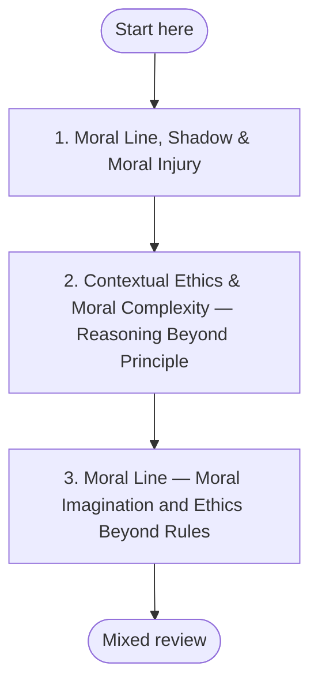

## Moral Line QuickStart

**Why this sequence?** Moral reasoning develops along two complementary tracks: justice/rights (Kohlberg) and care/responsibility (Gilligan). This dual-track architecture ensures you develop both principled reasoning and contextual care — not one at the expense of the other. The sequence moves from conventional through postconventional to applied integral ethics.
## Plan your pathway

Self-paced learning works better when you decide before you start. **Write one if-then plan now:** *"When [time/place], I will [first step]."* For example: "When I finish my morning coffee, I will open **Moral Line, Shadow & Moral Injury** and work on it for 20 minutes." If-then plans help people follow through on goals (Gollwitzer & Sheeran, 2006).

**Suggested pace:** the step estimates in the sequenced pathway below: 2, 3 and 4 weeks, about 9 weeks in all. Work on your own live moral challenges alongside each module.

**Visible progress:** [My Progress](../my-progress) shows the modules you have completed and the reviews due. It is stored only in your browser, and you can clear it at any time.

**Mixed review:** After every third module, run a mixed review on [My Progress](../my-progress). It mixes questions from the earlier modules instead of one module at a time, so it feels harder than rereading, and that effort is what builds lasting memory.

**Mastery before moving on:** Each module's Assess section sets a passing threshold. Meet it before you start the next module; if you do not, repeat the practices first. This gate is advisory: the site cannot check it for you, so be honest with yourself.

*In words:* start at step 1 and work in order. Your place in the path is the last module marked complete on My Progress. A mixed review follows every third module.

| Step | Module | Pass when |
|---|---|---|
| 1 | [Moral Line, Shadow & Moral Injury](../modules/moral-line-shadow-moral-injury) | At least three criteria at *Developing* or above. |
| 2 | [Contextual Ethics & Moral Complexity — Reasoning Beyond Principle](../modules/contextual-ethics-moral-complexity) | Stable in at least three of five criteria, Developing in the remainder, no Not-yet ratings remaining after a second attempt. |
| 3 | [Moral Line — Moral Imagination and Ethics Beyond Rules](../modules/moral-line-imagination-integral-ethics) | At least three criteria at *Developing* or above, including Four-framework articulation and Moral imagination application. |

---

## The Knowledge-Action Gap
Moral development is not primarily about knowing more ethics. It is about developing the structural capacity for more complex moral reasoning AND the character to act from that reasoning. This path addresses both.

## Dual-Track Architecture
Our approach integrates justice and care tracks as parallel, foundational developmental arcs. Neither is reducible to the other; they function as a unified framework for moral reasoning.

## Why Moral Line Development?
The structural development of your moral line directly dictates how you navigate four practical domains of everyday life:
1. **Conflict Resolution:** Moving from win-lose dynamics to multi-perspective resolutions.
2. **Leadership:** Making ethical organizational decisions under systemic pressure.
3. **Parenting &amp; Teaching:** Modeling post-conventional reasoning for the next generation.
4. **Civic Participation:** Engaging with complex societal issues beyond tribal polarization.

## The Sequenced Pathway
1. **The Moral Shadow (Step 1):** Uncover unconscious biases and defensive mechanisms. (Estimated time: 2 weeks)
2. **Contextual Ethics (Step 2):** Apply ethical principles across varying cultural frameworks. (Estimated time: 3 weeks)
3. **Integral Ethics (Step 3):** Synthesize justice and care tracks into lived behavior. (Estimated time: 4 weeks)
## Moral Development Requires Moral Challenge

Moral development is catalyzed by genuine moral dilemmas, not by reading about ethics. To work through this path effectively, identify 2–3 real, unresolved moral challenges in your own life to use as personal case studies.

## Scope

This QuickStart provides a conceptual map and practice framework for moral line development. It does not claim to produce structural moral-stage advancement through self-guided content alone. Durable moral development typically requires sustained relational engagement — dialogue with others who see moral complexity differently, exposure to genuine ethical dilemmas, and repeated feedback over time. Use this path as preparation and reflection infrastructure; pair it with the relationships and life experience that drive moral growth. See [What This Platform Can and Cannot Do](../about/what-this-platform-does).

## Companion Materials
For deep-dives into these concepts, refer to the core modules:
- Moral Shadow Exploration
- Contextual Ethics Framework
- Integral Ethics Integration
