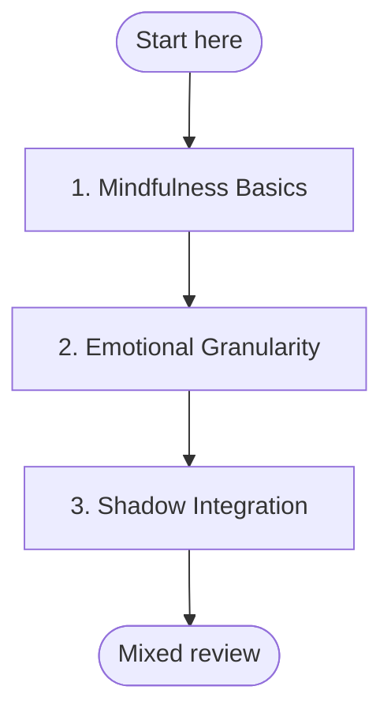

import Term from '@site/src/components/Term';

## 🧭 Personal → Integral (QuickStart)

**Why this sequence?** This path works from foundation to application. Mindfulness establishes the witnessing capacity that makes emotional work possible — you cannot name what you cannot notice. Emotional granularity then provides the precision needed for shadow work: tracking projections requires knowing exactly what you feel and why. Each step builds the capacity the next step requires.
**Goal:** Move from conventional self-awareness to an integral, multi-perspectival understanding of yourself and the world.

**Time commitment:** 3–6 weeks (20–30 min/day)

---

## Plan your pathway

Self-paced learning works better when you decide before you start. **Write one if-then plan now:** *"When [time/place], I will [first step]."* For example: "When I finish my morning coffee, I will open **Mindfulness Basics** and work on it for 20 minutes." If-then plans help people follow through on goals (Gollwitzer & Sheeran, 2006).

**Suggested pace:** 20–30 minutes a day for 3–6 weeks.

**Visible progress:** [My Progress](../my-progress) shows the modules you have completed and the reviews due. It is stored only in your browser, and you can clear it at any time.

**Mixed review:** After every third module, run a mixed review on [My Progress](../my-progress). It mixes questions from the earlier modules instead of one module at a time, so it feels harder than rereading, and that effort is what builds lasting memory.

**Mastery before moving on:** Each module's Assess section sets a passing threshold. Meet it before you start the next module; if you do not, repeat the practices first. This gate is advisory: the site cannot check it for you, so be honest with yourself.

*In words:* start at step 1 and work in order. Your place in the path is the last module marked complete on My Progress. A mixed review follows every third module.

| Step | Module | Pass when |
|---|---|---|
| 1 | [Mindfulness Basics](../modules/mindfulness-basics) | Level 3: you can sit for 5 minutes or more and return to the breath within seconds each time you notice drift. |
| 2 | [Emotional Granularity](../modules/emotional-granularity) | *Proficient* on both indicators. |
| 3 | [Shadow Integration](../modules/shadow-integration-101) | Level 3: you have owned at least one disowned trait and can relate to it with compassion rather than blame. |

---

## Step 1: Mindfulness

**Module:** [Mindfulness Basics](../modules/mindfulness-basics)

Establish a stable foundation of present-moment awareness before proceeding.

- Practice daily seated meditation (10 min minimum)
- Notice the difference between being *in* experience vs. *observing* experience
- **Goal:** Sustain attention for 10 minutes with minimal drift

As you practice, you will begin working with different <Term term="States" definition="Temporary conditions of consciousness — waking (gross), dreaming (subtle), deep sleep (causal), and nondual (witness)." /> of consciousness — from ordinary waking awareness to more refined states as your practice deepens. This is the foundation for developing across multiple <Term term="Lines" definition="Specific developmental domains such as cognitive, emotional, interpersonal, moral, somatic, spiritual, and self — each growing through stages independently." /> simultaneously.

---

## Step 2: Emotional Awareness

**Module:** [Emotional Granularity](../modules/emotional-granularity)

Expand your emotional vocabulary and precision.

- Move beyond "good/bad" to specific emotional states
- Name emotions as they arise during practice
- **Goal:** Identify 5+ distinct emotional states daily

Developing emotional <Term term="Lines" definition="Lines of development grow through stages. The emotional line involves your capacity to feel, differentiate, and regulate emotion." /> awareness is a key part of working with all four <Term term="Quadrants" definition="The four perspectives: I (interior-individual), It (exterior-individual), We (interior-collective), Its (exterior-collective)." /> — your inner emotional world (I), your observable behaviour (It), your relationships (We), and the systems you participate in (Its).

---

## Step 3: Shadow Work

**Module:** [Shadow Integration 101](../modules/shadow-integration-101)

Reclaim disowned aspects of yourself.

- Track emotional triggers for 24 hours
- Identify recurring projections onto others
- **Goal:** Own at least one previously disowned trait

This step introduces <Term term="Shadow" definition="The parts of ourselves we have disowned, repressed, or projected onto others — including both negative and positive qualities we cannot own." /> — the parts of yourself you have learned to disown. A key practice is recognising <Term term="Projection" definition="The unconscious act of attributing your own disowned feelings or traits to someone else. If you react strongly to a quality in another, ask: 'Do I have this quality myself?'" />, where you attribute disowned qualities to others. This is foundational <Term term="Shadow" definition="Shadow work: the practice of reclaiming disowned parts of self with compassion and awareness." /> work that prepares you for more advanced practices.

---

## Outcome

By completing this QuickStart, you will have developed:

- ✅ Increased self-awareness (I <Term term="Quadrant" definition="The I quadrant covers interior-individual experience — your thoughts, feelings, sensations, and states of consciousness." />)
- ✅ Reduced emotional reactivity
- ✅ Initial shadow awareness — the ability to recognise patterns you usually project onto others

These three modules focus on the I quadrant (first-person interior skills). Systems thinking and multi-perspective integration are addressed in later paths — see Next Steps below.

---

## Next Steps

After completing this QuickStart, explore:

- [Systems Thinking 101](../modules/systems-thinking-101) — develop a systems perspective and expand to collective quadrants
- [AQAL Overview](../maps/aqal-overview) — understand the full map
- [AQAL Glossary](../maps/glossary) — plain-language definitions for all terms
- [Daily Reflection Template](../reflections/daily-template) — track your ongoing growth
