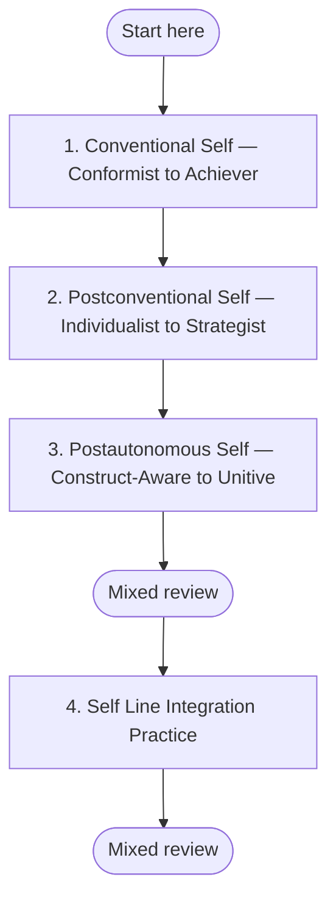

## 🧭 Self Line Development (QuickStart)

**Why this sequence?** Self-line development follows a specific unfolding: you must first understand how identity is constructed at your current stage before you can see the next stage as a genuine possibility. This sequence moves from overview (where are you now?) through the three major tiers — Conventional, Postconventional, Postautonomous — to integration practice that brings the whole arc together.
## Plan your pathway

Self-paced learning works better when you decide before you start. **Write one if-then plan now:** *"When [time/place], I will [first step]."* For example: "When I finish my morning coffee, I will open **Conventional Self — Conformist to Achiever** and work on it for 20 minutes." If-then plans help people follow through on goals (Gollwitzer & Sheeran, 2006).

**Suggested pace:** 2–3 reflection sessions a week while you move through the modules. Expect years, not weeks; move on when you meet the threshold, not by the calendar.

**Visible progress:** [My Progress](../my-progress) shows the modules you have completed and the reviews due. It is stored only in your browser, and you can clear it at any time.

**Mixed review:** After every third module, run a mixed review on [My Progress](../my-progress). It mixes questions from the earlier modules instead of one module at a time, so it feels harder than rereading, and that effort is what builds lasting memory.

**Mastery before moving on:** Each module's Assess section sets a passing threshold. Meet it before you start the next module; if you do not, repeat the practices first. This gate is advisory: the site cannot check it for you, so be honest with yourself.

*In words:* start at step 1 and work in order. Your place in the path is the last module marked complete on My Progress. A mixed review follows every third module.

| Step | Module | Pass when |
|---|---|---|
| 1 | [Conventional Self — Conformist to Achiever](../modules/self-line-conventional-conformist-achiever) | Four or more criteria at *Developing* or *Stable*, including Conventional Self Archaeology and Pre/Trans discrimination. |
| 2 | [Postconventional Self — Individualist to Strategist](../modules/self-line-postconventional-individualist-strategist) | Four or more criteria at *Developing* or *Stable*, including Individualist grief recognition and Pre/Trans discrimination. |
| 3 | [Postautonomous Self — Construct-Aware to Unitive](../modules/self-line-postautonomous-construct-aware-unitive) | Four or more criteria at *Developing* or *Stable*, including Wilber-Combs lattice and Epistemic humility. |
| 4 | [Self Line Integration Practice](../modules/self-line-integration-practice) | 14/20 with no criterion below 2. |

---

## Line vs. Stage Distinction

This QuickStart develops the **Self line specifically**, not your overall developmental stage center of gravity. In psychograph terms, your development is not one single line rising at the same speed; it is a profile of multiple lines developing unevenly over time. The Self line is one of those lines, and this page focuses on that line.

By contrast, the [Amber → Rational](./amber-to-rational), [Rational → Pluralistic](./rational-to-pluralistic), and [Pluralistic → Integral](./pluralistic-to-integral) QuickStarts are **stage-transition pathways**. Those paths focus on broader center-of-gravity movement across multiple lines. This path is different: it can be entered from any current center of gravity and is calibrated to your likely starting point.

A learner at Amber can begin meaningful Self line work. A learner at Teal can too. The question here is not "What stage am I at?" but "How is my Self line currently organizing meaning-making, and what practices help it mature with honesty over time?"

---

## Overview

This QuickStart is a practical orientation for Self/Ego line development using stage-calibrated entry points into the Self Line module suite.

**Timeline reality:** expect this work to unfold over years, not weeks.

---

## AQAL Mapping

| Dimension | Emphasis in this QuickStart |
|---|---|
| **Quadrants** | I (meaning-making and identity structure), We (relational mirrors and feedback), It (observable behavior change), Its (contexts that support or constrain ego development) |
| **Levels** | Cross-stage entry from conventional through postautonomous territories |
| **Lines** | Self/Ego line (primary), with explicit support from shadow, cognitive, emotional, and interpersonal lines |
| **States** | Reflective baseline (state practice is supportive, not the main driver of Self line stage movement) |
| **Types** | Self-paced learning with strong recommendation for relationally supported practice |

---

## Three Entry Points by Current Center of Gravity

Use the entry point that best matches your current center of gravity.

| If your current center of gravity is primarily... | Start here | Then continue with |
|---|---|---|
| **Amber/Conformist → Expert** | [Conventional Self — Conformist to Achiever](../modules/self-line-conventional-conformist-achiever) | [Self Line Integration Practice](../modules/self-line-integration-practice) |
| **Rational/Achiever → Individualist** | [Postconventional Self — Individualist to Strategist](../modules/self-line-postconventional-individualist-strategist) | [Conventional Self — Conformist to Achiever](../modules/self-line-conventional-conformist-achiever), then [Self Line Integration Practice](../modules/self-line-integration-practice) |
| **Pluralistic/Green → Teal** | [Postconventional Self — Individualist to Strategist](../modules/self-line-postconventional-individualist-strategist) | [Postautonomous Self — Construct-Aware to Unitive](../modules/self-line-postautonomous-construct-aware-unitive), then [Self Line Integration Practice](../modules/self-line-integration-practice) |

---

## Learn

Focus on understanding how Self line development differs from stage-transition learning:

- Stage transition paths address broad center-of-gravity development.
- This path targets the Self line's meaning-making structure specifically.
- Progress is better measured through longitudinal shifts in self-authorship, perspective-taking, and integration capacity than by short-term conceptual fluency.

---

## What Actually Develops the Self Line

Cook-Greuter-aligned findings and adjacent developmental research consistently point to four primary accelerants: **lived challenge**, **relational encounter**, **sustained reflection**, and **shadow integration**. In practice, this means real-life contradiction, meaningful feedback relationships, repeated structured self-observation, and ongoing retrieval of projection.

Curriculum engagement is therefore a **supporting accelerant, not a primary one**. This QuickStart gives you conceptual scaffolding and practice structure; life experience in a real relational field is what actually drives ego-structure reorganization over time.

---

## Practice

- Maintain weekly contact with disconfirming perspectives you cannot easily assimilate.
- Use a recurring reflection cadence (2–3 times weekly) while moving through modules.
- Add relational debriefs (peer, coach, or facilitator) to reduce self-sealing interpretation.
- Pair Self line work with [Shadow Work (QuickStart)](./shadow-work) as the most direct complementary accelerant.

---

## Reflect

Use this weekly prompt: **"Where did my current meaning-making structure become visible this week, and what challenged it?"**

---

## Assess

Monthly self-check (1–4 scale):

1. Openness to contradiction without collapse or defensiveness  
2. Capacity to receive relational feedback honestly  
3. Evidence of reduced projection and increased ownership  
4. Consistency between stated values and enacted behavior

---

## Integrate

Treat this path as one strand in a larger developmental architecture:

- Foundational stage pathways: [Personal → Integral](./personal-to-integral), [Amber → Rational](./amber-to-rational), [Rational → Pluralistic](./rational-to-pluralistic), [Pluralistic → Integral](./pluralistic-to-integral)
- Direct complementary practice: [Shadow Work (QuickStart)](./shadow-work)

---

## Timeline Honesty

"Ego development typically unfolds over years to decades. This path is a conceptual scaffold and practice framework, not a development accelerator. The practices here can support your development, but cannot substitute for the life experiences that drive it."

---

## Retrieval Schedule

- **24 hours:** Re-read your entry-point module notes and identify one real-life contradiction from the prior day.
- **72 hours:** Complete one relational debrief and one shadow projection check-in.
- **7 days:** Review your weekly reflection entries and select one concrete behavior adjustment for next week.

---

## Evidence and Citations

| Claim | Source | Quality Tier | Caveat |
|---|---|---|---|
| Ego development typically unfolds over long time horizons and is uneven across populations | Cook-Greuter, S. (2000). *Mature Ego Development*. Journal of Adult Development, 7(4). | Tier B | Longitudinal and cross-sectional data are strong in developmental psychology contexts but not intervention-trial based. |
| Ego development is driven by meaning-making reconstruction under contradiction and reflection | Kegan, R. (1994). *In Over Our Heads*. Harvard University Press. | Tier B | Theory-rich and practice-informed; not an RCT literature base. |
| Relational challenge/confirmation/continuity conditions support adult developmental movement | Kegan, R., & Lahey, L. (2009). *Immunity to Change*. Harvard Business Press. | Tier B | Applied developmental framework; organizational context may limit generalization. |
| Shadow integration supports developmental coherence by reducing projection and disowned material | Wilber, K., Patten, T., Leonard, A., & Morelli, M. (2008). *Integral Life Practice*. Integral Books. | Tier C | Integrative framework text; empirical support varies by component practice. |
