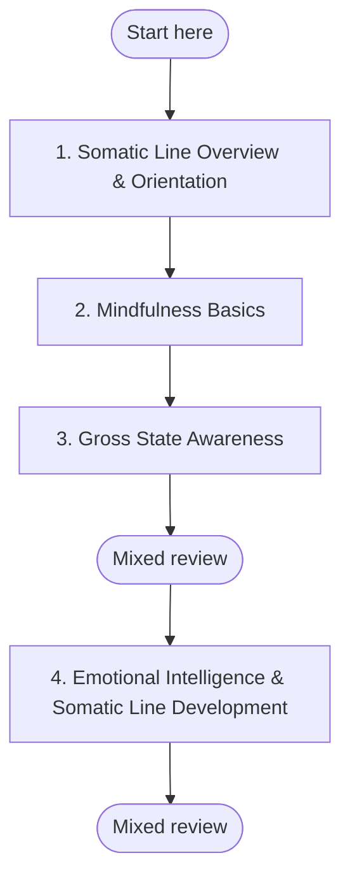

## Somatic Line Development (QuickStart)

**Goal:** Build interoceptive awareness, nervous system regulation, and embodied presence — the somatic infrastructure that supports all other developmental work.

**Time commitment:** 4–6 weeks (15–25 min/day)

**Why this sequence?** Somatic development follows a natural progression: you must first learn to notice what your body is doing (interoceptive awareness) before you can influence it (regulation), and you must be able to regulate yourself before you can use body signals as reliable information during complex tasks (integration). This sequence moves from awareness through regulation to applied embodiment. Each step builds the capacity the next step requires.

---

## Plan your pathway

Self-paced learning works better when you decide before you start. **Write one if-then plan now:** *"When [time/place], I will [first step]."* For example: "When I finish my morning coffee, I will open **Somatic Line Overview & Orientation** and work on it for 20 minutes." If-then plans help people follow through on goals (Gollwitzer & Sheeran, 2006).

**Suggested pace:** 15–25 minutes a day for 4–6 weeks.

**Visible progress:** [My Progress](../my-progress) shows the modules you have completed and the reviews due. It is stored only in your browser, and you can clear it at any time.

**Mixed review:** After every third module, run a mixed review on [My Progress](../my-progress). It mixes questions from the earlier modules instead of one module at a time, so it feels harder than rereading, and that effort is what builds lasting memory.

**Mastery before moving on:** Each module's Assess section sets a passing threshold. Meet it before you start the next module; if you do not, repeat the practices first. This gate is advisory: the site cannot check it for you, so be honest with yourself.

*In words:* start at step 1 and work in order. Your place in the path is the last module marked complete on My Progress. A mixed review follows every third module.

| Step | Module | Pass when |
|---|---|---|
| 1 | [Somatic Line Overview & Orientation](../modules/somatic-line-overview) | Three or more criteria at *Developing* or *Stable*. |
| 2 | [Mindfulness Basics](../modules/mindfulness-basics) | Level 3: you can sit for 5 minutes or more and return to the breath within seconds each time you notice drift. |
| 3 | [Gross State Awareness](../modules/gross-state-awareness) | Three or more criteria at *Developing* or *Stable* after two weeks of consistent practice. |
| 4 | [Emotional Intelligence & Somatic Line Development](../modules/emotional-intelligence-somatic-line) | A score of 3 or 4 on at least 4 of 6 dimensions indicates the module competencies are consolidating. A score of 1 or 2 on Regulatory Integration or Pre/Trans Discernment indicates that more foundational regulatory work is needed before the module's more advanced practices are safe to deepen. |

---

## Step 1: Foundation — Body Awareness

**Module:** [Somatic Line Overview](../modules/somatic-line-overview)

Establish the conceptual map and baseline practice. Learn what the somatic line is, how it develops, and what interoception actually feels like.

- Complete the 25-minute Somatic Baseline Scan
- Identify which body regions feel most alive and which feel quietest
- **Goal:** Describe at least 3 body regions with specific sensory qualities (temperature, tension, texture)

This module introduces the distinction between physical exercise (Body) and nervous system regulation (Somatic) — two practices that are often confused.

---

## Step 2: Regulation — Breath and Grounding

**Module:** [Mindfulness Basics](../modules/mindfulness-basics)

Build the witnessing capacity needed for somatic work. Mindfulness provides the stable observation platform without which body awareness becomes overwhelming rather than informative.

- Practice daily seated meditation (10 min minimum, shorter sessions fine for beginners)
- Notice the difference between being *in* experience and *observing* experience
- Pay special attention to the physical sensations of breathing — not controlling the breath, just noticing it
- **Goal:** Sustain attention on breath for 5+ minutes with gentle return after mind-wandering

**No prescribed breath ratios.** The goal is awareness and regulation through natural attention — not performance or forced patterns. If you find yourself counting or controlling, return to simply noticing.

---

## Step 3: Embodiment — Body as Anchor

**Module:** [Gross State Awareness](../modules/gross-state-awareness)

Extend body awareness from seated meditation into ordinary waking life. Learn to ground in your body during daily activities — conversations, meals, transitions between tasks.

- Practice the body-anchor technique: feet on floor, one breath, name one sensation
- Notice the felt difference between drowsy waking, alert attention, and activated stress
- **Goal:** Identify your current regulation state (regulated, hyperaroused, hypoaroused) without needing to change it first

This step is the bridge between formal practice and real life. The body becomes an anchor you can access in seconds, not just during dedicated practice time.

---

## Step 4: Integration — Somatic Intelligence in Action

**Module:** [Emotional Intelligence & Somatic Line Development](../modules/emotional-intelligence-somatic-line)

Apply somatic awareness to emotional and relational contexts. Learn to use body signals as real-time information during conversations, decisions, and emotionally charged moments.

- Track how different emotions show up in different body regions
- Practice naming the somatic signal *before* the emotion label (e.g., "tightness in chest" before "anxiety")
- **Goal:** Identify at least one instance where your body gave you information your mind had not yet articulated

> **Tier note:** This module includes body-scan and interoceptive practices that can surface held material. It is Tier 1 (solo-safe) for the core awareness and regulation practices. If body-scan practice activates dissociative responses, persistent distress, or trauma-related material, stop the solo practice and seek facilitator support. Somatic content at this level can be done independently by most learners, but anyone with an active trauma history should work with a qualified practitioner.

---

## Outcome

By completing this QuickStart, you will have developed:

- ✅ Basic interoceptive awareness — the ability to locate and describe body sensations with specificity
- ✅ A reliable grounding practice you can use in under a minute
- ✅ The ability to distinguish between regulated, hyperaroused, and hypoaroused states
- ✅ Initial integration of somatic signals into emotional awareness

These outcomes are accurate for the content delivered by these four modules. Systems-level somatic integration, co-regulation with others, and trauma-informed somatic processing are beyond the scope of this Tier 1 QuickStart and require facilitator support or clinical referral.

---

## Next Steps

After completing this QuickStart, explore:

- [AQAL Overview](../maps/aqal-overview) — understand the full map
- [AQAL Glossary](../maps/aqal-glossary) — plain-language definitions
- [Shadow Work Foundation](../modules/shadow-work-foundation) — somatic shadow work (facilitator recommended)
- [Emotional Granularity](../modules/emotional-granularity) — naming what the body feels
- [Daily Reflection Template](../reflections/daily-template) — track your ongoing growth