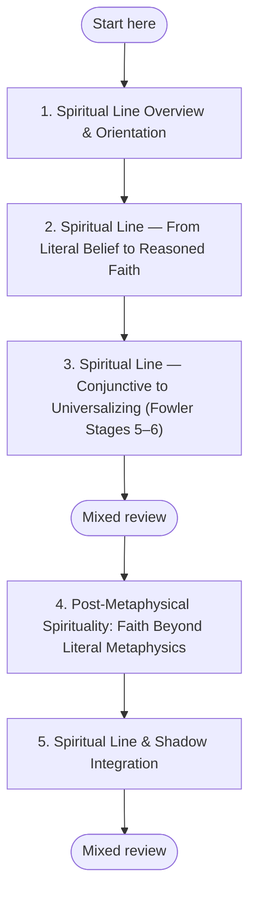

## 🕊️ Spiritual Line Development (QuickStart)

**Why this sequence?** Spiritual development follows Fowler's stages: Mythic-Literal to Synthetic-Conventional to Individuative-Reflective to Conjunctive to Universalizing. This sequence moves from faith embedded in story through systematic belief, critical examination, integration of paradox, and finally a faith that includes without being limited by any single tradition.
**Goal:** Build a grounded, developmentally informed Spiritual line practice that honors your background while supporting movement through recognizable stages of spiritual meaning-making.

**Time commitment:** **20–30 weeks** (recommended pacing: **4–6 weeks per module** across 5 modules)

---

## Plan your pathway

Self-paced learning works better when you decide before you start. **Write one if-then plan now:** *"When [time/place], I will [first step]."* For example: "When I finish my morning coffee, I will open **Spiritual Line Overview & Orientation** and work on it for 20 minutes." If-then plans help people follow through on goals (Gollwitzer & Sheeran, 2006).

**Suggested pace:** 4–6 weeks per module, 20–30 weeks across the five modules. Slow down if you need more time to integrate.

**Visible progress:** [My Progress](../my-progress) shows the modules you have completed and the reviews due. It is stored only in your browser, and you can clear it at any time.

**Mixed review:** After every third module, run a mixed review on [My Progress](../my-progress). It mixes questions from the earlier modules instead of one module at a time, so it feels harder than rereading, and that effort is what builds lasting memory.

**Mastery before moving on:** Each module's Assess section sets a passing threshold. Meet it before you start the next module; if you do not, repeat the practices first. This gate is advisory: the site cannot check it for you, so be honest with yourself.

*In words:* start at step 1 and work in order. Your place in the path is the last module marked complete on My Progress. A mixed review follows every third module.

| Step | Module | Pass when |
|---|---|---|
| 1 | [Spiritual Line Overview & Orientation](../modules/spiritual-line-overview-orientation) | Three or more criteria at *Developing* or *Stable*. |
| 2 | [Spiritual Line — From Literal Belief to Reasoned Faith](../modules/spiritual-line-mythic-to-rational) | Four or more criteria at *Developing* or *Stable*, including Stage phenomenology and at least one of the three Encounter practices completed. |
| 3 | [Spiritual Line — Conjunctive to Universalizing (Fowler Stages 5–6)](../modules/spiritual-line-conjunctive-universalizing) | Four or more criteria at *Developing* or *Stable*, including Stage distinction and Pre/Trans checkpoint use. |
| 4 | [Post-Metaphysical Spirituality: Faith Beyond Literal Metaphysics](../modules/spiritual-line-post-metaphysical-integral-religion) | Four or more criteria at *Developing* or *Stable*, including Three Eyes precision and Stabilize checkpoint use. |
| 5 | [Spiritual Line & Shadow Integration](../modules/spiritual-line-shadow-integration) | Five or more criteria at *Developing* or *Stable*, including Own-stage shadow clarity, Bypass Detection completed, and Pre/Trans checkpoint applied. |

---

## Three Entry Framings

### If you come from a religious tradition...

Your inherited tradition can be a profound developmental asset, not a problem to solve. This path does not ask you to abandon doctrine, ritual, or devotion; it asks you to deepen how you hold them over time. Spiritual line development is framed here as maturation in meaning-making, not pathologizing faith.

### If you identify as secular or non-religious...

You can work this path without adopting theistic beliefs. In Tillich's terms, spirituality can be understood as your "ultimate concern" — what you orient your life around at depth — and Fowler's developmental framing has been applied in both religious and secular populations. The question is not "Do you believe in God?" but "How does your deepest orientation develop in complexity, humility, and integration?"

### If you've experienced religious trauma...

Spiritual wounding is real, and your caution is understandable. Spiritual line development is not a demand to return to harmful authority structures, coercive communities, or invalidating language; it is a process of rebuilding trustworthy spiritual agency on your own terms. You can move slowly, stay in low-intensity practices, and define clear boundaries throughout.

#### When to Seek Support

Pause self-directed spiritual practice and seek qualified support if you notice persistent panic, dissociation, intrusive trauma material, severe sleep disruption, or sustained loss of daily functioning. If you are in immediate danger or feel unable to stay safe, contact emergency services or a crisis hotline right away.

---

## Overview

This QuickStart is the entry path for Spiritual line development across diverse learner backgrounds: traditional religious, spiritually curious, secular humanist, and post-trauma reorientation. It provides a sequence that keeps depth and safety together while avoiding pressure toward any single metaphysical worldview.

---

## AQAL Mapping

| Dimension | Emphasis in this QuickStart |
|---|---|
| **Quadrants** | I (interior meaning, devotion, existential orientation), We (community, tradition, dialogical interpretation), It (observable practices and commitments), Its (institutional and cultural contexts for spirituality) |
| **Levels** | Spiritual line movement from mythic-literal through rational-reflective, conjunctive/universalizing, and post-metaphysical integration |
| **Lines** | Spiritual line (primary), with explicit support from self, shadow, moral, and state lines |
| **States** | Contemplative and peak states are included as data, but not treated as equivalent to line altitude |
| **Types** | Tradition-rooted, secular, and trauma-sensitive pathways with shared developmental principles |

---

## State vs. Spiritual Line Distinction

This path is distinct from the [State Development QuickStart](./state-development). State development trains repeatable access to states (gross, subtle, causal, nondual). Spiritual line development trains how you **interpret, organize, and integrate** those experiences over time.

**Concrete example — same state, different line interpretation:** you have a profound meditation with a felt sense of unity.

- **Mythic-literal Spiritual line framing:** "This confirms my inherited sacred story as literally true."
- **Rational-reflective framing:** "This was a meaningful altered state that may be explained psychologically or neurologically."
- **Conjunctive/universalizing framing:** "This reveals a depth dimension that multiple traditions symbolize differently, each partially."
- **Post-metaphysical integral framing:** "This is valid first-person data to integrate with practice injunctions, peer dialogue, and developmental humility."

The state event may be similar. The Spiritual line structure interpreting that event is what develops.

---

## Sequenced Module Pathway

Follow the modules in order. Keep the **4–6 week pacing per module** unless you need slower integration.

| Sequence | Module | Estimated time | Why it comes here |
|---|---|---|---|
| 1 | [Spiritual Line Overview & Orientation](../modules/spiritual-line-overview-orientation) | 4–6 weeks | Establishes shared vocabulary, safety boundaries, and line-vs-state clarity before deeper work. |
| 2 | [Spiritual Line — Mythic to Rational](../modules/spiritual-line-mythic-to-rational) | 4–6 weeks | Builds literacy for traditional and rational framings so early-stage conflicts become workable rather than polarizing. |
| 3 | [Spiritual Line — Conjunctive & Universalizing](../modules/spiritual-line-conjunctive-universalizing) | 4–6 weeks | Expands capacity to hold multiple truth frameworks without collapsing into relativism or cynicism. |
| 4 | [Spiritual Line — Post-Metaphysical Integral Religion](../modules/spiritual-line-post-metaphysical-integral-religion) | 4–6 weeks | Integrates contemplative depth with epistemic rigor and pluralistic discernment. |
| 5 | [Spiritual Line — Shadow Integration](../modules/spiritual-line-shadow-integration) | 4–6 weeks | Addresses spiritual bypassing and projection so development remains honest, embodied, and relationally accountable. |

---

## Your Tradition as Resource

Your inherited tradition — religious, philosophical, or secular-humanist — is a primary development resource in this path, not an obstacle to transcend. Fowler's developmental research and adjacent interpretations suggest that depth practice within one coherent tradition often supports more durable Spiritual line maturation than rapid eclectic sampling without grounding.

If you are tradition-rooted, bring your lineage texts, rituals, and mentors as practice anchors. If you are secular, bring your core commitments (justice, truth, care, inquiry) as your working "ultimate concern" and develop them with the same rigor.

---

## Learn

Study one distinction at a time: line vs. state, depth vs. dogmatism, pluralism vs. relativism, and spirituality vs. bypassing. Revisit difficult sections rather than rushing forward.

## Practice

Maintain one weekly contemplative practice, one weekly reflection dialogue (peer/mentor/facilitator), and one weekly integration action in ordinary life (relationships, work, service, ethics).

## Reflect

Use this weekly prompt: **"How did my deepest concern shape my choices this week, and where did I protect identity instead of seeking truth?"**

## Assess

At the end of each module, rate (1–4): interpretive humility, consistency between practice and values, ability to include difference without collapse, and reduction of spiritual bypassing patterns.

## Integrate

Apply one insight per week to a concrete context: family conflict, workplace ethics, community participation, or daily commitments. Development is demonstrated by behavior and relational quality, not only private insight.

## Retrieval Schedule

- **24 hours:** Re-state the key distinction from your current module in your own words.
- **72 hours:** Review one real-life moment where your spiritual framing shaped action; note what you would adjust.
- **7 days:** Debrief with a trusted person and choose one practice change for the coming week.

---

## Parallel Paths

Support Spiritual line development with parallel tracks:

- [State Development QuickStart](./state-development) (Issue #5) — build state literacy without confusing it for line altitude
- [Shadow Work QuickStart](./shadow-work) (Issue #32) — reduce projection and spiritual bypassing
- [Self Line Development QuickStart](./self-line-development) (Issue #68) — strengthen identity complexity and reflective capacity
- [ILP Integration Map (Issue #34)](https://github.com/paruff/integral-education/issues/34) — synthesis framework across lines, states, and practices

---

## Evidence and Citations

| Claim | Source | Quality | Caveat |
|---|---|---|---|
| Faith/spiritual meaning-making develops through recognizable structural stages | Fowler, J. W. (1981). *Stages of Faith*. Harper & Row. | Tier B — developmental theory with broad practical uptake | Stage boundaries are interpretive and should not be used to rank persons. |
| Fowler's framework has been adapted for non-theistic/secular meaning systems | Fowler, J. W. (1981); Streib, H. (2001). Faith development theory revisited. *International Journal for the Psychology of Religion*, 11(3), 143–158. | Tier B | Secular application quality varies by construct definition and context. |
| "Ultimate concern" offers a non-theistic entry point to spiritual orientation | Tillich, P. (1957). *Dynamics of Faith*. Harper. | Tier B — foundational philosophical theology | Concept is broad and needs operational clarity in applied settings. |
| Religious trauma can shape spiritual development and requires safety-sensitive pacing | Winell, M. (2011). *Leaving the Fold*; Herman, J. (1992). *Trauma and Recovery*. Basic Books. | Tier B/C | Evidence base is mixed across clinical, qualitative, and practitioner sources. |
| Depth in a coherent tradition often supports maturation better than ungrounded eclecticism | Fowler (1981); Wilber, K. (2006). *Integral Spirituality*. Shambhala; Trungpa, C. (1973). *Cutting Through Spiritual Materialism*. Shambhala. | Tier C/B | Strong in theory and practitioner literature; direct comparative trials are limited. |

---

## Safety Notes

- **Consent:** Engage spiritual practices voluntarily and re-confirm willingness before deeper work.
- **Right to stop / Stop rules:** Stop immediately if you experience flooding, dissociation, panic escalation, or destabilizing confusion.
- **Contraindications:** If you are in acute crisis, active trauma destabilization, or significant functional impairment, use professional support before intensive work.
- **Grounding:** Use sensory orientation, paced breathing, and brief body-based practices before and after contemplative sessions.
- **Escalation path:** If distress persists beyond grounding, pause this path and consult a qualified trauma-informed mental-health professional, spiritual director, or facilitator.

This platform provides educational and developmental content only; it does not provide therapy, diagnosis, or clinical care.
