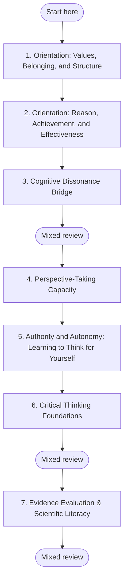

## 🧭 Amber → Rational (QuickStart)

**Why this sequence?** The order follows the arc of the transition itself. It starts with understanding where you are (Amber), clarifies where you are going (Rational), then works through the specific capacities that bridge the gap: tolerating uncertainty, seeing through others' eyes, and relocating authority from external sources to your own reasoning. Each module addresses a specific developmental edge in the order that edge typically emerges.
If you find yourself questioning beliefs you once held with certainty, feeling the tension between received wisdom and personal experience, you may be at one of the most significant thresholds of adult development. This transition is not about becoming cynical, abandoning loyalty, or proving your tradition wrong; it is about developing the capacity to think with greater depth, evidence-sensitivity, and interior honesty. Many adults experience this shift as both liberating and disorienting because it changes not only what you believe, but how you relate to authority, community, and truth itself. This QuickStart is designed to give you a steady, non-judgmental path through that transition.

**Goal:** Move from authority-anchored meaning-making toward self-authored, evidence-aware judgment without contempt for the stage that formed you.

**Time commitment:** Core path: **10–20 weeks**. With the two optional skill-building mini-modules below: **14–28 weeks**.

---

## Plan your pathway

Self-paced learning works better when you decide before you start. **Write one if-then plan now:** *"When [time/place], I will [first step]."* For example: "When I finish my morning coffee, I will open **Orientation: Values, Belonging, and Structure** and work on it for 20 minutes." If-then plans help people follow through on goals (Gollwitzer & Sheeran, 2006).

**Suggested pace:** 2–4 weeks per module: 20–30 minutes on weekdays and one weekly check-in. The seven core modules take about 10–20 weeks; slower is fine.

**Visible progress:** [My Progress](../my-progress) shows the modules you have completed and the reviews due. It is stored only in your browser, and you can clear it at any time.

**Mixed review:** After every third module, run a mixed review on [My Progress](../my-progress). It mixes questions from the earlier modules instead of one module at a time, so it feels harder than rereading, and that effort is what builds lasting memory.

**Mastery before moving on:** Each module's Assess section sets a passing threshold. Meet it before you start the next module; if you do not, repeat the practices first. This gate is advisory: the site cannot check it for you, so be honest with yourself.

*In words:* start at step 1 and work in order. Your place in the path is the last module marked complete on My Progress. A mixed review follows every third module.

| Step | Module | Pass when |
|---|---|---|
| 1 | [Orientation: Values, Belonging, and Structure](../modules/traditional-orientation) | Three or more criteria at *Developing* or *Stable*. |
| 2 | [Orientation: Reason, Achievement, and Effectiveness](../modules/rational-orange-orientation) | Three or more criteria at *Developing* or *Stable*. |
| 3 | [Cognitive Dissonance Bridge](../modules/cognitive-dissonance-bridge) | Three or more criteria at *Developing* or *Stable*. |
| 4 | [Perspective-Taking Capacity](../modules/perspective-taking-capacity) | Three or more criteria at *Conventional* or *Post-conventional*, with at least one at *Post-conventional*. |
| 5 | [Authority and Autonomy: Learning to Think for Yourself](../modules/authority-autonomy-transition) | Three or more criteria at *Transitional* or *Self-authoring*, with at least one at *Self-authoring*. |
| 6 | [Critical Thinking Foundations](../modules/critical-thinking-foundations) | At least 3 of the 4 questions correct, and three or more criteria at *Developing* or *Stable*, with **Self-application** at least *Developing*. |
| 7 | [Evidence Evaluation & Scientific Literacy](../modules/evidence-evaluation) | At least 4 of the 5 questions correct, counted from the answers you wrote down before reading the feedback. If you missed two or more, answer the retrieval cards again without looking, then check the section behind any you missed before moving on. |

---

## Overview

This path is for adult learners who still value structure, loyalty, and belonging, but increasingly need a way to examine beliefs, compare perspectives, and make decisions from a more self-authored centre. The sequence begins by honoring the coherence and gifts of Amber, then introduces Rational capacities gradually so development feels intelligible rather than threatening. You do not need to force a rupture or perform independence; you need a stable pace, honest reflection, and enough support to let new capacities come online with integrity.

---

## AQAL Mapping

| Dimension | Emphasis in this QuickStart |
|---|---|
| **Quadrants** | I — interior belief revision and self-authorship; We — community, belonging, and shared meaning; It — reasoning skills and evidence evaluation; Its — institutional, cultural, and authority systems |
| **Levels** | Amber/Mythic → Rational/Orange |
| **Lines** | Cognitive, moral, interpersonal, emotional |
| **States** | Reflective, grounded waking inquiry |
| **Types** | Structured-first learners; adults who need clarity, pacing, and continuity with existing commitments |

---

## Signs You May Be in This Transition

You do **not** need all of these to use this path. These are common, non-clinical markers:

- You notice a widening gap between what trusted authorities say and what your direct experience seems to show.
- You feel more curious about *why* something is true, not only *who* says it is true.
- You can still value your tradition or community, but some of its explanations no longer feel complete.
- You find yourself wanting to compare perspectives fairly instead of quickly sorting them into right and wrong camps.
- You feel both loyalty and tension: part of you wants to stay faithful, and part of you needs more room to think.
- You increasingly care about evidence quality, consistency, and reasoning in domains where you once relied mainly on trust.
- You sometimes experience disorientation, grief, or loneliness when old certainties stop functioning the way they once did.
- You want a way to grow that does not require contempt for your earlier worldview or the people who still inhabit it.

---

## Sequenced Learning Path

Work through the **five core transition modules in order**. The final two modules are skill-building intensives that fit best after the core arc, though some learners will weave them in alongside Modules 3–5.

| Sequence | Module | Why it comes here | Estimated time |
|---|---|---|---|
| 1 | [Amber/Mythic Stage Orientation](../modules/traditional-orientation) | Start by understanding the stage you are coming from so growth begins with dignity rather than rejection. | 2–4 weeks |
| 2 | [Rational/Orange Stage Orientation](../modules/rational-orange-orientation) | Clarify what the Rational stage is — and is not — before trying to practice its capacities. | 2–4 weeks |
| 3 | [Cognitive Dissonance Bridge](../modules/cognitive-dissonance-bridge) | Learn to recognize uncertainty and tension as developmental signals instead of immediate threats. | 2–4 weeks |
| 4 | [Perspective-Taking Capacity](../modules/perspective-taking-capacity) | Build the ability to hold your own view as one perspective among others without losing yourself. | 2–4 weeks |
| 5 | [Authority & Autonomy Transition](../modules/authority-autonomy-transition) | Work directly with the shift from external authority to internal self-authorship, including grief and belonging. | 2–4 weeks |
| 6 | [Critical Thinking Foundations](../modules/critical-thinking-foundations) | Strengthen argument analysis and discernment so Rational capacities become practical rather than abstract. | 2–4 weeks |
| 7 | [Evidence Evaluation](../modules/evidence-evaluation) | Learn to assess claims by the quality of their support, not only by the status of their source. | 2–4 weeks |

---

## Why This Sequence Works

This progression follows a developmental holding-environment logic. First, you need an honest map of Amber and Rational so the transition is understandable. Then you need support for the difficult middle territory — cognitive dissonance, perspective-taking, and the authority/autonomy shift — before deeper reasoning skills can stabilize. By the time you reach the critical-thinking and evidence modules, you are not just collecting techniques; you are consolidating a new way of knowing.

---

## Pacing Recommendation

Plan on **2–4 weeks per module**, with **one weekly practice check-in** to review what is shifting in your beliefs, relationships, and emotional responses. If a module feels merely interesting, stay with the practices until they become personally relevant; if a module feels destabilizing, slow down rather than pushing through. Use the [Daily Reflection Template](../reflections/daily-template) at least once per week — ideally after your check-in — to notice whether you are moving toward greater clarity, greater confusion, or both at once.

A workable rhythm for many learners is:

- **Weekdays:** 20–30 minutes of reading, journaling, or applied practice
- **Once per week:** 30–45 minute reflection check-in
- **At the end of each module:** decide whether you are ready to continue, repeat key exercises, or seek conversation with a trusted mentor, facilitator, pastor, or friend

---

## You Don't Have to Abandon Your Tradition

One of the most common fears in this transition is that Rational development requires rejecting your religion, family, culture, or inherited moral world. It does not. Healthy Rational development gives you a new relationship to tradition: you can examine it, interpret it, and remain in dialogue with it rather than being wholly fused with it or reacting against it.

For some learners, this means staying rooted in the same tradition with greater maturity. For others, it means renegotiating boundaries, language, or forms of participation. In either case, the aim of this path is not alienation for its own sake; it is honest development with continuity, respect, and room for discernment.

---

## Learner Expectations

This QuickStart will serve you best if you are willing to:

- move slowly enough that new insight can become lived practice
- let questions stay open longer than is comfortable
- distinguish productive discomfort from genuine overwhelm
- stay respectful toward your earlier worldview, even when you outgrow parts of it
- use reflection and dialogue, not just private analysis, to make sense of the transition

---

## Complementary Resources

- [Daily Reflection Template](../reflections/daily-template) — use this as your weekly practice check-in and to track shifts across quadrants, lines, levels, states, and types
- [State Development (QuickStart)](./state-development) — a complementary path if you want contemplative practice to support grounding, witnessing, and integration while you do stage work
- [AQAL Overview](../maps/aqal-overview) — revisit the larger developmental map when you want more context for how stage work relates to states, lines, and quadrants
- [AQAL Glossary](../maps/glossary) — look up plain-language definitions for any unfamiliar terms
- [What This Platform Can and Cannot Do](../about/what-this-platform-does) — an honest statement about what self-guided content can and cannot accomplish, grounded in intervention evidence

---

## What This QuickStart Does Not Do

This QuickStart provides a sequenced curriculum, practice prompts, reflection structures, and retrieval schedules. It does not — and the evidence does not support it doing — produce a structural stage transition through self-guided content alone. Durable development at this threshold typically requires sustained engagement (months to years), a relational holding environment (coach, mentor, peer cohort, or therapist), and real disorienting life experience that no curriculum can generate. Use this QuickStart as a map, a preparation, and a between-session scaffold. Do not use it as a substitute for the relationships and time that actually do the developmental work. See [What This Platform Can and Cannot Do](../about/what-this-platform-does) for the evidence behind this boundary.

---

## Evidence and Citations

| Claim | Source | Quality | Caveat |
|---|---|---|---|
| Adult development can involve structured stage transitions in how meaning is made | Kegan, R. (1982, 1994); Cook-Greuter, S. (1999, 2000) | Tier B — developmental theory and observational research | Stage models are interpretive frameworks; exact boundaries remain debated. |
| Cognitive dissonance and disorienting dilemmas can function as transition triggers in adult learning | Festinger, L. (1957); Mezirow, J. (1991) | Tier B | Theoretical and observational; not every experience of dissonance leads to developmental change. |
| Faith and meaning can mature without requiring total rejection of tradition | Fowler, J. (1981) | Tier B | Faith-stage models are influential but not universally accepted across traditions. |
| Development is better supported by a holding environment than by forced acceleration | Kegan, R. (1982, 1994) | Tier B | Strong concept in developmental practice; operationalization varies by context. |
