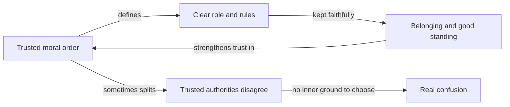

import ModuleFooter from '@site/src/components/ModuleFooter';
import RetrievalPrompt from '@site/src/components/RetrievalPrompt';

import Admonition from '@theme/Admonition';
import ModuleMeta from '@site/src/components/ModuleMeta';

<ModuleMeta />

---

{/* DRAFT (P9-05): written by an AI model for human review. Not audience-tested. */}

## 🧭 Orient

:::info Before this module

This is the first step on the path. You need nothing before it. The aim is not to change you. It is to name, in your own words, what already works in the way you live, so that everything after this builds on it.

:::

Much of a good life rests on things you did not have to invent: a role people can count on you for, rules that have stood the test of time, people and traditions you trust. This step helps you see those strengths clearly, and see them as yours.

:::tip Before you read
Take a minute to answer these in your own words before you read on. A wrong guess still helps you learn what follows.

1. Why might a person feel relief, rather than restriction, in having clear rules and a role they did not have to invent?
2. When two people you trust completely give you opposite instructions, what makes that so hard to settle?
:::

---

## 🌿 Encounter

There is a particular steadiness in knowing what is expected of you. You are the one who remembers every birthday, the one who opens the doors on Sunday, the one the team calls when something has to be done right. The role does not have to be argued over each morning. The rule does not have to be defended each time. You belong, and you know how.

You trust some voices because they have held up: a scripture, a tradition, a parent, a mentor, a chain of command that has been fair to you. They do not have to prove themselves line by line. You trust them because they have been right, because they have been legitimate, and because walking away from them would mean losing your place in something larger than you.

From the inside, this does not feel like "believing in duty". It feels like duty simply being the shape of a good life. It is hard to describe, because you are living it rather than studying it. This step puts words to it.

---

## 🧠 Learn

## What You Already Do Well

If you lean on trusted guidance, clear roles and a community of shared belief, you are doing something people have always done to hold families, congregations, workplaces and countries together. It is not a gap to be fixed. It is a working way of making good decisions, and it has real strengths.

Here is how it tends to work:

- **There is an order you trust.** It might come from your faith, your tradition, your profession or your family. You believe it is worth upholding.
- **Rules are dependable.** They do not shift with every mood or argument. That is what makes them a place to stand.
- **Authority is earned and respected.** The teacher, the elder, the commander, the pastor, the parent carry weight that is not to be dismissed lightly.
- **Who you are is tied to what you do for others.** Your role in your family, your community and your work is part of your identity.
- **Life has a direction.** What you do now counts toward something that matters later.
- **Your people are your people.** Loyalty to them is not a preference. It is a commitment.

*In words:* a trusted order gives you a clear role and clear rules. Keeping them faithfully brings belonging and good standing, which deepens your trust in the order. That loop is what makes life steady. When two people or sources you trust disagree, though, you have no separate place to stand while you weigh them, and the result is real confusion rather than a simple choice. Later steps on this path build that second skill without taking away the first.

**How well supported is this?** Useful, but still debated. It draws on a well-known theory of how people grow in handling relationships and authority. The theory has wide use in teaching and is mostly supported by research, but it has not been tested as thoroughly as some other ideas (Kegan, 1982). Treat it as a helpful way to notice patterns, not as a measurement of you or a verdict on anyone's worth.

## Five Strengths

Every one of these is needed in every walk of life, and each is easy to lose when someone talks only about what to change.

### Moral Conviction
You can hold a position and act on it, even at a cost. Giving up comfort, security or standing for something you believe is right is a strength in its own right. Many people reason their way out of their commitments when it gets hard. You tend not to.

### Belonging
You know what it is to be known, accepted and held inside a community of shared meaning. That is not narrowness. At its best it is real love and loyalty, and many people who have no such place feel its absence keenly.

### Sacrifice and Service
You will set aside your own wishes for a family, a faith, a duty or a team. Volunteering, military honour, vocation and parenting all depend on it. This is not blind obedience. It is commitment that costs something.

### A Life with a Story
You hold your life as a story with a beginning, a purpose and a direction. That helps you plan, endure hard stretches and keep going when the days are dull. People without such a story often describe their lives as scattered or pointless.

### Reliability
You know what you are meant to do, and you do it. Families, teams and congregations that depend on people like you work with a steadiness that is hard to build any other way.

**How well supported is this?** Good evidence for the effects of belonging, shared purpose and moral conviction on wellbeing and on groups working together. How these strengths relate to the pattern described above is an interpretation drawn from wider theory (Wilber, 2000), so treat the link as a helpful lens rather than a proven fact.

## Where Relying on Guidance Alone Runs Out

This is not a criticism. Any way of deciding has places where it is stretched, and naming them honestly is part of respecting you.

- **When trusted voices disagree, or are silent, or are wrong.** You may have no clear way to choose, because the authority was your way of choosing. Asking *why* a rule exists, or *whether* a source is reliable, is a separate skill.
- **When outsiders are treated with suspicion.** A strong "us" can make it hard to understand or cooperate with people outside it. At moderate levels this is ordinary community loyalty. At high levels it can cause real harm.
- **When rules meet new situations.** A rule applied the same way everywhere can fail when context changes what it means. Ambiguity can feel threatening, not just uncomfortable.
- **When every option costs something.** Life sometimes offers no clearly right answer. Tolerating that, without rushing to false certainty, takes practice.
- **When your sense of how you are doing comes mostly from others.** If good standing is the measure, you can be vulnerable to people who withhold it, or to feedback that is simply wrong.

**How well supported is this?** Useful, but still debated. These patterns are described in research on how people understand themselves and their obligations, mostly through interviews and self-report, with some cross-cultural checking still going on (Cook-Greuter, 1999; Kohlberg, 1981). They are patterns to notice in yourself, not labels for anyone.

---

## 🧘 Practice

## Practice — Strengths Inventory (15–20 minutes)

**Purpose:** Find the strengths above in your own life, so this step is more than reading.

**Worked example:** for the *reliability* prompt, someone might write: "I am the one in my family who remembers every birthday and sends the card. My sister says she never has to worry about it because I will. It feels like a small weight I carry gladly, and I would feel I had let people down if I forgot." Three to five plain sentences like these, about one real role, are all each prompt asks for.

**Instructions:**

1. Find a quiet place where you will not be interrupted. Take two or three slow breaths.
2. Read each prompt and write your answer in a journal or notebook. Aim for 3–5 sentences each. Do not edit or judge as you write. Just record what is true.
3. When you have finished, read your answers back slowly.

**Prompts:**

1. **Moral conviction:** Describe a position you hold that you would not give up just because it was unpopular or inconvenient. What makes it real to you?
2. **Belonging:** Name a community, family, tradition or group where you feel truly known and accepted. What does it give you that you could not easily find on your own?
3. **Service:** Describe one way you regularly set aside your own wishes for something larger, such as a family duty, a work role or a commitment to your community. What keeps you doing it?
4. **Reliability:** Describe a role where others really depend on you. How do you experience that responsibility?
5. **Your story:** Finish this sentence: "The story of my life, so far, is a story about ______." Notice whether a story comes, how long it takes and how it feels.

---

## ⚓ Stabilize

Reading this step, or even finishing the practice, gives you a map. It does not by itself change how you handle authority, roles or certainty. Understanding a pattern and being able to choose differently within it are two kinds of growth, on two different timescales. Do not mistake "I understand this now" for the slower work of noticing where you simply defer when you could test, or hold a rule firmly where the situation calls for judgment.

The words in this step ("duty", "role", "authority", "faith") come from research done mostly in Western institutions and religions. The forms these patterns take (which authorities, which roles, which moral codes) vary a great deal between cultures and traditions. If your own background looks different from the examples here, trust your lived experience over the illustration.

**Back to your opening questions:** clear rules and a given role can bring relief because they answer in advance what is expected of you, and keeping them brings belonging and good standing (the diagram in Learn). Nothing has to be invented or argued alone. Opposite instructions from two trusted people are hard because, when your sense of yourself rests on those relationships and that order, there is no separate place to stand and weigh them. The conflict feels like a threat to who you are, not only a puzzle.

---

## 🔍 Reflect

Use these prompts for journaling or conversation after the practice. There are no correct answers, and nothing here is meant to shame you.

1. Where in your life do you rely most on clear rules or trusted guidance? Is that mostly useful, sometimes limiting, or both? How did you come to rely on it there?
2. Think of a community you belong to where the rules or beliefs are rarely questioned. What does that steadiness give you? What does it cost you, if anything? Why do you think they are so rarely questioned?
3. When you meet someone whose values differ a lot from yours, what is your first reaction: curiosity, unease, judgment, something else? Why do you think that comes first for you?
4. Which of the five strengths do you recognise most readily in yourself? Which would you most want to protect as you grow, and why?
5. Is there a situation right now where you wish you had clearer guidance to turn to? What would it give you if you had it?

---

## 📊 Assess

Use this rubric after the practice and reflection. It is for honest self-assessment, not for comparing yourself with anyone.

| Criterion | Not yet | Developing | Stable |
|---|---|---|---|
| **Understanding the pattern**: you can describe in your own words how a trusted order, clear roles and belonging fit together | Cannot yet | Can describe parts of it with prompting | Can describe it in your own words, with one example from your life |
| **Naming strengths**: you can name at least three of the five strengths as active in your life | Cannot name any that feel true | Can name one or two with effort | Can name three or more, each with a specific example |
| **Naming limits**: you can name at least two places where relying on guidance alone has been hard for you, without shame | Cannot identify any, or feel only shame | Can name one, with discomfort | Can name two or more calmly, each tied to a real situation |
| **Respect for others**: you can think about people who lean on guidance and tradition without contempt or superiority | Find it hard not to judge | Mostly respectful, with slips | Consistently curious and respectful; can name one recent moment you caught a judgment and chose curiosity |
| **Next step**: you can name one area of your life where weighing things for yourself would serve you | Cannot yet | Can with prompting | Can write one sentence naming the area and a first step |

**Passing threshold:** Three or more criteria at *Developing* or *Stable*.

---

## 🔄 Integrate

Carry this into your week:

- **Gratitude:** Each day this week, note one time that duty, reliability, conviction or belonging served you or someone near you well. Write it down without qualification.
- **Notice without judging:** When you see someone defer to a rule, an elder or their community, practise seeing it as a way of living that works, not a failing.
- **Honest check:** Pick one area (work, family, community, faith). Write one sentence on whether relying on outside guidance is helping you there or making things harder.
- **Talk it over:** Share one idea from this step with someone you trust. Notice how they respond, and how you do.

---

<RetrievalPrompt moduleName="Orientation: Values, Belonging, and Structure" cards={[
  {q: "How do a trusted order, clear roles and belonging fit together?", a: "A trusted order defines clear roles and rules. Keeping them brings belonging and good standing, which deepens trust in the order. That loop makes life steady."},
  {q: "Why is it so hard when two people you fully trust disagree?", a: "If your sense of yourself rests on those relationships and that order, you have no separate place to stand and weigh them, so the conflict feels like a threat to who you are."},
  {q: "Name the five strengths described in this step.", a: "Moral conviction, belonging, sacrifice and service, a life with a story, and reliability."},
  {q: "Name four places where relying on guidance alone can run out.", a: "When trusted voices disagree or are silent or wrong; when outsiders are treated with suspicion; when rules meet new situations; when every option costs something; or when your sense of how you are doing comes mostly from others."},
  {q: "Why does this step name your strengths before the limits?", a: "Because honesty about limits only lands when you first feel seen and respected, and because the strengths are real and needed at every point on the path."},
]} />

---

## ⏱️ Retrieval Schedule

| Interval | Activity |
|---|---|
| 24 hours | Without looking, name as many of the five strengths as you can and say in a sentence what each gives a community. Add one example from your own life to any you had none for. Then check against the Five Strengths section and note what you missed |
| 72 hours | Complete the Assess rubric for the first time. Note which criterion feels most alive and which most challenging |
| 7 days | Revisit the Reflect prompts. Choose one you answered briefly and write a fuller response. Notice whether anything has shifted |
| 14 days | Complete the Assess rubric again. Note any movement from *Not yet* to *Developing* or *Developing* to *Stable*. Confirm you are ready for the next step on the path |

---

## 📚 Evidence and Citations

Evidence is rated Tier A (primary research or strong empirical base), Tier B (theoretical synthesis or practitioner evidence) or Tier C (provisional or expert opinion). In this step's wording: Tier A is "well tested", Tier B is "useful, but still debated", Tier C is "an expert's view, not yet tested".

| Claim | Source | Quality | Caveat |
|---|---|---|---|
| A person's sense of self can rest on relationships and a shared order, so conflicts between trusted voices feel threatening | Kegan, R. *The Evolving Self* (1982), Harvard University Press | Tier B (useful, but still debated): constructive theory with wide educational use | A theoretical model; testing so far is supportive but not exhaustive |
| Identity can be tied closely to role and group norms, with feedback from authority taken as authoritative | Cook-Greuter, S. R. *Postautonomous Ego Development* (1999), doctoral dissertation, Harvard University | Tier B (useful, but still debated): qualitative research with large samples | Relies on self-report; cross-cultural validity still being checked |
| Conventional moral reasoning, oriented to rules and good standing, is widely found and holds up across cultures | Kohlberg, L. *The Philosophy of Moral Development* (1981), Harper & Row | Tier A (well tested): longitudinal cross-cultural research | Critics point to gender bias (Gilligan) and cultural limits; the conventional pattern itself replicates robustly |
| The strengths named here (conviction, belonging, service, story, reliability) matter for individuals and groups | Wilber, K. *A Theory of Everything* (2000), Shambhala | Tier B (useful, but still debated): theoretical synthesis | Not primary research; synthesizes the work of several others |

---

:::note Safety Note

This module is rated **Tier 1 (self-guided, low intensity)**. It involves reflective self-inquiry about your own values and habits and does not aim to bring up traumatic or highly charged material.

**Consent:** Go ahead when you are willing to look honestly at how you make decisions and what you value. You may pause or stop at any time. No answer to any prompt is required or checked by anyone else.

**When to wait:** If you are in the middle of a crisis of meaning, a major disruption to who you are, or acute distress, put this aside and talk to a trusted person or a qualified practitioner first. This site does not offer therapy or clinical care.

**Stop rule:** If reflecting on these patterns brings strong shame, grief or unease, stop. Step away. Take three slow breaths, place your feet firmly on the floor and name three things you can see around you. Come back only when you feel settled.

**Easier alternative:** If self-inquiry feels too much, do only the Strengths Inventory, focusing on what is working and what you value, and leave the section on limits for another day.

**If it continues:** If distress persists, contact a trusted support person or a qualified practitioner. Do not continue alone if you feel overwhelmed.

:::

<ModuleFooter />
