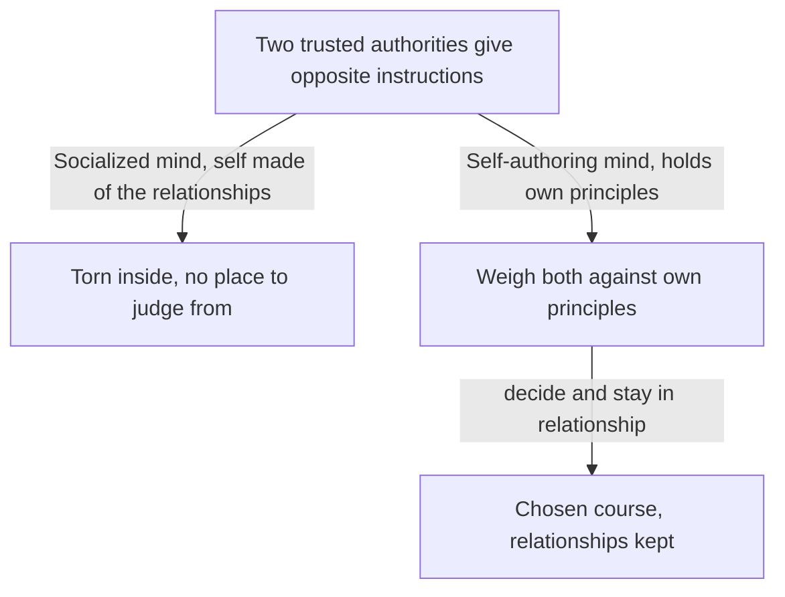

import ModuleFooter from '@site/src/components/ModuleFooter';
import RetrievalPrompt from '@site/src/components/RetrievalPrompt';

import Admonition from '@theme/Admonition';
import ModuleMeta from '@site/src/components/ModuleMeta';

<ModuleMeta />

:::info Before this module
This module assumes you can hold your own view as one view among others. That skill is the footing for the work here: learning to weigh what you have been told, and to decide for yourself where you stand.
:::

**Where this fits:** This is step 5 of the [Clear Thinking Path](../quickstarts/traditional-to-rational). It builds on [Cognitive Dissonance Bridge](./cognitive-dissonance-bridge) by naming the change at the heart of the whole path: moving from outside authority as your main source of truth and direction to your own considered judgment. If you have not yet worked through them, the earlier steps help: [Orientation: Values, Belonging, and Structure](./traditional-orientation), [Orientation: Reason, Achievement, and Effectiveness](./rational-orientation) and [Cognitive Dissonance Bridge](./cognitive-dissonance-bridge). [Perspective-Taking Capacity](./perspective-taking-capacity) is a companion skill you build alongside this one.

---

## 🧭 Orient

You already know a great deal about authority. You know how to keep a promise when it costs you. You know how to take guidance from a parent, an elder, a pastor, a foreman or a teacher who has walked the road before you. You know that rules often carry the wisdom of people who learned the hard way. None of that is a weakness, and this module does not ask you to give it up.

What this module looks at is a quieter question: when you hold a belief, where does its weight come from? From the person or tradition who gave it to you, or from reasons you have weighed and can stand behind yourself? Most people find the answer is "both", and that it differs from one part of life to another.

Be ready for this to touch something deep. For many people, thinking things through for themselves brings real grief: for a community, for a certainty, or for the person they used to be. That grief is treated here as real and worth attention, not as something to push past.

:::tip Before you read
Take a minute to answer these in your own words before you read on. A wrong guess still helps you learn what follows.

1. Why might saying no to someone you respect feel like betrayal rather than like setting a boundary?
2. When a person starts to decide for themselves what is true, what might they lose even as they gain something?
:::

## 🧠 Learn

## What Shared Authority Gives You, and Why It Matters

Before looking at what changes, it helps to see clearly what a life built on shared authority does, and does remarkably well.

In this way of living, a person is rooted in sources outside themselves: family tradition, church or faith community, a role in the family or the workplace, the customs of the community, or a trusted figure such as a priest, elder, teacher or leader. These sources are not just consulted. They help make you who you are. They tell you what is true, what is right, how to live and what to value. This is not laziness or a lack of thought. It is a steady, tested way of answering the question of how to live, and the people around you share it.

Its gifts are real and large:

- **Moral clarity:** You know right from wrong. A shared moral order guides what you do, so you are not worn down by having to settle every question alone.
- **Belonging and identity:** You know who you are because you know *whose* you are: your family, your people, your faith, your God. Your identity is not a project you build from nothing. It is given, and it holds you steady.
- **A meaningful order:** The world is not random or indifferent. There is a purpose and a story, and your life has a place in it. Suffering has meaning. Death does not have the last word.
- **Clear roles:** You know what is expected of a good son or daughter, a faithful spouse, a loyal member, a devoted believer, an honest worker. That clarity reduces friction and gives direction that feels dignifying, not confining.
- **Community and accountability:** Because the authority is shared, people are responsible to one another. You are not alone. You are held by, and held to account by, people who share your commitments.

When questions start to arise and the old answers begin to show their seams, *all of this* can feel at risk. The change is not only in your head. It touches everything that makes life meaningful, safe and livable.

That is why adults going through it often describe it not as a step up but as a loss, and at its hardest, as something like a death.

## Kegan: From a Mind Shaped by Others to a Mind That Weighs for Itself

Robert Kegan, a psychologist at Harvard, gives one of the most precise accounts of this change (1994). He describes two ways a grown adult can make sense of life. He calls them the third and fourth "orders of mind". They describe not just what a person thinks, but how the person is put together.

**The socialized mind (Kegan's third order):**

Here a person is shaped by their relationships with the people who matter to them and by the communities they belong to. They do not simply *have* relationships and memberships. In an important sense, they *are* them. Their values, their sense of right, and their picture of reality are built with and through those people and communities.

Kegan points to several marks of this way of making sense:

- When two authorities you trust disagree, there is no inner place from which to judge between them. When two people you love give you opposite instructions, you feel torn, not because you are weak, but because the conflict is happening *inside* you rather than being a problem to be settled *by* you.
- Requests from the people you look up to feel like obligations, not like requests you could weigh and decline. Saying no to an authority figure feels like betrayal rather than a reasonable boundary.
- It is hard to have a truly *private* self, a part of you that is not organized around what important others expect. Their voices live inside you.

Kegan also describes what a person needs to grow through a change like this without coming apart. He calls it "confirmation, contradiction, continuity". First you need to be truly *confirmed*, respected for who you are now. Then you can be *contradicted*, invited to grow. And through both there must be *continuity*: the person who was respected is the same person being called forward. Without this, change tends to break a person rather than grow them.

**The self-authoring mind (Kegan's fourth order):**

Here a person has built an inner standpoint: values, commitments and principles they have made their own, from which they can weigh outside authorities rather than simply obey them. This does not mean rejecting authority. It means relating to it differently. Where the socialized mind lives *inside* the authority, the self-authoring mind can *step back* from it long enough to ask whether it is trustworthy, consistent and worth following.

Its marks include:

- Holding several authorities in view at once and weighing them from your own standpoint. When two authorities disagree, you have your own grounds for deciding.
- Keeping a commitment you believe in even when important people in your life disagree.
- Seeing relationships as chosen and weighed, not as what you are made of. You can step back, look at a relationship and decide how to take part in it, without the relationship falling apart.
- Being open with others while also having a private inner life. Your most important decisions come from within, not from others' expectations.

Kegan judges this change to be one of the biggest demands placed on adults today. Many adult roles, such as advanced study, professional work, citizenship and leading complex organizations, quietly expect it. Yet his research suggests that a large share of adults still make sense of life mainly in the first way. The demand is real; the growth it asks for does not happen automatically.

The same two conflicting instructions land differently in each way of making sense:

*In words:* when two people you trust give opposite instructions, the socialized mind has no inner standpoint of its own to judge from, so the conflict is felt as being torn inside. The self-authoring mind can weigh both against principles it has made its own, decide, and stay in relationship with both people.

**Evidence tier:** B (good evidence, with real limits) — an influential theory of how adults grow; in real life the lines between these ways of making sense are not sharp, and estimates of how many people are in each are hard to measure well. Kegan's descriptions are a lens for noticing patterns, not a measurement of you or a verdict on anyone's worth.

## Cook-Greuter: From Conforming to Judging by Your Own Standards

Susanne Cook-Greuter (1999) studied how a person's sense of self matures. She built on Jane Loevinger's Washington University Sentence Completion Test, in which people finish short sentences and their answers are scored against a scale of levels of ego development. Where Kegan focuses on how we relate to other people, Cook-Greuter traces how we relate to our own experience.

**The Conformist pattern:**

Here a person identifies almost completely with the rules, norms and expectations of their group. Stepping outside the group's norms feels not just awkward but threatening to who you are. You experience yourself as the sum of your roles and memberships.

Its marks include:

- **Clear categories:** right and wrong, us and them, clean and unclean, saved and lost. The world is sorted into categories that matter, and grey areas feel threatening.
- **Judging yourself through others:** you know how you are doing by watching how others respond. Praise confirms your worth; criticism threatens it, not as feedback on something you did but as a verdict on you.
- **Following the rule as written:** rules are concrete, literal and binding. The letter matters more than the spirit, and exceptions bring anxiety.
- **Keeping the group together comes first:** harmony in the group matters more than saying something true that would cause conflict. People may look as if they agree when they do not.

**Toward judging by your own standards:**

Cook-Greuter describes a long road from the Conformist pattern through further patterns she calls Expert and Achiever, and beyond. Along that road a person builds a steady inner standpoint, values and principles of their own that do not depend on any one group. They stop relying mainly on others' approval and start to judge themselves by standards they hold.

Its marks include:

- **Principles over rules:** rules are seen as expressions of deeper values, and the values come first. When a rule and the value behind it pull apart, the value wins.
- **Living with complexity:** you can hold several views at once without rushing to settle them. Grey areas are not threatening; they are how hard situations usually are.
- **Judging yourself from within:** you are the first judge of your own work, by your own standards and values. Others' approval still matters, but it does not decide the verdict.
- **Honest relationships:** you can stay truly present with others without needing their approval or agreement, and you can disagree openly without the relationship collapsing.

This is a long journey with many steps along the way. It is not a single leap but a gradual reshaping, often over years, of how a person relates to their own experience, their own authority and their own ability to make meaning.

**Evidence tier:** B (good evidence, with real limits) — large-sample research with an instrument whose scorers agree well with one another; it relies on people's own written answers, and whether it holds across cultures is still an open question.

## Beck and Cowan: Authority as a Given System, Authority as Your Own Reasoning

Don Beck and Christopher Cowan (1996), building on the research of Clare Graves, describe the same shift in terms of value systems.

**When authority is a given system:**

One value system is organized around an absolute authority, usually divine, traditional or institutional, that stands above any one person's judgment and is the final ground of truth, morality and meaning. Life has a definite purpose that has been revealed or handed down through rightful authority. Sacrifice for the greater good is expected and honoured. Rules are sacred. Order is built into the world.

In Beck and Cowan's terms, this value system answers the question "What is the right way to live?" with: "According to the authority that has been given the truth."

**When authority is your own reasoning:**

Another value system appears when the question shifts from "What does the authority say?" to "What does the evidence show?" Authority now sits within: your own reasoning, your own looking into things, your own standards for weighing a claim. Truth is not simply received; it is found, through method, evidence, testing and argument.

In Beck and Cowan's terms, this value system answers the same question with: "According to the principles I have worked out through my own investigation and effort."

**The shift between them:**

The move between these two is a move from an authority that stands outside and above you (God, tradition, institution, role) to an authority inside you (your reasoning, evidence, method). It is not only a change in what you believe, but in where you place the ground of belief itself.

That shift carries a real loss. When your own reasoning becomes the main ground, the world no longer comes with a guarantee. The moral order no longer arrives ready-made. In a new way, you are responsible for building the frame you will live within, and that responsibility is both freeing and dizzying.

Beck and Cowan's model describes a shift in where authority sits; it does not say what you should conclude about God or your tradition. Some people come through this shift holding their faith in a new way, examined and chosen as their own.

**Evidence tier:** B (useful, but still debated) — a theoretical synthesis built on Graves' research; influential, but not fully replicated in controlled studies.

## What Can Be Lost: The Grief in This Change

Any honest account of this change has to name what theories of adult growth often skip: the *loss* that can come with it.

Learning to think for yourself is real growth. But growth, as Kegan observed, is not only gain. It is also real loss: losing what the old way of living gave you before anything new has taken its place.

What, specifically, can be lost?

**Belonging.** A community built on shared authority is also built on a shared story and a shared moral order. When you begin to question the authority, you may risk, or actually face, a kind of exile. That might be outward, being kept at a distance by your community, or inward, no longer feeling fully *at home* in a community you are still part of. The belonging was never a side benefit; it was part of who you were. Losing it can feel like losing yourself, not just losing a membership.

**Certainty.** Shared authority gave the comfort of knowing: what is true, what is right, what the world is, what happens after death, what you are for. Reasoning things through for yourself trades some of that certainty for likelihood, open questions and complexity. The gain is real: a more honest, more careful fit with how things actually are. But the loss is real too. Some questions the old answers settled (Why am I here? Does my life matter? Is there love at the heart of things?) may now feel open again, or be framed as questions reason alone cannot settle. Living without the old answers, before new ones have formed, is a kind of homesickness most cultures have no name for.

**A meaningful order.** At its depth, life under shared authority rests on the conviction that the world is not random. There is a story, a purpose, a God, or a tradition large enough to hold suffering, meaninglessness and death. When the authority starts to give way, that frame can shift. Some people find their faith deepens in a new form. Others lose not only a set of teachings but the felt sense that the world is turned toward them and that they matter to how things are. That is a grief that psychological language rarely honours well.

**Clear roles.** Shared authority gave reliable clarity about what a good son does, what a faithful believer looks like, what an honourable member owes to others. Those roles were not chains; they were guides that let you know whether you were living well. Without them, before your own values have settled, many people feel lost about right and wrong, as if the compass that told them where they stood has gone quiet.

**Continuity with who you were.** Perhaps the deepest loss is a sense of continuity with the person you used to be. The child formed in the tradition, the young adult who believed without reservation, the member who knew exactly where they stood: that person was real, and their commitments were real. When thinking for yourself means revising or letting go of some of those commitments, it can feel like a break. You may wonder whether you have betrayed yourself, betrayed those who formed you, or lost something essential.

Naming these losses is not optional. It is tempting to skip the grief and treat the change as pure gain, pure freedom, pure progress. The thinker Ken Wilber warns about this kind of growth, which gains the new by denying the real value of the old. That denial does not grieve well. It tends to breed contempt for people who still live by the old ways, and a smug cleverness that has bought its clarity at the cost of its depth.

Thinking for yourself, at its best, needs no contempt for the way of life that formed you or for the people who still live by it. It can hold both the real gifts of shared authority and the need to weigh things for yourself, honouring what is lost while building something new.

## Two Framework Lenses: Kegan and Cook-Greuter Side by Side

Kegan's framework gives this module its core picture: moving from an authority that *makes up* who you are (you are inside it) to one you can weigh *from* a standpoint of your own (you can look at it). It explains how the change works: you do not just add a new belief; you change what authority means to you.

Cook-Greuter's research gives a finer-grained map of the same ground. It traces a gradual path with several steps between conforming and judging by your own standards. That matters because Kegan's shift is rarely one clean step, and her in-between patterns help you find where you are within a long change rather than expecting a simple before and after.

## The Limitations of the Authority-Autonomy Framework

This framework describes a change in where authority sits. It should not be read as saying that thinking for yourself is simply "better" than relying on authority in every way. The gifts of shared authority (belonging, moral clarity, a meaningful order) are real losses when they go, not childish attachments to be outgrown at no cost.

The five-domain audit and the rubric in this module are also simplified pictures of a messier process. Most people are not one way across their whole life. You may weigh everything for yourself at work while still relying largely on authority in matters of faith or family, and the clean categories here can hide that if you apply them too literally.

Finally, describing this change mainly through Kegan, Cook-Greuter and Beck and Cowan risks treating something with deep cultural and religious roots as if it were only a matter of how the mind is organized. For many people, the authority in question cannot be separated from a particular faith or community. The psychological language here should add to, not replace, whatever words your faith or community already has for this passage.

## 🌿 Encounter

The practices below ask you to do something that may feel hard if you were raised to honour authority: look at your own sources of authority from a step outside. Expect some resistance, discomfort or a sense of disloyalty. That reaction is useful information about where you stand right now.

---

## 🧘 Practice

## Practice A — The Authority Audit (35–45 minutes)

**Purpose:** Map where your beliefs come from, now and in the past, across five areas of life. This makes the unspoken visible and shows where your sources are outside you, within you, or shifting.

**Instructions:**

Find a quiet place where you will not be interrupted. You will need a journal or a few sheets of paper. Read each area slowly, then answer honestly. There are no correct answers, and you can stop at any point.

**The five areas:**

For each area, answer the three questions below. Take 5–7 minutes per area.

| Area | What it covers |
|---|---|
| **1. Moral/Ethical** | How you decide what is right, what is wrong, and what you owe to others |
| **2. Religious/Spiritual** | How you understand the deepest questions: meaning, purpose, death, God |
| **3. Political/Civic** | How you form views about how society should be run and what justice requires |
| **4. Relational/Family** | How you decide what a good spouse, parent, child or friend does |
| **5. Work/Vocation** | How you judge what work is worth doing and what makes a working life honourable |

**Worked example:** for the Work/Vocation area, someone might write: (1) "My main authority has been my first manager, who taught me what good work looks like." (2) "About 70% received, 30% my own: I now judge my own work, but I still use her checklist." (3) "It is shifting a little: I recently changed one step in her process because it did not suit my team, and I noticed no one objected." Short, specific answers like these are enough for each area.

**For each area, answer:**

1. **Who or what has been your main authority in this area?** (Name specific sources: a parent, a tradition, a text, an institution, a teacher, a community, your own reasoning, evidence you have seen, and so on.)

2. **How much of what you believe here did you work out through your own reasoning, and how much did you receive from someone else?** If you had to put a number on it, such as "20% my own, 80% received" or "50/50", what would it be? Do not aim for precision; aim for honesty.

3. **Where, if anywhere, is authority in this area shifting?** Are you having questions, tension or second thoughts here? Are you moving toward weighing things yourself, or do you still rely mainly on an outside source? What, if anything, makes this area hard to look at?

**After all five areas:**

Write one paragraph answering: *"Looking across all five areas, what do I notice about where my beliefs come from? Where do I most weigh things for myself? Where do I rely most on outside authority? Where is the change most in motion, and most uncomfortable?"*

---

## Practice B — The Self-Authored Position (35–45 minutes)

**Purpose:** Choose one question on which thoughtful people disagree, and work out a reasoned position you could defend, without leaning on any outside authority as the reason for your conclusion. The goal is not to land on the "right" answer, but to practise, in mind and heart, the act of making up your own mind.

**Instructions:**

**Step 1 — Choose your question (5 minutes):**

Choose one question from the list below, or name your own. It should be a question on which you do not yet have a clear view of your own, or where your current view mostly comes from an authority rather than from your own reasoning.

Suggested questions (choose one):

- A disputed moral question in your line of work
- A significant political or civic question in your community
- A question of faith or meaning that your tradition has answered but that you have not yet examined for yourself
- An ethical question in your family or close relationships
- A disputed question of fact (what the evidence actually shows on a contested topic)

**Step 2 — Name your current position and where it comes from (5 minutes):**

Write a short statement: *"My current position on this question is ___________. I hold it mainly because ___________."*

Then: *"The authority source(s) for this position are ___________."* (Name specific sources: a tradition, a text, a mentor, what your community agrees on, personal experience, evidence-based reasoning, and so on.)

**Step 3 — Map the evidence and arguments (15–20 minutes):**

Look into the best arguments on more than one side. You are not looking for the view that is easiest to dismiss; you are looking for the one that makes you think hardest.

For each of two or three serious positions, write:

- The strongest version of this position (the most charitable, consistent way of putting it; see [Perspective-Taking Capacity](./perspective-taking-capacity))
- The main evidence or reasoning behind it
- The most serious objection to it
- Why a thoughtful, sensible person might hold it

**Step 4 — Work out your own position (10–15 minutes):**

Now write a clear statement of your own position, grounded not in what an authority told you to believe but in the reasoning and evidence you have looked at:

*"Having considered the arguments and evidence, my position on this question is ___________."*

*"I hold this position because ___________. The evidence or reasoning that most supports it is ___________. The strongest objection I cannot yet fully answer is ___________."*

*"This position is my own in this sense: I would hold it even if ___________."* (Name an authority, such as a tradition, a community or a mentor, whose disagreement would not change your conclusion, and say why.)

Your position may well agree with what your tradition teaches. That is fine. What matters here is that you can now say *why* you hold it.

**Step 5 — Reflect on making up your own mind (5 minutes):**

Write one paragraph: *"What was it like to ground this position in my own reasoning rather than in an outside authority? What was uncomfortable about it? What felt right?"*

---

## 🔍 Reflect

Use these prompts for journaling or for conversation with someone you trust after you finish both practices. There are no correct answers. Take them slowly, one per sitting if you need to.

1. **The authority you carry.** In the Authority Audit, which area surprised you most? Where did you rely on outside authority more than you expected? Where did you find more of your own judgment than you expected? Why do you think that area surprised you, and what does your map tell you about the change still under way?

2. **What you are grieving.** Whether or not this feels like loss to you right now, there is usually something shared authority gave you that is no longer as reliable once the change begins. What, specifically, is that for you? Belonging, certainty, a meaningful order, clear roles, or something else? What would it mean to grieve this loss honestly, rather than denying it or getting stuck in it?

3. **Loyalty and betrayal.** Many people experience thinking for themselves as a kind of betrayal: of their tradition, their community, their parents, their God. Have you felt this? If so, what specifically feels like betrayal? Is the betrayal real? Is it possible to honour what was truly good in what formed you *while also* learning to weigh it and sometimes revise it?

4. **Staying the same person.** Kegan observes that the person formed by shared authority and the person learning to think for themselves are the *same person*, not a replacement. What about you has stayed the same through this change, and how do you know? Which values, commitments or deep loyalties have survived and deepened, even as the *reason* you hold them has become more your own?

5. **The self you are building.** Thinking for yourself is not the same as needing no one. A person who makes up their own mind still has relationships, dependencies, traditions and communities they value. Who are you in the process of becoming? Not simply the self you were given, and not the opposite of it, but a self that can honour how it was formed while also being truly *its own*? Why does the difference between making up your own mind and needing no one matter in your life right now? Write for ten minutes without stopping.

---

## 📊 Assess

Use this rubric after you finish both practices and the reflection. The columns describe a gradual change. It is for honest self-assessment, not for comparing yourself with anyone.

The three columns describe the change this module covers:

- **Authority-dependent:** Your beliefs, judgments and direction come mainly from outside: tradition, institution, an authority figure, what the community agrees on. Inner questions or tension are usually set aside or settled by deferring to authority.
- **Transitional:** Outside and inner authority are both active, often in conflict. Positions of your own are emerging but are not yet steady. You feel the loss of outside certainty, and your response may swing between grief, anxiety and too much confidence too soon.
- **Self-authoring:** You have a steady inner standpoint from which you can relate to, weigh and sometimes overrule outside authority. You still value outside authorities, but they no longer make up who you are. You have acknowledged the grief for what was lost and are working it through.

**Examples of what *Self-authoring* can sound like:**
- "I changed careers even though my parents were disappointed. Their reaction was something I weighed, not permission I needed."
- "I can take a mentor's guidance without handing over my judgment. I adapted their approach to my situation and took responsibility for the result."

## Authority & Autonomy Development Rubric

| Criterion | Authority-dependent | Transitional | Self-authoring |
|---|---|---|---|
| **Authority awareness** — I can name where my beliefs come from and judge their basis | I cannot name or examine my own sources of authority; the question feels strange or beside the point | I can name my sources in some areas but am unsure whether my positions are received or my own | I can name my sources across areas and know which positions are my own and which are mainly received: my completed Authority Audit names a source and a percentage of my own judgment for all five areas |
| **Self-authored reasoning** — I can reach a reasoned position on a disputed question without needing an authority's approval | I cannot reach a position on a disputed question without deferring to an outside authority as the reason | I can reach a tentative position but lean heavily on authorities and am unsure it stands without their approval | I can state a clear, evidence-based position I would hold without an authority's endorsement, and I can name the limits of my certainty: I have a written position that includes the strongest objection I cannot yet answer |
| **Grief acknowledgment** — I can name what is really lost in this change, without denying it or overstating it | I cannot see any loss in the change; I see it as all gain or all disaster | I can name some of what is lost but tend either to play it down ("it doesn't matter") or to catastrophize ("everything is ruined") | I can name specific losses, such as belonging, certainty, a meaningful order or clear roles, honestly and with some calm, and hold the loss and the growth together: I can name at least two specific losses in writing, and one gain I can point to |
| **Loyalty navigation** — I can keep caring for the tradition and community that formed me while building my own standpoint | I cannot tell the difference between weighing my tradition and betraying it; the thought of judging for myself brings sharp guilt or a sense of disloyalty | I can sometimes tell weighing from betraying, but the line is shaky; judging for myself often brings anxiety about my relationships | I can weigh the tradition and community that formed me with both care and independence, and say what I still honour and what I have chosen to revise, and why: I can name one thing I still honour and one I revised, with the reason for each |
| **Identity continuity** — I can see myself as the same person through this change | I feel like a completely different person from the one I was raised to be; I see no thread connecting them | I sometimes feel the continuity; some values and commitments clearly carry over, but the change feels more like a break than growth | I have a clear sense of continuity: the same person, with deeper and more honestly chosen commitments, who honours how they were formed while learning to think for themselves: I can write down at least two values that have carried through the change |

**Passing threshold:** Three or more criteria at *Transitional* or *Self-authoring*, with at least one at *Self-authoring*.

---

## The Gifts of the Authority-Autonomy Transition

The clearest gift of this change is being able to hold a position, moral, political, family or work-related, that is truly your own: reasoned out, examined, and defensible on grounds you can explain, rather than simply received and repeated. That ability reaches into every part of adult life, not only the ones this module names.

It also brings a particular kind of maturity in relationships: being able to disagree with the people who formed you, parents, communities, traditions, without either giving in to their view or having to reject them altogether. Thinking for yourself does not require cutting off the relationships that shaped you. It makes it possible to stay in them out of chosen loyalty rather than loyalty by default.

Finally, this change builds the strength to bear grief: to name a real loss (belonging, certainty, a meaningful order) honestly, without denying it or getting stuck in it. That strength is a resource you will draw on again, because later changes in life also often ask you to let go of something real for something not yet fully formed.

## ⚓ Stabilize

**Thinking for yourself is not the same as rejecting authority (a caution against overreach):** Making up your own mind is not reflexive rejection of authority, contrariness for its own sake, or a puffed-up sense that your own reasoning is now beyond question. In Kegan's account, the self-authoring mind is a real, lasting ability, not a mood or a pose. It shows in being able to hold a position under real pressure, and to change it when real counter-evidence comes, not in how loudly or confidently you assert it.

**Back to your opening questions:** saying no to someone you respect can feel like betrayal because, in the socialized mind, you are partly made of those relationships, so refusing an instruction feels like refusing part of yourself (the diagram in Learn). A person who starts deciding for themselves what is true gains an inner standpoint, and risks losing belonging, certainty, a meaningful order, clear roles, and some sense of continuity with who they were. That loss is real and is treated as real grief, not an obstacle.

**Settling in, not arriving:** There is no single moment when this change is finished. Most people weigh things for themselves more in some areas of life than in others for years. Coming back to the Authority Audit from time to time, rather than treating one pass as final, is how the change actually settles in.

## 🔄 Integrate

Authority and autonomy are not just ideas. They show up in the decisions you make, the positions you defend, and the relationships you keep this week.

**Daily practice this week:**

- **The authority check:** Once a day, when you form a belief, give an opinion or make a decision, pause and ask: *Where is this coming from?* Is it a position I have reasoned out, or one I am carrying from an authority without having looked at it? Name it. You are not being asked to drop beliefs that come from authority; you are being asked to see them clearly.
- **One position of your own each week:** Find one situation this week where you hold a view on a disputed matter. Express it, in conversation, in writing, or in your own deliberation, as clearly and as much in your own words as you can. Name what grounds it. Notice how it feels to stand on your own reasoning without needing anyone's endorsement.
- **The grief check:** At the end of each day, notice whether any loss from this change is present, however faintly. Not the idea of loss, but the actual feeling of it. Let it be there for thirty seconds without fixing it. Then name it in one sentence and move on.
- **The continuity thread:** Once this week, write for five minutes on: *"What about me has stayed the same through this change? Which values, commitments and loyalties have I carried, deepened and made more truly my own?"*

**Related modules:** For handling the tension that comes before thinking for yourself, see [Cognitive Dissonance Bridge](./cognitive-dissonance-bridge). For seeing a matter through other people's eyes, which thinking for yourself depends on, see [Perspective-Taking Capacity](./perspective-taking-capacity).

---

<Admonition type="tip" title="Facilitator Note">
- This module can bring up sharp grief around belonging, faith or family loyalty. Read the Safety Note in full before facilitating, and keep the grounding alternative (Practice A only) available as a gentler option.
- Watch for reflexive contrariness being mistaken for thinking for yourself. The caution against overreach in Stabilize is the key checkpoint here: making up your own mind shows in how a position holds under real pressure, not in how confidently it is asserted.
- The Authority Audit can be genuinely unsettling for someone in the middle of a break with their community or a crisis of faith. The contraindications in the Safety Note apply directly and are not boilerplate.
- Keep discussion of the Beck and Cowan and Kegan material tied to the learner's own five-area audit rather than letting it stay abstract. The theory is scaffolding for honest self-examination, not the point of the module.
- Never treat a learner's faith or loyalty as the problem to be solved. Many people do this work and stay in their tradition; others change how they take part. Both are legitimate outcomes.
</Admonition>

<RetrievalPrompt moduleName="Authority and Autonomy: Learning to Think for Yourself" cards={[
  {q: "What is Kegan's socialized mind (third order), and how does authority work in it?", a: "In the socialized mind, a person is shaped by their relationships with the people who matter to them and by the communities they belong to. Values, beliefs and sense of right are built *through* those relationships; the self is not yet separate from them. Outside authorities are not just consulted; they help *make up* the self. This brings deep belonging and moral clarity, along with no inner place from which to judge between authorities who disagree."},
  {q: "What is Kegan's self-authoring mind (fourth order), and what does it make possible?", a: "In the self-authoring mind, a person has built an inner standpoint, values and principles of their own, from which outside authorities can be weighed. It does not reject authority; it relates to it differently. Where the socialized mind lives *inside* the authority, the self-authoring mind can *step back* from it long enough to ask whether it is trustworthy, consistent and worth following. This makes truly self-chosen commitment possible."},
  {q: "What is Kegan's \"confirmation, contradiction, continuity\" idea about how people grow through change?", a: "Growing through a change like this needs three things: first the person is truly *confirmed*, respected for who they are now; then *contradicted*, invited to grow beyond it; and through both there is *continuity*, the same person who was respected is the one called forward. Without confirmation, the challenge tends to break the person. Without continuity, the person cannot experience the change as growth rather than as losing themselves."},
  {q: "What does Cook-Greuter's Conformist pattern look like, and how does it differ from judging by your own standards?", a: "In the Conformist pattern, a person identifies with the group's norms, rules and authorities. They judge themselves by how others respond, think in clear categories, and follow rules as written. Further along Cook-Greuter's path, a person has a steady inner standpoint, judges rules by the values behind them, can live with complexity and grey areas, and does not need outside approval as the main basis for judging themselves."},
  {q: "What shift between two value systems do Beck and Cowan describe, in terms of authority?", a: "One value system places final authority outside the person: in God, tradition, institution, or trusted figures who have been given the truth. The other places it inside: in one's own reasoning, weighing of evidence and standards of method. The shift is from \"What does the authority say?\" to \"What does the evidence show?\", a change not just in beliefs but in where the *ground of belief* sits."},
  {q: "Name four things that can be truly lost when shared authority gives way.", a: "(1) Belonging: membership in a community held together by shared authority and story; (2) Certainty: the comfort of knowing what is true, right and meaningful; (3) A meaningful order: the felt sense that the world has a purpose that includes you; (4) Clear roles: reliable guidance about what a good son, believer or community member does. Naming these losses as real is part of growing through the change honestly."},
  {q: "What does Ken Wilber warn about in growth that skips the grief?", a: "He warns about growth that gains the new by denying the real value of the old, treating the way of life that formed you as merely inferior rather than as something with real gifts. That denial does not grieve well. It tends to breed contempt for people who still live by the old ways, and a cleverness that has bought its clarity at the cost of its depth."}
]} />

## ⏱️ Retrieval Schedule

| Interval | Activity |
|---|---|
| 24 hours | Without looking, list the areas and main authorities in the audit you made in Practice A, then open it and compare. What did you leave out? For one area, add one sentence: *"What I have not yet examined in this area, what I still carry only because an authority gave it to me, is ___________."* |
| 72 hours | Return to Practice B (The Self-Authored Position). Choose a *different* question and repeat the exercise. Notice whether making up your own mind feels different the second time. |
| 7 days | Without looking back, write down what you remember of the Reflect prompts. Then choose the one you answered most briefly and write a fuller response, especially prompt 2 (grief) or prompt 3 (loyalty), which most often have more to say after a week of practice. |
| 14 days | Complete the Assess rubric again. Note any movement from *Authority-dependent* to *Transitional*, or from *Transitional* to *Self-authoring*. Decide whether you are ready for the next step on the Clear Thinking Path. |

---

## 📚 Evidence and Citations

How strong is the evidence? Tier A means well tested: strong, consistent evidence from several high-quality studies. Tier B means good evidence, with limits. Tier C means early or expert opinion, not yet well tested.

| Claim | Source | How strong | Caveat |
|---|---|---|---|
| The move from the socialized mind (third order) to the self-authoring mind (fourth order): from a self made up by others to a self that weighs for itself, as a central challenge of adult life | Kegan, R. *In Over Our Heads: The Mental Demands of Modern Life* (1994), Harvard University Press | Tier B — a theory of how adults grow; widely applied in education, clinical and organizational settings; mixed evidence on how many adults reach the fourth order | A theoretical model; in real life the lines are not sharp; testing how common each order is is methodologically hard; some cultural specificity in the original samples |
| "Confirmation, contradiction, continuity": what a person needs to grow through change without coming apart | Kegan, R. *The Evolving Self: Problem and Process in Human Development* (1982), Harvard University Press | Tier B — a theory of how adults grow, drawing on clinical case material; widely applied in educational and organizational settings | Built partly from clinical observation; direct testing of the three conditions is limited; whether it applies across cultures still needs checking |
| Conformist pattern toward judging by your own standards: from judging yourself through others and following rules as written to principled, inner self-assessment | Cook-Greuter, S. R. *Postautonomous Ego Development: A Study of Its Nature and Measurement* (1999), doctoral dissertation, Harvard University | Tier B — large-sample research using the Washington University Sentence Completion Test; scorers agree well with one another | Relies on people's own written answers, which have built-in limits of interpretation; whether it holds across cultures is still being studied; how adults worldwide are spread across the levels is not settled |
| A shift between value systems: from authority-based to evidence-based knowing as the ground of belief | Beck, D. E., & Cowan, C. C. (1996), Blackwell: their book on value systems, leadership and change, built on Clare Graves' research | Tier B — a theoretical synthesis built on Graves' original research; widely applied in organizational and cultural-change work | Graves' original data were limited in sample diversity and geography; the later extensions are influential but not fully replicated in controlled studies |
| Grief and loss in times of personal change: a real cost to the person when an earlier way of making sense gives way | Kegan, R. *In Over Our Heads* (1994), Harvard University Press; Neugarten, B. L. "Adult Personality: Toward a Psychology of the Life Cycle" (1968), in *Middle Age and Aging*, University of Chicago Press | Tier B — theory and research on the adult life cycle; widely recognized in the adult-development literature | Grief as part of such change is coherent in theory and seen in practice, but has had little systematic study on its own |
| Ego development and autonomy: the Autonomous level and its marks of principled self-assessment and living with complexity | Loevinger, J. *Ego Development: Conceptions and Theories* (1976), Jossey-Bass | Tier B — foundational research using the sentence-completion method; highly influential; widely replicated with the Washington University Sentence Completion Test | The original scoring manual has changed through later research; culture and education strongly affect results; how universal the sequence is remains under study |
| Identity in higher education: seven areas of growth, including developing autonomy and establishing identity | Chickering, A. W., & Reisser, L. *Education and Identity* (2nd ed., 1993), Jossey-Bass | Tier B — a synthesis of research on college students' growth; widely used in higher education | The original research mostly studied traditional-age college students in U.S. institutions; whether it applies to older adults and non-Western settings still needs checking |

---

:::note Safety Note

This module is rated **Tier 1 (self-guided, low intensity)**. The practices and reflections deal with grief, loyalty and staying the same person through change. For some people this touches live wounds: an ongoing crisis of belonging, a sharp break with a tradition or community, or a recent rift in a close relationship connected to this kind of change.

**Consent:** Go ahead when you are willing to look at both where your beliefs come from and the real losses that can come with changing that. You may pause or stop at any time. No answer to any prompt is required or checked by anyone else. If you are in a sharp phase of grief, a crisis about who you are, or a break with your community, consider waiting on this module until you have enough support around you.

**Contraindications:** If you are currently in a crisis of belonging, a serious upheaval in your sense of who you are, an acute spiritual crisis, or a recent break with a community or tradition that is causing you serious distress, put this module aside and first seek support from a trusted person or a qualified practitioner. This platform does not provide therapy or clinical care.

**Stop rules:** If thinking about authority, loss or loyalty brings up strong grief, shame, anger or a feeling of being shaken, stop right away. Step away from the exercise. Take three slow breaths, put your feet firmly on the floor, and name three things you can see in the room around you. Come back only when you feel settled. You do not need to finish all the practices in one sitting.

**Grounding alternative:** If the grief or loyalty prompts feel too stirring, do Practice A only (the Authority Audit), focusing on the mapping task, and leave the Self-Authored Position and the Reflect prompts for a separate session when you have more support from people around you.

**Escalation:** If distress continues, or if you are going through an active break with your community or a spiritual crisis, reach out to a trusted support person (a friend, mentor, pastor or counsellor) or a qualified practitioner. Do not continue the module alone if you feel badly shaken.

Go at your own pace. If a practice brings up strong distress, stop, ground yourself with slow breathing, and talk with someone you trust or a qualified professional before continuing.

:::

<ModuleFooter />
