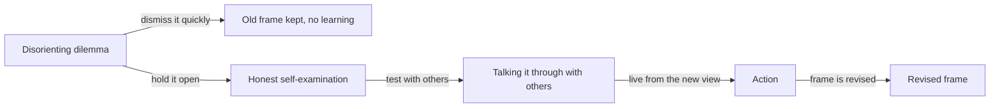

import ModuleFooter from '@site/src/components/ModuleFooter';
import RetrievalPrompt from '@site/src/components/RetrievalPrompt';
import ModuleMeta from '@site/src/components/ModuleMeta';
import Admonition from '@theme/Admonition';

<ModuleMeta />

:::info Before this module
This module assumes you have worked through step 2, Orientation: Reason, Achievement, and Effectiveness. Knowing what careful, evidence-based thinking looks like helps you read the discomfort of doubt as a signal to work with, not as a threat.
:::

**Position in the path:** This is the third step in the **Clear Thinking Path**. It builds on [Orientation: Values, Belonging, and Structure](./amber-mythic-orientation) and [Orientation: Reason, Achievement, and Effectiveness](./rational-orange-orientation). Those two steps described the ground you stand on and what careful thinking involves. This one gives you ways to work with the tension you may feel between them. Recommended prior reading: both orientation steps.

:::tip Before you read
Take a minute to answer these in your own words before you read on. A wrong guess still helps you learn what follows.

1. When two things you believe pull against each other, what are the different things people do to make the discomfort go away?
2. Why might the discomfort of doubting a long-held belief be a sign of growth rather than a sign that something has gone wrong?
:::

---

## 🧠 Learn

You already know a good deal about holding steady under strain. You have kept a promise when it cost you. You have stayed loyal to family through a hard season, kept faith through loss or illness, or finished a job properly when cutting corners would have been easier. That steadiness is a real strength, and this module asks you to use it.

The strain here is of a particular kind: the discomfort of finding that two things you believe will not fit together. Maybe something a trusted voice taught you does not match what you have seen at work. Maybe a rule you were raised with does not seem to fit a situation in your own family. This module is about how to stay with that discomfort long enough to learn from it, without rushing to make it go away and without throwing out what you hold dear.

## Cognitive Dissonance as a Signal

In 1957, the psychologist Leon Festinger described something most people recognize: we feel uncomfortable when we hold two beliefs, values or views of our own behaviour that do not agree with each other. He called this *cognitive dissonance*.

His central finding was that this discomfort pushes us to act, but not always by changing the belief. People reduce the discomfort by any means at hand. They reject the new information, explain away their own behaviour, add reasons that make the conflict seem smaller, or avoid situations where they would have to face it.

**Evidence tier:** A (well tested) — foundational experimental research, repeated many times; researchers still debate exactly why the discomfort drives us the way it does.

Later researchers of adult growth saw something more in this discomfort. When it touches the deep beliefs you live by, it can be a sign that your way of making sense of things is meeting the edge of what it can hold. In that case the discomfort is not a malfunction. It is what it feels like when a way of seeing that has served you well meets something it cannot yet explain.

This matters if you feel a pull between what authority says and what the evidence shows, between loyalty to your tradition and your private questions, or between the rules you were given and the complicated life you are actually living. That pull is not a sign that something has gone wrong with you. It is a normal part of thinking things through for yourself.

## Kegan's Subject-Object Idea: When What You Are Becomes What You Have

The psychologist Robert Kegan (1982, 1994) offers a clear way to describe what happens when this kind of change is under way. His key idea is the difference between *subject* and *object*.

Some parts of your life are *subject*. You are so close to them that you cannot see them, because you are looking *through* them, the way you look through a pair of glasses without seeing the lenses. For many people, the authority they answer to, the moral order they live by and the role they hold in family and community are subject in this sense. They are not things you have. They are part of who you are.

*Object*, in Kegan's use, means something you can hold, look at, reflect on and relate to. Growth, in his account, happens when something that was subject becomes object: when you can look *at* something you could once only look *through*.

Kegan describes one important version of this shift as the move from what he calls the third order of mind to the fourth. In the third, the self is formed by its relationships with the people and authorities it trusts, by its place in a community and by the moral order it lives within. These are not beliefs the self holds; they are the very ground it stands on. So questioning them does not feel like updating a belief. It can feel like losing yourself.

In the fourth, a person has an inner place to stand from which to weigh what others expect. When this happens, a person can say, "I have a relationship with this tradition," and not only, "I *am* this tradition." This is not losing the tradition. It is a new relationship to it, one in which you can weigh it honestly, keep it, and understand why you keep it.

Seen this way, the discomfort of doubt is what that shift feels like from the inside: something that was once invisible to you, because you saw through it, is becoming visible and open to examination. It is uncomfortable exactly because it used to be part of you.

**Evidence tier:** B (respected theory, partly tested) — an influential theory, widely used in education and organizations; research so far supports it but has not tested it fully. Kegan's model is a lens for noticing patterns, not a measurement of you or a verdict on anyone's worth.

## Mezirow's Disorienting Dilemma: What Sets Deep Learning Going

Jack Mezirow (1991) studied how adults learn in ways that change not only *what* they know but *how* they know. His work focuses on how the change happens.

He observed that this kind of learning almost always starts with what he called a **disorienting dilemma**: an experience you cannot make sense of with the frame you already have. It may be sudden, such as a death in the family, a moral failure, or meeting someone whose whole outlook is very different from yours. Or it may be slow, as experiences that your frame cannot explain pile up over years. What matters is that it is *real*: you cannot settle it just by adding more facts to the frame you already have.

Mezirow described a cycle that often follows:

1. **Disorienting dilemma** — an experience that does not fit the existing frame.
2. **Honest self-examination** — looking at the assumptions underneath the frame, not just the details inside it.
3. **Talking it through with others** — Mezirow's term is rational discourse: testing your revised assumptions with people who can question and sharpen them.
4. **Action** — living from the revised frame in what you actually do and in your relationships.

The disorienting dilemma is not an obstacle to get past as fast as possible. It is the opening. Closing it too soon, by dismissing the challenge instead of examining your frame, shuts the door on what the discomfort was pointing to.

**Evidence tier:** B (respected theory, mostly built from interviews and observation) — adult learning theory drawn from qualitative research; how widely it applies is still debated, and the steps may not happen in a fixed order.

*In words:* a disorienting dilemma can go two ways. Dismissed quickly, it leaves the old frame in place and nothing is learned. Held open, it leads to honest examination of the assumptions behind the frame, then to testing those assumptions with others, then to acting from the revised view.

## The Holding Environment

Kegan also uses the term *holding environment* for something you may know well from family and community life: the support a person needs to get through a hard change. To work through this kind of disorientation, you need enough support from people and from routine that you neither snap back to the old way of seeing nor fall apart.

A holding environment can be a trusted friend, a mentor or pastor, a counsellor, a study group, or even a steady set of practices. What it gives you is a place where the tension can be felt without having to be settled at once: where the new view cannot yet be put into words, the old one is no longer enough, and you are steady enough to let things reorganize.

**Evidence tier:** B (useful idea, lightly tested) — a framework drawn partly from clinical psychology; it has been turned into measurable terms only to a limited degree.

The practices in this module are meant to work as a modest holding environment. They do not speed the change up. They give you a structure for working with the tension instead of avoiding it or forcing it shut.

---

## Three Ways of Looking: Festinger, Kegan, and Mezirow

This module draws on three thinkers, each answering a different question about the same experience. Festinger answers *what is happening*: two beliefs that do not fit are causing discomfort, and you will reduce it somehow. Kegan answers *what it means for how you grow*: the discomfort marks the place where something you looked through is becoming something you can look at. Mezirow answers *how to work with it well*: treat the dilemma as an opening for honest self-examination, not a problem to make disappear as fast as possible.

Used together, they give you three steps: notice the discomfort (Festinger), find what is shifting from subject to object (Kegan), and keep the dilemma open long enough to think it through instead of settling it too soon (Mezirow). Used alone, each tells only part of the story. Festinger without Kegan can sound like nothing more than getting rid of discomfort. Kegan without Mezirow can stay abstract, with no practice for staying with the dilemma.

---

## Where This Approach Has Limits

This approach has real limits, and they are worth naming plainly.

First, not every uncomfortable clash of beliefs is a deep one. Ordinary factual disagreements, simple misunderstandings and disputes that a bit more information would settle are not disorienting dilemmas in Mezirow's sense. Treating every disagreement as a chance for personal growth can become its own way of avoiding things, and turns ordinary problem-solving into needless drama.

Second, patience with tension can be misused where a firm boundary or a clear moral judgment is called for. Not every tension should be sat with forever. Some situations, such as active harm, ongoing exploitation, or a plainly false claim with real consequences, call for a decision, not a long tolerance of uncertainty dressed up as open-mindedness. Your sense that some things are simply right or wrong is not what this module asks you to give up.

Third, the approach assumes you have a basic sense of safety and real support around you. Without support from people or from a steady routine, long-lasting tension can bring long-lasting distress rather than growth. Putting up with uncertainty is not a treatment in itself, and the practices here are no substitute for support when the strain is severe.

---

## 🌿 Encounter

The two practices below put Festinger's, Kegan's and Mezirow's ideas into direct contact with your own beliefs, instead of leaving them as theory. Practice A asks you to find beliefs that are under real pressure in your own life. Practice B asks you to describe, from the inside, an outlook you find hard to understand. Complete both before moving to the Stabilize section.

---

## 🧘 Practice

## Practice A — Dissonance Inventory (25–30 minutes)

**Purpose:** Identify three beliefs that are under pressure in your life right now, places where what you were taught and what you have lived are pulling against each other. The goal is not to settle the tension but to name it clearly.

**Worked example:** a low-stakes belief, "If I work hard enough, I will always be recognized." *State the belief:* hard work is noticed and rewarded, and that is how a fair workplace runs. *Name the pressure:* a colleague who works less was promoted, and I cannot explain it with this belief. *What is at stake:* if it is wrong, I would have to rethink why I stay late. *Discomfort:* a slight tightness in my shoulders. Your own beliefs can be larger, but each answer can be this short and specific.

**Instructions:**

1. Find a quiet place where you will not be interrupted. Take three slow breaths before beginning.
2. For each prompt below, write in a journal or notebook. Write without editing or judging. Allow 5–8 minutes per belief.
3. After completing all three, read back what you have written slowly. Do not try to resolve anything yet.

**Prompt for each belief:**

> Identify a belief you have held — from your tradition, family, community, workplace or the people whose word you trust — that is under some kind of pressure right now. The pressure may come from your own experience, from evidence you have come across, from a moral situation the belief does not seem to fit, or from questions you cannot set aside.

For each belief, answer:

1. **State the belief** — as clearly and generously as you can. Write it as though you still fully held it and it made sense. Do not make a cartoon of it.
2. **Name the pressure** — what experience, evidence or question is pressing against it? Be specific. What exactly does this belief fail to explain or hold?
3. **Notice what is at stake** — if this belief changed a great deal, what else would change? What would you lose? Which relationships, commitments, or parts of your sense of self are tied to it?
4. **Locate the discomfort** — where in your body do you feel the tension when you sit with this belief under pressure? Notice it without trying to change it.

**Note:** Three beliefs is a target, not a minimum. If only one or two come up with real weight, work with those. Do not invent a belief under pressure just to finish the exercise.

---

## Practice B — Perspective-Taking from the Inside (20–25 minutes)

**Purpose:** For a short time, step inside an outlook you find hard, not to argue against it or understand it from a distance, but to put it into words from the inside, fairly and honestly.

**Instructions:**

1. Choose an outlook, belief system or set of values that you find hard to accept or understand. It may be a religious tradition, a political view, a moral framework, or a cultural way of life.
2. Set your own view aside as deliberately as you can. Take three slow breaths.
3. Answer the prompts below *as someone who sincerely holds this outlook*. Write in the first person. The goal is to make it hang together as its holders see it, not to agree with it. Understanding a view from the inside does not mean adopting it.

**Prompts:**

1. **"From where I stand, the most important thing in life is ___________."** — Name the deepest value or commitment of this outlook, without irony or keeping your distance.
2. **"What makes me certain this is true is ___________."** — Name the evidence, authority, experience or reasoning that makes this outlook feel solid and trustworthy from the inside.
3. **"When someone challenges this outlook, what I most want them to understand is ___________."** — Say what outsiders most often miss or get wrong about it.
4. **"The real concern behind this outlook is ___________."** — Name the real concern, loss or threat that this outlook is built to answer.

When you have finished, step back into your own view. Write one sentence: **"What I understood from the inside that I had not understood from the outside is ___________."**

---

## ⚓ Stabilize

## Checkpoint: Real Tolerance, Closing Too Soon, and Collapse

The Encounter practices are meant to help you build a real ability to stay with tension, but two other patterns can be mistaken for it. Tell them apart honestly before moving on.

**Real tolerance of tension:** You feel the tension fully, and can state the pressure on the belief clearly and specifically, while you can still think about it. You are not rushing to settle it, and you are not avoiding it either. In Kegan's terms, the subject-object shift is under way: something you once looked through is becoming visible enough to examine.

**Closing too soon:** The tension is made to vanish quickly, by restating the original belief more forcefully, waving away the evidence or experience that pressed on it, or treating the challenge itself as the problem ("the real issue is that I was tempted to doubt"). This looks like resolution, but it shuts the opening Mezirow describes: the frame is defended rather than examined. Note that holding on to a belief after you have honestly looked at the pressure on it is *not* this pattern. What marks closing too soon is speed and avoidance, not the conclusion you reach.

**Collapse:** The pressure on one belief feels like a threat to your whole self, not to one belief among others. This fits Kegan's account of a belief that is still *subject*, something you look through, rather than *object*, something you can look at. If naming a belief under pressure in Practice A brought on a sense that everything about who you are was shaken, rather than a specific, contained discomfort, that is a risk of collapse, not useful tension. Slow down, and see the Safety Note below.

Apply this checkpoint to your experience of both practices: which pattern was most present, and what does that tell you about how well you can hold this kind of tension right now?

---

## 🔍 Reflect

Use these prompts for journaling or for conversation with someone you trust, after both practices. There are no correct answers. Take time with each.

1. **Threat or growth?** When you met the beliefs under pressure in Practice A, what was your first response: a wish to dismiss the pressure, a wish to defend the belief, anxiety or unsteadiness, real curiosity, or something else? Why do you think that was your first response, and what does it tell you about how you usually deal with this kind of tension?

2. **Subject or object?** Using Kegan's terms: are any of the beliefs in your Dissonance Inventory still *subject*, things you are rather than things you have? What would it mean, in concrete terms, for one of them to become *object*, something you could examine rather than something through which you see everything else?

3. **The dilemma that opened you.** Think of a time when a disorienting dilemma, an experience you could not fit into the way you saw things, actually led to real growth. What made it possible for the tension to widen you rather than close you down? What was present then that is or is not present now? Describe the specific situation and how it unfolded.

4. **What is at stake.** In Practice A, you noted what would be at stake if a belief changed a great deal. Sit with the biggest loss you named. Is that loss real? Is it certain? Or is it a fear about what change would cost, one that could be tested rather than assumed? How could you test it in the next week?

5. **The holding environment.** What would make it possible for you to stay with this tension well, instead of closing it too soon: which people, routines or practical arrangements? What do you already have? What is missing?

**Back to your opening questions:** people reduce dissonance by rejecting the new information, explaining away their behaviour, adding reasons that make the conflict seem smaller, or avoiding the situation, and only one route, revising the frame, produces learning (Festinger, and the diagram in Learn). Doubt can signal growth because something you once saw through, and so could not see, is becoming something you can examine, which is uncomfortable precisely because it used to be part of you. Telling real tolerance from closing too soon or collapse is the checkpoint above.

---

## 📊 Assess

Use this rubric after completing both practices and the reflection. It is meant for honest self-assessment.

| Criterion | Not yet | Developing | Stable |
|---|---|---|---|
| **Naming dissonance** — You can identify at least two beliefs in your own life that are really under pressure, stated fairly without making a cartoon of them | Cannot identify any or names only trivial examples | Can name one with some fairness and specificity | Can name two or more with real specificity and fairness: written down, each with the pressure stated in one concrete sentence |
| **Kegan's subject-object** — You can apply the subject-object distinction to your own experience: identifying what you are looking *through* versus what you can look *at* | Cannot apply the distinction to yourself | Can apply it with prompting to one example | Can apply it on your own to several areas of your life: you can point to at least two examples you wrote down, one still subject and one now object |
| **Mezirow's disorienting dilemma** — You can describe a disorienting dilemma in your own life and explain why it cannot be settled by adding facts to the frame you already have | Cannot identify an example | Can identify an example but has difficulty explaining why the frame itself needs to change | Can identify and explain clearly, including what the existing frame cannot hold: a written account of one real dilemma and what the old frame could not hold |
| **Perspective-taking from the inside** — You can describe an outlook you find hard so fairly that someone who holds it would recognize your description | Description is mostly from the outside, critical, or a cartoon | Description captures some of the outlook's own logic | Description hangs together as its holders see it, and they would recognize it as fair: you have shown it to someone who holds it, or checked it against their own words |
| **Dissonance as signal, not threat** — You can describe the tension, in your own case, as useful information about your growth rather than as an attack on who you are | Tension is felt mainly as a threat or as something to get rid of quickly | Tension is sometimes tolerated but the urge to close it is strong | Tension is recognized as a signal and can be held steadily enough to examine it: you can name a recent time you paused at least a day before responding |

**Passing threshold:** Three or more criteria at *Developing* or *Stable*.

---

**Worked examples:**
- **Level 3:** "When my manager contradicted something I believed, I sat with the discomfort for a full day before responding, rather than defending or accepting immediately."
- **Level 4:** "I now recognise the physical sensation of cognitive dissonance — tightening in my chest — as a cue to slow down, not rush to resolution."

---

## What Patience with Tension Gives You

Learning to hold this kind of tension well turns what feels like a threat into what it actually is: information about where your thinking is being stretched. That alone changes how this part of the path feels. The discomfort stops meaning that something has gone wrong and starts meaning that you are learning.

The ability you build here, staying with tension long enough to examine it instead of settling it at once, is not only for this step. You will use it again in every later step of this path, because each one also starts with a way of thinking that has served you well meeting the edge of what it can hold.

Practice B gives you something more: a real ability to understand people who see things differently, without having to agree with them. That is groundwork for the next step, [Perspective-Taking Capacity](./perspective-taking-capacity).

---

## 🔄 Integrate

The ability to stay with tension is not a fixed trait that you either have or lack. It can be trained, and it grows with deliberate practice, the way physical stamina grows when you keep at hard work a little longer each time.

**Daily practice this week:**

- **Notice and name:** Once each day, notice a moment when information, a point of view or a situation presses against a belief you hold. Instead of settling the tension right away, pause and name it specifically. Write it in one sentence.
- **Lengthen the pause:** Sit with one such tension for one minute longer than your natural urge to settle it. You do not have to resolve anything. Just stay with it one minute longer than feels comfortable.
- **Track the habit:** Notice how you usually reduce this kind of discomfort. Do you dismiss the new information? Add a reason that makes it smaller? Avoid the situation? Look for agreement from people who think as you do? Naming the habit is the first step toward choosing differently.
- **Return to the inventory:** Midweek, without looking, recall the beliefs on your Dissonance Inventory from Practice A, then check your notes. Has anything shifted? Has any belief under pressure moved, either toward being settled or toward becoming more complicated? Note the movement without forcing it.

**Frame:** The goal is not to stir up more tension or to tear down your beliefs. The goal is to grow your *ability to stay present with tension*, long enough that it can inform you rather than just unsettle you. You can build this a little at a time, in small daily doses, without a crisis.

---

<Admonition type="tip" title="Facilitator Note">

- Practice A's beliefs-under-pressure prompt can bring up deeply unsettling material; screen for participants currently in an acute crisis of identity or faith before running this module in a group setting
- Practice B works best when the chosen outlook is hard for the participant but not tied to personal trauma or an ongoing conflict in their life
- The Stabilize checkpoint's difference between collapse and real tolerance is easier to judge with a partner or facilitator than alone; consider pairing participants for this step
- Watch for closing-too-soon language in group discussion (restating the original belief more forcefully) being mistaken for successful completion of the module, while respecting a participant who holds a belief after honestly examining it

</Admonition>

---

<RetrievalPrompt moduleName="Cognitive Dissonance Bridge" cards={[
  {q: "What is cognitive dissonance, and why does it matter for your growth?", a: "Cognitive dissonance (Festinger, 1957) is the discomfort of holding two beliefs or views that do not fit together. When it touches the deep beliefs you live by, it can signal that your way of making sense of things is meeting the edge of what it can hold: a way of seeing that has served you well is meeting something it cannot yet explain."},
  {q: "What is Kegan's subject-object distinction?", a: "Subject = what you are so close to that you cannot see it, because you look *through* it. Object = what you can hold, examine and reflect on. Growth happens when what was *subject* becomes *object*: when something that was part of who you are becomes something you can relate to and examine."},
  {q: "What shift does Kegan describe between his third and fourth orders of mind?", a: "A move from a self formed by its relationships with trusted authorities and community to a self that can look at those relationships, with an inner place to stand from which to weigh what others expect. It is a new relationship to your tradition, not the loss of it: \"I have a relationship with this tradition,\" not only \"I am this tradition.\""},
  {q: "What is Mezirow's disorienting dilemma?", a: "An experience you cannot make sense of with the frame you already have; it sets off deep learning in adults. It starts honest examination of the assumptions underneath the frame itself, not just the details inside it."},
  {q: "What is Kegan's holding environment, and why does it matter during a hard change?", a: "Support from people or structure that is strong enough for you to bear the disorientation without snapping back to the old way of seeing or falling apart. It holds the space between the old (no longer enough) and the new (not yet fully formed)."},
  {q: "What is the difference between ending the tension by dismissing the challenge and ending it by revising the frame?", a: "Dismissing the challenge reduces the discomfort without learning; it shuts the opening. Revising the frame is deep learning: it changes not just what you know but how you know. Holding on to a belief after honestly examining the pressure on it is not dismissal."}
]} />

## ⏱️ Retrieval Schedule

| Interval | Activity |
|---|---|
| 24 hours | Without looking, list the beliefs under pressure from your Practice A inventory, then open the inventory you made and compare. What did you leave out? For each belief under pressure, add one sentence: "What this tension is actually asking me to look at is ___________." |
| 72 hours | Return to the Perspective-Taking exercise. Choose a different outlook you find hard and repeat Practice B. Notice whether your ability to describe it from the inside has changed. |
| 7 days | Revisit the Reflect prompts. Choose the prompt you answered most briefly and write a fuller response. Notice what is different after a week of noticing tension daily. |
| 14 days | Complete the Assess rubric again. Note any movement from *Not yet* to *Developing* or from *Developing* to *Stable*, particularly on the subject-object and dissonance-as-signal criteria. Confirm you are ready to continue to step 4 of the Clear Thinking Path. |

---

## 📚 Evidence and Citations

Evidence is rated Tier A (primary research or a strong body of tested findings), Tier B (theory built from research and practice, or evidence from practitioners) or Tier C (early or expert opinion).

| Claim | Source | How strong | Caveat |
|---|---|---|---|
| Cognitive dissonance: discomfort caused by beliefs or views that do not fit together, which pushes people to reduce it by any means at hand | Festinger, L. *A Theory of Cognitive Dissonance* (1957), Stanford University Press | Tier A — foundational experimental research, repeated many times | Why the discomfort drives us is still debated; some specific experiments give mixed results when repeated; the original theory has been refined, but the core finding holds up |
| Subject-object theory: growth happens when what was subject (part of who you are) becomes object (something you can examine); the shift from the third to the fourth order of mind | Kegan, R. *The Evolving Self* (1982), Harvard University Press; Kegan, R. *In Over Our Heads* (1994), Harvard University Press | Tier B — respected theory, widely used in clinical, educational and organizational settings | A theoretical model; research so far supports it but has not tested it fully; in real life the boundaries between the orders of mind are not sharp |
| The disorienting dilemma as what sets deep adult learning going: an experience that cannot be understood with the frames you have, which starts honest examination of the frame's assumptions | Mezirow, J. *Transformative Dimensions of Adult Learning* (1991), Jossey-Bass | Tier B — adult learning theory built from interviews and observation of adult learners; widely used | Rests on qualitative research; how widely it applies is still debated; the steps of the cycle may not happen in a fixed order |
| The holding environment as support during a hard change: support from people or structure that lets disorientation be borne without collapse or falling apart | Kegan, R. *The Evolving Self* (1982), Harvard University Press | Tier B — respected theory; draws on Winnicott's work in child psychology | A framework drawn partly from clinical psychology; it has been turned into measurable terms only to a limited degree |
| Staying with tension can be trained: deliberately practising staying with beliefs that do not fit builds the ability to bear them | Cooper, J. *Cognitive Dissonance: Fifty Years of a Classic Theory* (2007), Sage Publications | Tier B — a review bringing together five decades of experimental and applied research | How this ability is built is not as well established as exposure-based approaches to anxiety; the comparison with those approaches should be held loosely |

---

:::note Safety Note

This module is rated **Tier 1 (self-guided, low intensity)**. It involves reflective self-inquiry about beliefs under pressure and the assumptions you live by. Some learners may find it emotionally stirring if the tension touches commitments central to who they are or decisions they are facing now.

**Consent:** Go ahead when you are willing to examine beliefs that may be under pressure in your life, and to sit with discomfort rather than settling it right away. You may pause or stop at any time. No answer to any prompt is required or judged by anyone else.

**When to wait:** If you are in an acute crisis of meaning, a major upheaval in your sense of who you are, or a period of psychological distress, postpone this module and get support from a trusted person or qualified practitioner first. This platform does not provide therapy or clinical care.

**Stop rules:** If examining beliefs under pressure leaves you badly shaken, or brings strong shame, grief or panic, stop immediately. Step away from the exercise. Take three slow breaths, place your feet firmly on the floor, and name three things you can see in the room around you. Return only when you are settled.

**Gentler option:** If the Dissonance Inventory feels too intense, do Practice B only, choosing an outlook not closely tied to who you are, and leave the Dissonance Inventory for another session.

**If distress continues:** Contact a trusted support person, such as a friend, mentor or pastor, or a qualified practitioner. Do not continue the module alone if you feel badly shaken.

Go at your own pace. If a practice brings up strong distress, stop, ground yourself with slow breathing, and talk with someone you trust or a qualified professional before continuing.

:::

<ModuleFooter />
