import ModuleFooter from '@site/src/components/ModuleFooter';
import RetrievalPrompt from '@site/src/components/RetrievalPrompt';
import ModuleMeta from '@site/src/components/ModuleMeta';
import Admonition from '@theme/Admonition';

<ModuleMeta />

:::info Before this module
This module assumes you have practised staying steady when two things you believe do not fit together, instead of settling the question too quickly. Being able to live with an open question for a while is what makes it possible to see honestly through someone else's eyes.
:::

**Where this fits:** This is step 4 of the Clear Thinking Path. It builds on [Cognitive Dissonance Bridge](./cognitive-dissonance-bridge). Here you practise one skill: holding your own view as one view among others, so you can understand people who see things differently and still know where you stand. If you have not done them yet, start with [Orientation: Values, Belonging, and Structure](./traditional-orientation), [Orientation: Reason, Achievement, and Effectiveness](./rational-orientation) and [Cognitive Dissonance Bridge](./cognitive-dissonance-bridge).

---

## 🧭 Orient

You already do more of this than you may think. If you have settled a quarrel between two of your children, served on a church or parish council, worked on a crew where people had different ideas about how a job should be done, or sat on a jury, you have had to understand a matter from more than one side before deciding. People who keep a family, a congregation or a workplace together usually get practice at this.

This module takes that everyday skill and makes it deliberate. You will practise setting your own view aside long enough to understand a position you disagree with, from the inside. The point is not to give up your position. The point is to find out whether you can hold it as your view, one among others, and not only as "the way things are."

Before you start, notice how you react to the idea of stating a view you think is wrong, or even harmful, in its strongest form. If you feel resistance, that is useful. It shows you where this skill currently reaches its limit.

:::tip Before you read
Take a minute to answer these in your own words before you read on. A wrong guess still helps you learn what follows.

1. When someone disagrees with you about something important, what are the different explanations you could give for why they see it differently?
2. What would it take for you to state a view you disagree with so well that its supporters say you put it better than they did?
:::

## 🌿 Encounter

Bring to mind one real person who holds a view you find hard to respect. Do not pick a caricature or an extreme case. Pick someone you know holds their position thoughtfully: a relative, a neighbour, a colleague, someone from another congregation or another party.

For a moment, just notice what it feels like to consider that their view might make sense from the inside. Do not try to build their case or answer it yet. Notice the resistance, and what happens if you stay with it a few seconds longer. That is the raw material the practices below work with.

---

## 🧠 Learn

## Where You Start: Loyalty and a Shared Moral Order

When your life rests on a shared moral order, such as a faith, a family name, a service, or a trade with its own standards, the natural first question about any outside view is whether it fits that order. Views from outside tend to be weighed as errors, as threats to what holds the group together, or as weaker versions of the truth you already have. The first move is belonging, loyalty and keeping things coherent, rather than holding several views side by side in one frame.

This is not a personal failing or a lack of intelligence. It is a sound way of living that serves real goods: bonds between people, rules that are kept, communities that hold together, and meaning carried by a shared authority. It sustains deep loyalty, moral clarity and lasting institutions, gifts that more scattered ways of living often lack.

What it does not do on its own is let you hold your own view as a view: to stand far enough back from it that you can compare it with others, weigh it alongside them, or learn from them, without losing yourself.

That ability is more than knowing more facts. It is a change in how you stand toward your own beliefs.

## Selman's Levels of Social Perspective-Taking

Robert Selman (1980) gave one of the fullest research-based accounts of how people learn to take another person's point of view. Over more than a decade of work with children and adolescents, he described five levels in this ability.

**Level 0, others see what I see:** A young child cannot clearly separate their own view from other people's. They assume everyone sees things as they do. When views differ, the difference is taken as a mistake, not as another way of seeing.

**Level 1, they lack information:** The child knows others can see things differently, but puts it down to different information. If the other person just knew what I know, they would agree with me. Taking another view here mostly means correcting what the other person is missing.

**Level 2, I take your view, you take mine:** The child can step outside their own view and see that another person really may see the same situation differently, and that the other person can do the same for them ("I can see myself through your eyes, and I know you can see yourself through mine"). This is a big step, but it still runs between two people: I take your view, you take mine.

**Level 3, standing outside both:** The adolescent can step into a third position, outside both people in a disagreement, and look at both views at once. This is the first real ability to hold two conflicting views in one frame without folding one into the other. It is the footing for careful, independent reasoning.

**Level 4, every standpoint comes from somewhere:** The person sees that even that outside position is itself placed somewhere: every view, including the one that tries to weigh all views fairly, comes out of a particular society, culture and set of shared meanings. This is where careful thinking turns and examines its own standpoint.

When a disagreement touches what people hold most dear, such as faith, family or loyalty, many adults work mostly at levels 1 and 2. This module aims to make level 3, the third-person standpoint, something you can count on, not something you reach now and then.

```mermaid
flowchart LR
  accTitle: Five levels of perspective-taking
  accDescr: Perspective-taking grows from assuming everyone sees things as I do, to seeing differences as missing information, to swapping viewpoints with one other person, to standing outside both viewpoints, to seeing that even that outside standpoint comes from somewhere.
  S0["Level 0: others see what I see"] -->|"learn that views differ"| S1["Level 1: they lack information"]
  S1 -->|"learn that views are really different"| S2["Level 2: I take your view, you take mine"]
  S2 -->|"step outside both"| S3["Level 3: third-person standpoint"]
  S3 -->|"see that standpoint comes from somewhere"| S4["Level 4: society and shared meanings"]
```

*In words:* each level adds one move. First a child assumes everyone sees what they see. Then differences are explained as missing information. Then a person can swap viewpoints with one other person. Then they can stand outside both and hold the two views together, the level this module aims to make steady. Finally they see that even that outside standpoint comes from a particular social and cultural place. The levels are a lens for noticing patterns, not a measurement of you or a verdict on anyone's worth.

**Evidence tier:** B (good evidence, with limits) — long-term observational research with children and adolescents; applying it to adults who disagree about deep beliefs is an inference, not something the research tested directly.

## Kohlberg's Moral Reasoning: From Shared Rules to Principles You Can State Yourself

Lawrence Kohlberg's long-term research on moral reasoning, carried out across several cultures (1969, 1981), is the moral counterpart to Selman's levels. Kohlberg described six steps of moral reasoning, grouped in three levels.

**Preconventional reasoning (steps 1–2):** The person reasons from immediate self-interest or a fair trade. Rules are kept to avoid punishment or to get a reward.

**Conventional reasoning (steps 3–4):** The person reasons from roles, relationships and an order built on rules. Step 3 is about being a good son, daughter, friend or member: keeping the approval of the people close to you and living up to what your role asks. Step 4 is about keeping the wider order: following the rules, doing your duty, and respecting rightful authority. If you value duty and structure, you will recognise this reasoning. It is the reasoning that keeps a family, a workplace and a congregation running.

The key feature of conventional reasoning is that you stand *inside* the moral order. You do not weigh the framework; it is the ground you weigh everything else from. Weighing a moral framework itself takes the ability to step *outside* it for a while, to take a third-person standpoint on your own moral system.

**Postconventional reasoning (steps 5–6):** The person reasons from principles they can state and defend for themselves, apart from any particular agreement or authority. Step 5 recognises that rules and institutions are made by people: they bind us because they serve values we share, and they can be changed when they fail to. Step 6 is commitment to broad principles, such as justice, human dignity and freedom of conscience, that can outweigh a particular custom.

Kohlberg's key point for this module: moving from steps 3–4 to step 5 depends directly on the third-person standpoint. You cannot reason from principles that are truly your own unless you can hold the moral framework you inherited *as a framework*, rather than as the unexamined shape of reality. Seeing it that way does not require giving it up. You can examine your tradition from this standpoint and still choose it, now as your own.

**Evidence tier:** A (well tested) — long-term research across cultures, widely repeated; Gilligan's critique of gender bias and weaker support across cultures for the postconventional steps are real caveats.

## Wilber's First-, Second- and Third-Person Perspectives

Ken Wilber's model (1995, 2000) offers a broad map of the perspectives we can take. He describes three basic kinds, which he calls the three persons of the verb:

**First person ("I"):** The view from the inside: your own experience, feelings, intentions and sense of meaning. Speaking in the first person is speaking from within yourself.

**Second person ("You" and "We"):** The view from real meeting with another: understanding each other, conversation, moral relationship, shared meaning, culture.

**Third person ("It" and "Its"):** The view from outside: plain description, observation, and how whole systems and structures work.

Wilber's central point: every full view of a matter needs all three. A first-person account with nothing else shuts out everyone else. A third-person account with nothing else leaves out the people. A person deeply loyal to a group can come to treat the group's view as simply "our" view, and judge everything outside from there. The skill this module builds is being able to occupy each of the three and to use them together.

The aim is not to rank the third person above the first or second. It is to be *able to take* all three, and to know which one you are using and why.

**Evidence tier:** C (useful but still debated) — a theoretical framework that pulls many ideas together, not original research; how to test or measure it is limited and disputed.

## Steel Manning: Perspective-Taking as a Thinking Practice

The philosopher Daniel Dennett (2013) set out a demanding rule for arguing well, often called **steel manning**. A "straw man" attacks a weak or distorted version of the other side's position. A "steel man" asks you to build and answer *the strongest version* of the position you are examining.

Dennett's test is strict: you should be able to state the other view so clearly, fairly and persuasively that the person who holds it would say, "Yes, that is exactly what I believe, and you have put it better than I did." If you cannot do that, you do not yet understand the position well enough to disagree with it well.

Steel manning is more than a debating trick. It is careful practice of the third-person standpoint: entering a position fully enough to weigh it from the inside, not only from the outside. It is what Selman calls level 3, the standpoint from which you can hold your own view and another's in one frame.

**Evidence tier:** C (useful but still debated) — the reflection of an experienced philosopher; whether it works as a training method has not been tested in controlled studies.

## Four Lenses: Selman, Kohlberg, Wilber and Dennett

This module uses four frameworks that each describe the same ability from a different side. Selman shows how the ability to hold another person's view forms, level by level, from assuming everyone sees what you see up to a real third-person standpoint. Kohlberg shows that the same ability is what lets moral reasoning move from keeping shared rules to reasoning from principles you can state yourself. Wilber's first-, second- and third-person model gives the broad map: it names the three kinds of perspective and insists that sound thinking uses all three together rather than letting one swallow the others. Dennett's steel manning gives the practical exercise: a concrete test you can apply to any case to check whether you are really taking the other view or only saying you are.

Together they move from how the ability grows (Selman), to what it means for right and wrong (Kohlberg), to the broad map (Wilber), to a practice you can train (Dennett). None replaces the others. Selman's levels without Dennett's practice stay a description rather than something you can act on. Wilber's map without Selman's account of growth can be mistaken for a fixed set of types rather than an ability you build. And any of the three without Kohlberg's point risks treating perspective-taking as a purely mental skill with no bearing on how you actually reason about right and wrong.

## The Limits of These Frameworks

Each of these frameworks has real limits, and it is worth naming them honestly.

Selman worked mainly with children and adolescents. Applying his levels to adults who disagree about deep beliefs is a reasonable inference, not a directly tested claim. Adults do not climb the levels once and stay there. Most people work at level 3 in some areas of life and slip back to level 1 or 2 under threat, tiredness or high emotional stakes.

Kohlberg's model has been heavily criticised, most notably by Carol Gilligan, who argued that his original scoring undervalued moral reasoning based on care and relationships compared with reasoning from abstract principles, in ways that disadvantaged women in the original studies. Postconventional reasoning is also less well supported across cultures than the conventional steps, and most adults do not reason at steps 5–6 in every area of their lives.

Wilber's model and Dennett's steel manning share a different limit: both can be done as a mental exercise without the real change in how you stand toward your beliefs. A tidy four-part analysis or a well-written steel man does not prove the third-person standpoint has become steady. It may only show that you have learned the exercise's format. The Stabilize section below comes back to this.

---

## 🧘 Practice

## Practice A — The Steel Man Exercise (30–35 minutes)

**Purpose:** Practise stating the strongest version of a position you really disagree with, as direct training in the third-person standpoint.

**Setup:** a quiet place, your journal or a sheet of paper, and half an hour you will not be interrupted. Take it at your own pace; you can stop at any point and come back to it.

**Worked example:** a low-stakes disagreement, whether a town should close its main street to cars on weekends. A steel man opens: "People who support this want a street where children can walk safely and neighbours meet, and they see cars as taking space that belongs to everyone. They are not against drivers; they are asking what the street is for." It then adds the strongest evidence they would cite. Dennett's test: would a supporter say, "Yes, that is what I believe"? If a shop owner's concerns appeared as an afterthought, revise. Your own topic can be weightier, but the steps are the same.

**Instructions:**

1. Choose one position you strongly disagree with. It should be held by real people you respect in some way: a political, moral or philosophical position, or a question of faith or how to live, not a plainly wrong statement of fact. Take a moment to confirm that you really disagree with it.

2. Set your own view aside on purpose. Take three slow breaths. Commit to setting your view down for a while: not giving it up, just setting it down.

3. Write a clear, full statement of the position you disagree with. Aim for *the strongest version* of it: not the version easiest to dismiss, but the one a thoughtful supporter would recognise as a fair and convincing statement of what they believe. Aim for 200–300 words. Take your time.

4. Apply Dennett's test: would the person who holds this position say, "Yes, that is what I believe, and you have put it better than I did"? If not, revise and try again.

5. When the steel man is done, write one paragraph from your own point of view: "After stating this position as fairly as I can, what I notice that I had not noticed before is ___________."

**Reflection prompts:**

- Where was it hardest not to slip into caricature or dismissal? What does that tell you about the shape of your disagreement?
- Is there any part of the position, now stated at its strongest, that you think is worth engaging with rather than simply refuting?
- What would need to be true for you to hold this position? What would a thoughtful, sensible person have to believe to end up here?

---

## Practice B — Four Quadrant Perspective Audit (25–30 minutes)

**Purpose:** Look at a real issue you feel strongly about from four deliberate angles, the four quadrants, moving from your first reaction to a fuller picture.

**Instructions:**

Choose a real issue you care about that people disagree on: a public debate, a disagreement at work or in your congregation, a family dispute, or a question facing your community. State your own position clearly in one sentence.

Then fill in this audit for that issue:

| Quadrant | Question | Your response |
|---|---|---|
| **I** (first person, inside) | What do I feel and believe about this issue? What experiences, values and commitments shape my view? | *(write here)* |
| **We** (second person, shared meaning) | What shared meanings, customs, loyalties and relationships are at stake for people on each side? What would real conversation between the sides require? | *(write here)* |
| **It** (third person, observable facts) | What does the evidence show about this issue? What actions, outcomes and measurable effects matter? What do the data and research actually show, and where does the evidence run out? | *(write here)* |
| **Its** (third person, systems and structures) | What institutional, historical or economic factors shape this issue? What would need to change in those structures to address it? | *(write here)* |

When all four are filled in, write two or three sentences: **"Having looked at this issue from all four quadrants, what I see now that I did not see before is ___________. The perspective I find hardest to take from the inside is ___________ because ___________."**

**Note:** The goal is not to abandon your view but to understand the whole issue. Careful thinking does not require giving up your positions. It requires knowing which quadrant your reasoning is coming from, and why.

---

## Practice C — Dialogue Journaling with an Imagined Conversation Partner (20–25 minutes)

**Purpose:** Build the second-person perspective through a sustained, written conversation with someone who sees life very differently from you.

**Instructions:**

1. Choose a person, real or typical of a group, whose beliefs about life differ a great deal from yours: someone of another faith or none, of a different political view, or with a different idea of what family or duty asks. Do not choose a caricature or someone you regard only with contempt. Choose someone you believe is a thoughtful, sensible human being who simply makes sense of life in a different way.

2. In your journal, begin a written conversation. Write your opening line: "I want to understand something about how you see things. I'll start with ___________." Then answer as your conversation partner would, as fairly and as consistently with their beliefs as you can.

3. Continue for at least six exchanges (six turns each, twelve in total). Aim for a real meeting: let your partner challenge, surprise or complicate your view. Avoid writing a conversation where your side "wins."

4. When the conversation is done, step out of it and write: "What my partner helped me understand that I could not have understood from outside their beliefs is ___________. Where I still disagree, and why, is ___________."

**Guidance for writing your partner's voice:**

- Write in their first person throughout.
- Draw on what you know of their beliefs from meeting such people, from reading, or from experience.
- When you do not know how they would answer, pause and ask: "What would make sense from inside their beliefs?" rather than "What would a caricature of them say?"
- The test of quality is whether someone who really holds those beliefs would recognise your partner as a fair voice for them.

---

## 🔍 Reflect

Use these prompts for journaling, or for talking over with someone you trust, after the practices. There are no right answers.

1. **First person and third person.** In daily life, how much of your perspective-taking is truly third-person, holding your own view as one among several real ones, and how much is first-person, judging other views from within your own? Where do you manage the third-person standpoint best, and why there? Where does it break down, and how can you tell?

2. **The hardest position.** Which beliefs were hardest to steel man or to speak for in the practices? What does that difficulty show you? Is it that those beliefs really do not hang together, or that they press on something you stand inside rather than something you can look at?

3. **Selman's levels in your own life.** Think back to a time your understanding of someone very different from you changed: when you moved from level 1 (they just have the wrong information) to level 2 (they really do see it differently) to level 3 (I can see both of us from a place outside either). What made that change possible?

4. **The quadrant you resist.** In Practice B you named the perspective you find hardest to take. Why is that one hard for you? What does it cost you to leave it out of your everyday reasoning? Where might that gap have led to blind spots or mistakes?

5. **A principle of your own.** Kohlberg observed that postconventional reasoning needs a self that can stand outside the moral framework it inherited. Can you name one moral position you hold that is *self-authored*: one you would keep even if your tradition, community or the authorities you respect rejected it? It may well be one your tradition also holds; what matters is that you can state the principle behind it yourself. How did you arrive at it?

---

## 📊 Assess

Use this rubric after all three practices and the reflection. It is for honest self-assessment, not for comparing yourself with others.

The three columns follow Selman's levels and Kohlberg's moral reasoning as covered in Learn. The names come from Kohlberg's research. "Conventional" is not an insult: it names reasoning from shared rules, roles and order.

- **Egocentric (1st person only):** Your reasoning stays mostly inside your own frame; other views are judged mainly as right or wrong versions of your own.
- **Conventional (2nd person):** You can take one other person's view in a two-way exchange, but the third-person standpoint (holding both at once from outside) is not yet steady.
- **Post-conventional (3rd person and beyond):** You can hold your own view and another's at the same time from a standpoint outside both, and reason from principles you can state yourself rather than from community authority alone.

**Worked examples:**
- **Selman's level 3 in practice:** "I restated someone's political argument in my own words and asked if I got it right. They corrected one point, showing me exactly where my understanding was incomplete."
- **Selman's level 4 in practice:** "I can explain not just what my uncle believes about immigration but why it makes sense given his town's economic decline."

## Perspective-Taking Rubric

| Criterion | Egocentric (1st person only) | Conventional (2nd person) | Post-conventional (3rd person and beyond) |
|---|---|---|---|
| **Steel man quality**: stating the strongest version of a position you disagree with | My statement is dismissive, incomplete or a caricature; a supporter would not recognise it as fair | My statement is reasonably accurate but mostly describes what the position says, without showing why it makes sense from the inside | My statement hangs together and is convincing; a supporter would recognise it as a fair, or even better, statement of their view: I have a written steel man of at least 200 words and have checked it with a supporter or with their own published words |
| **Quadrant range**: taking all four quadrant perspectives on an issue people disagree about | My analysis stays almost entirely in the I quadrant (my own reaction, values and identity); the others are filled in only on the surface | My analysis covers two or three quadrants with reasonable depth; I use We or It, but the Its (systems) perspective stays thin | All four quadrants get real analysis; the reasoning in each is distinct, does not repeat the others, and draws on different kinds of evidence: my completed audit has a separate written response for each of the four |
| **Dialogue honesty**: how real the imagined partner in Practice C is | My partner's voice repeats my own assumptions or is a caricature; it never challenges or surprises me | My partner offers believable alternative positions but stays fairly predictable and does not seriously challenge how I frame things | My partner's voice is truly independent; it gives answers I could not have predicted, and some exchanges made me rethink: I can point to a specific exchange that surprised me and changed what I wrote next |
| **Postconventional moral reasoning**: naming a moral position that is self-authored | I cannot name any moral position I would keep if my community or authorities disapproved | I can name a candidate position but struggle to state the principle that holds it up on its own | I can name a self-authored position, state the principle it rests on, and explain why that principle binds me apart from anyone's approval: I have written down the position, the principle, and one example where I held to it at a cost |
| **Knowing your own limits**: seeing where your own perspective-taking falls short | I cannot name areas where the third-person standpoint breaks down for me; I treat my view as the view | I can name some areas of difficulty but tend to blame the difficulty on the other positions simply being wrong | I can name specifically the areas and conditions where my perspective-taking is most limited, and the work that remains: I can name at least two specific situations where it breaks down and what usually sets that off |

**Passing threshold:** Three or more criteria at *Conventional* or *Post-conventional*, with at least one at *Post-conventional*.

---

## The Gifts of Perspective-Taking Capacity

The third-person standpoint is one of the rarer and more consequential things an adult can learn. It is what makes real conversation across disagreement possible at all: not the polite show of listening, but an actual moment in which another person's way of seeing becomes something you can step into rather than only watch from outside.

It also has practical value beyond conversation. A person who can reliably steel man the other side negotiates better, predicts how others will act more accurately, and is far less prone to the confident mistakes that come from assuming one's own frame is simply "how things are." Think of a parent who can state a teenager's case fairly before deciding, or a foreman who can state the crew's objection before ruling on it. Kohlberg's point goes further: the same ability that makes conversation possible is what lets your moral reasoning become your own rather than only inherited.

Finally, the ability grows with use. Each honest steel man, each Four Quadrant Audit that brings something new to light, each imagined conversation that truly surprises you does more than show the skill. It strengthens it, so the next act of real perspective-taking takes somewhat less effort than the last.

## Stabilize

**Knowing the words is not the same as having the skill:** You can produce a fluent, correct-looking steel man, a well-organised Four Quadrant Audit or a believable imagined conversation purely as a mental exercise, without the third-person standpoint being steady underneath. Being able to describe Selman's level 3, or Wilber's three perspectives, is not the same as reliably standing at level 3 in a real disagreement, especially one that touches who you are or what you hold dear. Treat a fluent description of these frameworks as a starting point for practice, not as proof that the skill is already settled.

**Back to your opening questions:** people see things differently for different reasons: missing information (level 1), a really different view (level 2), or the particular standpoint each of us speaks from (levels 3 and 4), as in the diagram in Learn. To state a view you disagree with so well that its supporters say you put it better, you need the third-person standpoint, and Dennett's test: write the strongest version, then check whether a supporter would recognise it, revising until they would.

**Steadiness, not a finish line:** The third-person standpoint is not gained once and kept for good. Under tiredness, threat or high enough stakes, most adults slip back for a while toward Selman's level 1 or 2, putting the disagreement down to the other person's mistake or missing information rather than holding both views from a third position. Making the skill steady means noticing the slip when it happens and returning to the third-person standpoint on purpose, not deciding that one hard conversation wiped out the ground you have gained.

---

## 🔄 Integrate

Perspective-taking is not only for big debates. It is an everyday habit of seeing, and like any habit it grows through steady, small practice.

**Daily practice this week:**

- **Name the perspective:** Once each day, at the end of your evening meal, recall a conversation, news item or situation where you reacted purely from your own first-person frame. Ask: "What would this look like from a third-person standpoint, as one of several real perspectives?" Write one sentence naming what shifts. Two minutes is enough.
- **Selman check:** When you catch yourself dismissing, caricaturing or shrinking another view, ask which of Selman's levels is at work. Level 1 (they just have the wrong information), level 2 (I can take their view, one to one), or level 3 (I can hold both of us from a place outside either)? Name it to yourself.
- **Kohlberg's question:** Pick one moral conviction you hold. Ask: does this rest on my community's authority (conventional), or on a principle I could state and defend on its own terms (postconventional)? If conventional, is that a problem here? If postconventional, what grounds the principle?
- **One steel man a week:** Once a week, on the same day each week, choose one position from the news that you find yourself brushing aside, and write a two-paragraph steel man. Keep these in a private journal as a training log.

**Complementary resource:** For how individual perspectives interact within larger systems, see Systems Thinking 101.

---

<Admonition type="tip" title="Facilitator Note">

- The Steel Man Exercise is the heart of this module. Do not let participants rush past it. A rushed steel man that restates the position dismissively defeats the purpose.
- Watch for participants who fill in every cell of the Four Quadrant Audit but stay purely descriptive. Real engagement shows up as something they notice that surprises them, not just completed cells.
- If a participant cannot name a single self-authored moral position in the Kohlberg reflection, that is useful information, not a failure. It may mean the move from conventional to postconventional reasoning has not yet begun.
- Remind participants of the Stabilize section: describing Selman's or Wilber's frameworks fluently is not the same as the skill holding steady in a real disagreement.
- Treat participants' faith and traditions with respect throughout. The exercises ask people to understand other views, never to give up their own.

</Admonition>

<RetrievalPrompt moduleName="Perspective-Taking Capacity" cards={[
  {q: "What are Selman's five levels of social perspective-taking?", a: "Level 0, others see what I see (cannot separate own view from others'); Level 1, they lack information (difference = information gap); Level 2, I take your view, you take mine (two-way role-taking); Level 3, third-person standpoint (standing outside both and holding both views at once); Level 4, every standpoint comes from somewhere (even the third-person standpoint is shaped by society, culture and shared meanings)."},
  {q: "What does Kohlberg mean by postconventional moral reasoning?", a: "Reasoning from principles you can state and defend yourself, such as justice, human dignity or freedom of conscience, apart from any particular agreement, community approval or authority. The person can step outside the moral framework they live in and weigh it against principles. This needs the third-person standpoint."},
  {q: "What is conventional moral reasoning, in Kohlberg's terms?", a: "Steps 3–4: reasoning organised around keeping roles and relationships (step 3) or upholding rules, duty and the wider order (step 4). The moral framework is not yet something one weighs from outside; it is the ground from which weighing happens."},
  {q: "What are Wilber's three perspectives (the persons of the verb)?", a: "First person (I): your own inside experience; second person (You/We): meeting another, conversation and shared meaning; third person (It/Its): the outside view of facts, systems and structures. The skill is to occupy all three and use them together, knowing which one you are using and why."},
  {q: "What is a steel man argument, and why does it matter for this skill?", a: "A steel man builds the *strongest version* of a position you disagree with, not the easiest caricature to knock down. It is the practice form of Selman's level 3: entering another position fully enough to weigh it from the inside, not only from the outside."},
  {q: "What is the limit of judging every view from inside your own group's frame, and what does the third-person standpoint add?", a: "Judging from inside the group's frame sorts views by us/them, right/wrong, inside/outside, so outside views are weighed only as errors or threats. The third-person standpoint lets you hold your own view *as a view*, one among several real ones, and reason from a place outside any one group, without having to give your own view up."}
]} />

## ⏱️ Retrieval Schedule

| Interval | Activity |
|---|---|
| 24 hours | Without looking, write the key points of the steel man you wrote in Practice A, then open it and compare. What did you leave out? Apply Dennett's test again: would a supporter of the position recognise it as a fair statement? If not, revise it. Add one sentence noting what was hardest to state fairly. |
| 72 hours | Return to Practice B (Four Quadrant Audit). Complete the same audit on a *different* issue. Notice whether any quadrant is easier or harder the second time. |
| 7 days | Without looking, recall which Reflect prompt you answered most briefly and write a fuller response to it. Note whether your daily perspective-naming practice has changed anything. |
| 14 days | Complete the Assess rubric again. Note any movement from *Egocentric* to *Conventional* or from *Conventional* to *Post-conventional*. Confirm you are ready for the next step of the path. |

---

## 📚 Evidence and Citations

Evidence quality is rated using these summary definitions: Tier A (well tested: strong evidence from several sources that agree), Tier B (good evidence, with limits), or Tier C (useful but still debated: early findings or expert opinion).

| Claim | Source | Quality | Caveat |
|---|---|---|---|
| Five-level model of social perspective-taking, from egocentric to societal-symbolic; the third-person standpoint as a milestone in growth | Selman, R. L. *The Growth of Interpersonal Understanding* (1980), Academic Press | Tier B (good evidence, with limits): long-term observational research with children and adolescents across several groups | The sequence of levels is broadly repeated, but the boundaries are not sharp; timing is influenced by schooling and culture; how adults are spread across the levels is less well researched |
| Conventional → postconventional moral reasoning: the move from reasoning by roles and rules to reasoning from principles one can state oneself; its dependence on the third-person standpoint | Kohlberg, L. chapter in *Handbook of Socialization Theory and Research* (1969), Rand McNally; Kohlberg, L. *The Philosophy of Moral Development* (1981), Harper & Row | Tier A (well tested): long-term research across cultures; widely repeated with varied samples | Gilligan (1982) noted gender bias in the original scoring; support across cultures for the postconventional steps is more limited; most adults do not reach steps 5–6 in every area of life |
| First-, second- and third-person perspectives (persons of the verb) as basic kinds of perspective, matched to four quadrants | Wilber, K. *Sex, Ecology, Spirituality* (1995), Shambhala; Wilber, K. (2000), Shambhala | Tier C (useful but still debated): a theoretical framework that pulls together several research traditions | Not original research; draws together cognitive, moral and contemplative traditions of research on human growth; how to test or measure it is limited and disputed |
| Steel manning as careful perspective-taking practice: building the strongest version of a position you disagree with before engaging it | Dennett, D. *Intuition Pumps and Other Tools for Thinking* (2013), W. W. Norton | Tier C (useful but still debated): the reflection of an experienced philosopher; widely used in teaching how to reason | Based on experience and advice rather than research; whether steel manning works as a training method has not been tested in controlled studies |
| The third-person standpoint as a foundation for abstract reasoning and scientific inquiry | Piaget, J. *The Principles of Genetic Epistemology* (1972), Basic Books; Inhelder, B., & Piaget, J. *The Growth of Logical Thinking from Childhood to Adolescence* (1958), Basic Books | Tier A (well tested): long-term observational research; highly repeated | Abstract reasoning does not show up evenly in every area, even in adults; schooling and culture strongly affect it |

---

:::note Safety Note

This module is rated **Tier 1 (self-guided, low intensity)**. It involves structured perspective-taking exercises and reflective writing. Some people find the steel-manning practice stirs strong feelings when it asks them to engage seriously with positions that press on their deepest commitments.

**Consent:** Go ahead when you are willing to try on views you disagree with, and to look at how you yourself take other views. You may pause or stop at any time. No answer to any prompt is required or checked by anyone else.

**When to wait:** If you are going through a serious crisis about who you are, a period of sharp upheaval in your beliefs or faith, or a time of psychological distress, put this module off and first get support from a trusted person (a friend, mentor or pastor) or a qualified professional. This platform does not provide therapy or clinical care.

**Stop rules:** If the exercises leave you badly shaken, ashamed, angry, or feeling detached from yourself or your surroundings, stop right away. Step away from the exercise. Take three slow breaths, place your feet firmly on the floor, and name three things you can see in the room around you. Come back only when you feel settled.

**A gentler option:** If the steel-manning exercise presses too hard on who you are, do only Practice B, the Four Quadrant Audit, on a lower-stakes issue, and leave the steel-manning and dialogue practices for another time.

**If distress continues:** Contact a trusted person or a qualified professional. Do not continue the module alone if you feel badly unsettled.

Go at your own pace. If a practice brings up strong distress, stop, ground yourself with slow breathing, and talk with someone you trust or a qualified professional before continuing.

:::

<ModuleFooter />
