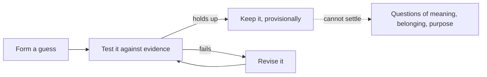

import ModuleFooter from '@site/src/components/ModuleFooter';
import RetrievalPrompt from '@site/src/components/RetrievalPrompt';

import Admonition from '@theme/Admonition';
import ModuleMeta from '@site/src/components/ModuleMeta';

<ModuleMeta />

---

{/* DRAFT (P9-05): written by an AI model for human review. Not audience-tested. */}

## 🧭 Orient

:::info Before this module

This is the second step on the path. It assumes you have worked through [Orientation: Values, Belonging, and Structure](./traditional-orientation), which names what you already do well. This step looks at a second way of deciding, which you can add to the first without giving anything up.

:::

This step describes weighing evidence for yourself: checking a claim against what can be seen, tested and reasoned through, rather than accepting it because of who said it. It has real strengths and real limits. People often treat it as the only grown-up way to think, or wave it away as cold. Neither is fair. Seeing it plainly lets you use it well.

:::tip Before you read
Take a minute to answer these in your own words before you read on. A wrong guess still helps you learn what follows.

1. If you stop accepting a rule because of who said it, what do you use instead to decide whether to keep it?
2. Why might someone who has achieved a great deal still ask "is this all there is?"
:::

---

## 🌿 Encounter

Think of the quiet confidence of having tested something yourself. You tried it, it held up, and you trust it a little more than you did the day before. Think of the freedom of being able to say "I see this differently from my family, my church or my party" and finding that the ground does not give way.

Here, the world is something to be understood, measured and improved. Weight does not come from a title. It comes from the better argument, the stronger data, the result that comes out the same each time. Progress is a track record: this treatment works better than that one, this way of doing the job gets fewer errors than that one.

People who think this way do not feel they are "believing in evidence". They feel that evidence is simply how you find out what is true. Putting words to it is a bit like describing your own handwriting, and this step tries to do that carefully.

---

## 🧠 Learn

## How Weighing Evidence Works

At its simplest, it is a loop:

*In words:* you form a guess and test it against evidence. If it holds up, you keep it for now. If it fails, you revise it and test again. Nothing is final, and that humility is part of the method. The dotted line shows the limit: this loop is excellent for finding out what works, and much weaker for settling what is worth caring about.

**How well supported is this?** Well tested. Reasoning about possibilities and testing ideas systematically is one of the most replicated findings in the study of how thinking grows (Piaget, 1972). Not everyone uses it equally in every area of life, and what you have learned and where you live shape how much (Piaget, 1972).

## Five Strengths

### Checking Claims Against Evidence
You can ask whether a claim is true, coherent and holds up when someone else repeats the test. This is the basis of medicine, engineering and every kind of knowledge that has made lives better. Being able to say "I was wrong; the evidence shows otherwise" is an achievement of character as well as of thinking.

### Standing on Your Own Judgment
You can claim rights and dignity on principle and make your own decisions in line with your own values. The idea that each person has worth that no group or authority may override without good reason grew out of this.

### Testing and Revising
The cycle of guess, test and revise carries its own humility: no conclusion is final, and better evidence can always change it. It has expanded what people can do in health, building and learning.

### Reforming What Is Not Working
You can step back from any institution and ask whether it does what it says it does. That kind of questioning is behind reforms such as the end of slavery, public health campaigns and fairer laws. It does not accept harm just because it is old or well-established.

### Fairness Based on Contribution
You can believe that position should follow effort and competence rather than birth or connections. However imperfectly it is practised, this has widened the circle of people whose work is recognised.

**How well supported is this?** Well tested for the effects of reasoning on evidence and of revising beliefs when evidence changes. The wider claims about fairness and reform are historical interpretations: they are widely held, but not tested in the same way. Reasoning from principles you have chosen is covered by Kohlberg (1981).

## Where Weighing Evidence Stops

This is not a criticism. Any tool has a range where it works best, and being honest about it makes you better at using it.

- **Meaning and purpose.** Beauty, love, belonging and purpose do not come out of a measurement. A life can look successful and still feel flat. Many people who have achieved a lot describe a quiet "is this all there is?"
- **Breaking things into parts.** Splitting a problem into pieces works wonderfully for machines and chemistry. It works less well for living systems, communities and meaning, where the whole behaves in ways the parts do not predict.
- **Costs that don't show up in the numbers.** What is not counted is easily missed: damage to a community, to a place or to people not yet born.
- **Isolation.** Standing on your own judgment can slide into standing alone. Without a community, a story and shared purpose, people can end up lonely, overworked and measuring themselves only by what they produce.
- **Treating "can be measured" as "is real".** Saying that only what can be measured counts is a belief about the world, not a result of science. It closes off questions that matter.

**How well supported is this?** Useful, but still debated. These limits are drawn from broad theory and long-standing criticism of how evidence-based thinking is sometimes used (Wilber, 2000). Many are matters of judgment, not tested findings.

---

## 🧘 Practice

## Practice — Reasoning Audit (20–25 minutes)

**Purpose:** Find out honestly where weighing evidence for yourself is already at work in your life, and where you still lean mostly on trusted guidance. This is not a test. It is an inventory.

**Worked example:** for the *testing a guess* question, someone might write: "I suspected my afternoon slump came from my heavy lunches, not poor sleep. For two weeks I ate a lighter lunch and noted my energy at 3 pm each day. The slump eased on most light-lunch days, so I kept the change, while staying open to other causes." That is the whole loop: a guess, a test, a result, and a revised position.

**Instructions:**

1. Find a quiet place where you will not be interrupted. Take two or three slow breaths.
2. For each question, write a candid answer in a journal or notebook, 2–4 sentences each. Write what is true, not what sounds good.
3. When you finish, read your answers back slowly and notice patterns.

**Questions:**

1. **Changing your mind:** Think of a belief you held for years and later revised because of new evidence. What was it, and what changed your mind? If you cannot think of one, what does that tell you?
2. **A standard of your own:** In one important area (work, relationships, values, health), name a standard you hold that you reached yourself rather than inherited. How did you come to it? How sure are you it is truly yours?
3. **Weighing a source:** Think of a person, institution or tradition you once deferred to and no longer do. What changed? What did you use to weigh it?
4. **Testing a guess:** Describe a time this year when you formed a guess, tested it and changed your position based on what you found. It can be practical, such as a decision about health, work or family.
5. **Two views at once:** Name two views you hold together, knowing each captures something real and neither is the whole picture. How do you move between them?
6. **Limits:** Which of these do you recognise in yourself, even partly? Rate each *Not at all / Somewhat / Clearly*:
   - Finding meaning beyond achievement and performance is hard
   - Tending to reduce complicated human matters to what can be counted
   - Impatience with, or dismissal of, experience that is not backed by evidence
   - Success has not brought the fulfilment you expected
   - Belonging or community feels harder since you stepped back from traditional structures
7. **Where you still defer:** Name one area where you still rely mainly on outside authority, such as tradition, an expert or social expectation. What would it take to weigh that area more for yourself, and would you want to?

---

## ⚓ Stabilize

Reading this step, or even finishing the audit, gives you a map. It does not by itself change how you relate to evidence, independence or achievement. Understanding a pattern and being able to choose differently within it are two kinds of growth, on two different timescales. Do not mistake "I understand this now" for the slower work of noticing where achievement has quietly become your whole identity, or where taking things apart has stopped you sitting with a question worth sitting with.

The words in this step ("evidence", "independence", "merit") come from research done mostly in Western science and schooling. The forms these patterns take vary a great deal between cultures and professions. If your own context looks different from the examples, trust your lived experience over the illustration.

**Back to your opening questions:** when a rule is no longer accepted because of who said it, it is tested against evidence and standards you have chosen yourself, kept provisionally if it holds up, and revised if it fails (the diagram in Learn). Someone who has achieved a great deal can still ask "is this all there is?" because meaning, belonging and purpose do not come out of a measurement. When only what can be measured counts as real, life can feel flat despite real success.

---

## 🔍 Reflect

Use these prompts for journaling or conversation after the practice. There are no correct answers.

1. Where in your life is weighing evidence for yourself most useful, and why there? Where is it not enough, or costing you something you have not yet named?
2. Has learning to decide for yourself cost you anything, such as belonging, certainty, a shared story or community? If so, how do you carry that?
3. Which of the five strengths do you recognise most readily in yourself? Which do you most want to keep as you go on growing, and why?
4. Which of the limits feels most relevant to your life right now? What would honest recognition of it ask of you?
5. How could you keep what weighing evidence gives you while treating it as a tool, not as the whole of who you are? Describe one moment in your week where that would look different.

---

## 📊 Assess

Use this rubric after the practice and reflection. It is for honest self-assessment, not for comparing yourself with anyone.

| Criterion | Not yet | Developing | Stable |
|---|---|---|---|
| **Understanding the loop**: you can describe how guess, test and revise work in your own words | Cannot yet | Can describe parts of it with prompting | Can describe it fully with an example from your life |
| **Naming strengths**: you can name at least three of the five strengths as active in your own life | Cannot name any that feel true | Can name one or two with effort | Can name three or more, each with a specific example |
| **Naming limits**: you can name at least two limits you have experienced, without defensiveness or shame | Cannot identify any, or react with dismissal or shame | Can name one, with discomfort | Can name two or more calmly, each tied to a real situation |
| **Holding both**: you can hold the strengths and the limits together without defending one at the expense of the other | Find it hard to hold both | Mostly balanced, with defensiveness or shame at times | Consistently able; you can write one strength and one limit from the same situation |
| **A standard of your own**: you can name a belief or standard you built through evidence and reflection rather than inherited | Cannot name one | Can name one with prompting | Can name two or more and explain how each was built, naming the evidence or experience behind it |

**Passing threshold:** Three or more criteria at *Developing* or *Stable*.

---

## 🔄 Integrate

Carry this into your week:

- **Evidence check:** Once a day, pick one claim you accepted without checking. Notice whether checking changes anything, and how checking feels.
- **Noticing limits:** When you catch yourself reducing something to numbers, working purely for performance or feeling the flatness described above, notice it without judgment, as information.
- **Naming strengths:** Each day, name one time your own judgment served you or someone near you well.
- **A question beyond the loop:** In one area where you rely on evidence, write down one question that evidence and logic alone cannot answer, about meaning, belonging or what matters. Hold it without rushing to resolve it.

---

<RetrievalPrompt moduleName="Orientation: Reason, Achievement, and Effectiveness" cards={[
  {q: "What are the steps of the evidence-weighing loop?", a: "Form a guess, test it against evidence, keep it provisionally if it holds up, revise it and test again if it fails. Nothing is final."},
  {q: "What do you use to decide whether to keep a rule if you stop accepting it because of who said it?", a: "Evidence and standards you have chosen yourself, applied openly and revised when they fail."},
  {q: "Name the five strengths described in this step.", a: "Checking claims against evidence, standing on your own judgment, testing and revising, reforming what is not working, and fairness based on contribution."},
  {q: "Name four places where weighing evidence reaches its limits.", a: "Meaning and purpose; breaking things into parts when the whole behaves differently; costs that are not counted; isolation; or treating 'can be measured' as 'is real'."},
  {q: "Why might someone who has achieved a great deal still ask 'is this all there is?'", a: "Because meaning, belonging and purpose do not come out of a measurement, so success measured only in results can still feel flat."},
  {q: "What is the difference between using evidence as a tool and treating it as the only way to know?", a: "As a tool it is excellent for finding out what works. Treating it as the only way to know claims that only what can be measured is real, which is a belief about the world, not a result of science."}
]} />

## ⏱️ Retrieval Schedule

| Interval | Activity |
|---|---|
| 24 hours | Without looking, list the five strengths you can remember and say in a sentence what each makes possible. Add or refine one example from your own life for each. Then check against the Five Strengths section and note what you missed |
| 72 hours | Redo the Reasoning Audit. Note which question shows your strongest capacity and which shows the clearest limit |
| 7 days | Revisit the Reflect prompts. Choose one you answered briefly and write a fuller response. Notice whether anything has shifted |
| 14 days | Complete the Assess rubric again. Note any movement from *Not yet* to *Developing* or *Developing* to *Stable*. Confirm you are ready for the next step on the path |

---

## 📚 Evidence and Citations

Evidence is rated Tier A (primary research or strong empirical base), Tier B (theoretical synthesis or practitioner evidence) or Tier C (provisional or expert opinion). In this step's wording: Tier A is "well tested", Tier B is "useful, but still debated", Tier C is "an expert's view, not yet tested".

| Claim | Source | Quality | Caveat |
|---|---|---|---|
| Reasoning about possibilities, testing ideas systematically and isolating variables | Piaget, J. *The Principles of Genetic Epistemology* (1972), Basic Books | Tier A (well tested): longitudinal observational research, highly replicated | Not all adults use it equally across all areas; schooling and culture shape it |
| People can build their own standards and judge outside expectations against them | Kegan, R. *In Over Our Heads: The Mental Demands of Modern Life* (1994), Harvard University Press | Tier B (useful, but still debated): constructive theory with wide educational use | A theoretical model; testing so far is supportive but not exhaustive |
| Reasoning from self-chosen principles, tested against consequences and universal criteria | Kohlberg, L. *The Philosophy of Moral Development* (1981), Harper & Row | Tier A (well tested): longitudinal cross-cultural research | Critics point to gender bias (Gilligan, 1982) and cultural limits; the pattern replicates robustly in educated adult samples |
| Limits of evidence-based thinking when it claims too much: flat meaning, reducing to parts, isolation | Wilber, K. *A Theory of Everything* (2000), Shambhala | Tier B (useful, but still debated): theoretical synthesis | Not primary research; synthesizes the work of several others |
| Standards built through evidence and reflection, with identity grounded in personal values and competence | Cook-Greuter, S. R. *Postautonomous Ego Development* (1999), doctoral dissertation, Harvard University | Tier B (useful, but still debated): qualitative research with large samples | Relies on self-report; cross-cultural validity still being checked |

---

:::note Safety Note

This module is rated **Tier 1 (self-guided, low intensity)**. It involves reflective self-inquiry about your own habits of thought, values and achievements and does not aim to bring up traumatic or highly charged material.

**Consent:** Go ahead when you are willing to look honestly at how you think and what you value. You may pause or stop at any time. No answer to any prompt is required or checked by anyone else.

**When to wait:** If you are in the middle of a major disruption to who you are, a crisis of meaning or acute distress, put this aside and talk to a trusted person or a qualified practitioner first. This site does not offer therapy or clinical care.

**Stop rule:** If reflecting on these patterns brings strong shame, grief or unease, stop. Step away. Take three slow breaths, place your feet firmly on the floor and name three things you can see around you. Come back only when you feel settled.

**Easier alternative:** If thinking about the limits feels too much, do only the parts about strengths and leave the limits for another day.

**If it continues:** If distress persists, contact a trusted support person or a qualified practitioner. Do not continue alone if you feel overwhelmed.

:::

<ModuleFooter />
