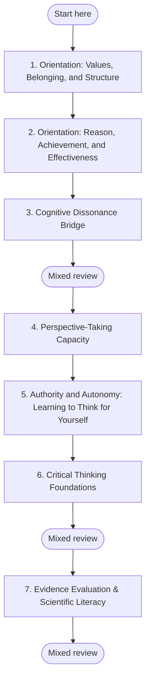

## Clear Thinking Path

**Why this order?** The seven steps follow the way this kind of change usually unfolds. You start by taking stock of the values you stand on, then look at what careful, independent thinking is and is not. After that you work on the skills that make it possible: staying steady when things do not add up, seeing a matter through other people's eyes, and learning to weigh a claim yourself instead of relying only on who said it. Each step builds on the one before it.

If you find yourself asking questions about beliefs you once held without doubt, or feeling a pull between what you were taught and what you have seen for yourself, you are not doing anything wrong. This path is not about becoming cynical, giving up your loyalties, or proving your tradition wrong. It is about thinking with more depth and honesty while keeping what you hold dear. Many people find this both freeing and unsettling, because it changes not only what they believe but how they relate to authority, community and truth. This path is meant to give you a steady, respectful way through.

**Goal:** Learn to weigh evidence and make up your own mind, and keep your respect for the people and traditions that shaped you.

**Time commitment:** Core path: **10–20 weeks**. With the two optional skill-building steps at the end: **14–28 weeks**.

---

## Plan your pathway

Self-paced learning works better when you decide before you start. **Write one if-then plan now:** *"When [time/place], I will [first step]."* For example: "When I finish my morning coffee, I will open **Orientation: Values, Belonging, and Structure** and work on it for 20 minutes." If-then plans help people follow through on goals (Gollwitzer & Sheeran, 2006).

**Suggested pace:** 2–4 weeks per module: 20–30 minutes on weekdays and one weekly check-in. The seven core modules take about 10–20 weeks; slower is fine.

**Visible progress:** [My Progress](../my-progress) shows the modules you have completed and the reviews due. It is stored only in your browser, and you can clear it at any time.

**Mixed review:** After every third module, run a mixed review on [My Progress](../my-progress). It mixes questions from the earlier modules instead of one module at a time, so it feels harder than rereading, and that effort is what builds lasting memory.

**Mastery before moving on:** Each module's Assess section sets a passing threshold. Meet it before you start the next module; if you do not, repeat the practices first. This gate is advisory: the site cannot check it for you, so be honest with yourself.

*In words:* start at step 1 and work in order. Your place in the path is the last module marked complete on My Progress. A mixed review follows every third module.

| Step | Module | Pass when |
|---|---|---|
| 1 | [Orientation: Values, Belonging, and Structure](../modules/traditional-orientation) | Three or more criteria at *Developing* or *Stable*. |
| 2 | [Orientation: Reason, Achievement, and Effectiveness](../modules/rational-orientation) | Three or more criteria at *Developing* or *Stable*. |
| 3 | [Cognitive Dissonance Bridge](../modules/cognitive-dissonance-bridge) | Three or more criteria at *Developing* or *Stable*. |
| 4 | [Perspective-Taking Capacity](../modules/perspective-taking-capacity) | Three or more criteria at *Conventional* or *Post-conventional*, with at least one at *Post-conventional*. |
| 5 | [Authority and Autonomy: Learning to Think for Yourself](../modules/authority-autonomy-transition) | Three or more criteria at *Transitional* or *Self-authoring*, with at least one at *Self-authoring*. |
| 6 | [Critical Thinking Foundations](../modules/critical-thinking-foundations) | At least 3 of the 4 questions correct, and three or more criteria at *Developing* or *Stable*, with **Self-application** at least *Developing*. |
| 7 | [Evidence Evaluation & Scientific Literacy](../modules/evidence-evaluation) | At least 4 of the 5 questions correct, counted from the answers you wrote down before reading the feedback. If you missed two or more, answer the retrieval cards again without looking, then check the section behind any you missed before moving on. |

---

---

## Who this path is for

This path is for adults who value structure, loyalty and belonging, and who increasingly want a way to examine beliefs, compare views fairly and decide for themselves. You do not need to break with anyone or perform independence. You need a steady pace, honest reflection and, ideally, someone you trust to talk things over with.

---

## Signs this path may fit you

You do **not** need all of these. They are common, everyday signs, not a diagnosis:

- You notice a growing gap between what trusted voices say and what you have seen for yourself.
- You are more curious about *why* something is true, not only *who* says it is true.
- You still value your tradition or community, but some of its answers no longer feel complete.
- You want to compare views fairly instead of sorting them quickly into right and wrong.
- You feel both loyalty and tension: part of you wants to stay faithful, and part of you needs more room to think.
- You care more and more about the quality of evidence and the consistency of an argument, in areas where you used to rely mainly on trust.
- You sometimes feel unsettled, sad or alone when old certainties stop holding the way they did.
- You want to grow without showing contempt for your earlier views or for the people who still hold them.

---

## The seven steps

Work through the **first five steps in order**. The last two build practical skills and fit best after those five, though some people work on them alongside steps 3 to 5.

| Step | Module | Why it comes here | Estimated time |
|---|---|---|---|
| 1 | [Orientation: Values, Belonging, and Structure](../modules/traditional-orientation) | Start by honouring the values and structure you stand on, so growth begins with respect rather than rejection. | 2–4 weeks |
| 2 | [Orientation: Reason, Achievement, and Effectiveness](../modules/rational-orientation) | See what careful, evidence-based thinking is, and what it is not, before you practise it. | 2–4 weeks |
| 3 | [Cognitive Dissonance Bridge](../modules/cognitive-dissonance-bridge) | Learn to treat doubt and tension as signals to work with, not as threats. | 2–4 weeks |
| 4 | [Perspective-Taking Capacity](../modules/perspective-taking-capacity) | Learn to hold your own view as one view among others without losing yourself. | 2–4 weeks |
| 5 | [Authority and Autonomy: Learning to Think for Yourself](../modules/authority-autonomy-transition) | Work directly with the move from relying on outside authority to weighing things yourself, including the grief and the question of belonging. | 2–4 weeks |
| 6 | [Critical Thinking Foundations](../modules/critical-thinking-foundations) | Strengthen how you examine an argument and judge it, so these skills become practical. | 2–4 weeks |
| 7 | [Evidence Evaluation & Scientific Literacy](../modules/evidence-evaluation) | Learn to judge a claim by the quality of its support, not only by the standing of its source. | 2–4 weeks |

---

## Why this order works

First you need an honest picture of where you stand and what careful thinking involves, so the change makes sense instead of feeling like a threat. Then you need support through the hardest part: doubt, seeing through other eyes, and weighing things yourself. By the time you reach the critical-thinking and evidence steps, you are not just collecting techniques. You are building a steadier way of making up your mind.

---

## Pace and weekly check-in

Plan on **2–4 weeks per module**, with **one check-in each week** to see what is shifting in your beliefs, your relationships and your feelings. If a module feels merely interesting, stay with the practices until they matter to you personally. If it feels unsettling, slow down rather than pushing through.

A weekly check-in can be as simple as three questions, written down:

- What did I think or do differently this week?
- What is still unsettled, and who could I talk it over with?
- Am I moving toward more clarity, more confusion, or both at once?

A workable rhythm for many people is:

- **Weekdays:** 20–30 minutes of reading, journaling or practice
- **Once a week:** a 30–45 minute check-in
- **At the end of each module:** decide whether you are ready to move on, repeat key exercises, or talk with a trusted mentor, pastor, teacher or friend

---

## You do not have to leave your tradition behind

A common fear is that thinking for yourself means rejecting your faith, family, culture or inherited moral world. It does not. Careful thinking gives you a new way of relating to your tradition: you can examine it, interpret it and stay in conversation with it, instead of either being unable to question it or turning against it.

For some people this means staying rooted in the same tradition with deeper understanding. For others it means rethinking boundaries, language or the ways they take part. Either way, the aim of this path is not to push you away from anything. It is honest growth with continuity, respect and room for judgment.

---

## What helps you get the most from this path

- Move slowly enough that new insight can become part of how you live.
- Let questions stay open longer than is comfortable.
- Tell the difference between useful discomfort and being overwhelmed.
- Stay respectful toward your earlier views, even when you move beyond parts of them.
- Use conversation and reflection, not only private thinking, to make sense of the change.

---

## What this path does not do

This path gives you a set order of steps, practice prompts, reflection questions and review schedules. It does not, and the research does not support the claim that it could, change how you make sense of the world through self-guided reading alone. Lasting change of this kind usually takes months to years, a trusted person or group to talk with (a mentor, coach, peer group, pastor or counsellor), and real experiences that unsettle your certainties, which no course can provide. Use this path as a map, a preparation and a support between conversations, and not as a substitute for the relationships and time that do the real work.

---

## Evidence and Citations

| Claim | Source | How strong | Caveat |
|---|---|---|---|
| Adults can change, over years, in how they make sense of themselves, other people and authority | Kegan, R. (1982, 1994); Cook-Greuter, S. (1999, 2000) | Tier B: respected research, mostly observation rather than controlled tests | These are ways of describing people, not exact measures, and researchers still disagree about where the lines fall. |
| Doubt and unsettling experiences can be a starting point for learning in adulthood | Festinger, L. (1957); Mezirow, J. (1991) | Tier B | Mostly theory and observation. Not every experience of doubt leads to lasting change. |
| Faith and meaning can mature without rejecting your tradition altogether | Fowler, J. (1981) | Tier B | Influential, but not accepted by every tradition. |
| People change better with steady support around them than when pushed to change fast | Kegan, R. (1982, 1994) | Tier B | A strong idea in practice, but how it is applied varies a great deal. |
